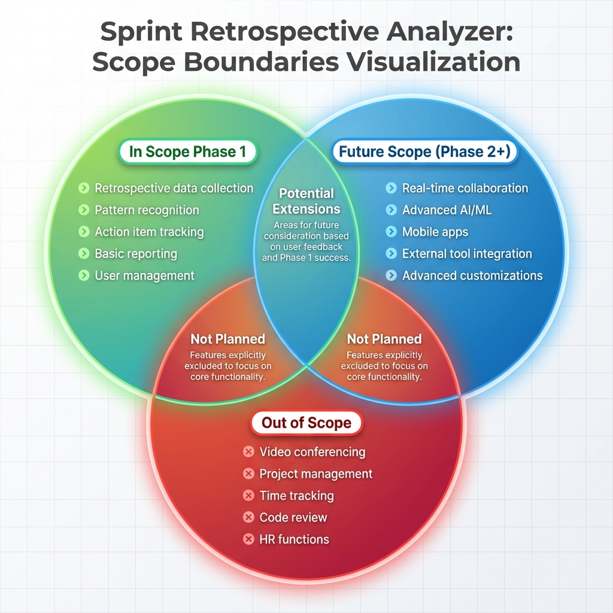

# Scope Boundaries Document
## Sprint Retrospective Analyzer

**Document Version:** 1.0  
**Date:** January 27, 2026  
**Project:** Sprint Retrospective Analyzer

---

## 1. Executive Summary

This document defines the scope boundaries for the Sprint Retrospective Analyzer system, clearly distinguishing what is included within the project scope and what is explicitly excluded. This ensures alignment among all stakeholders and prevents scope creep during development.

### Visual Scope Overview

---

## 2. In-Scope Items

### 2.1 Core Features

#### ✅ Retrospective Data Collection
- Web-based interface for capturing sprint retrospective feedback
- Support for structured categories: "What went well", "What didn't go well", "Action items"
- Text-based feedback entry for team members
- Sprint identification and metadata (sprint number, date, team)

#### ✅ Pattern Recognition & Analysis
- Automated text analysis to identify recurring themes
- Keyword extraction and pattern detection across sprints
- Sentiment analysis on feedback entries
- Trend identification over multiple sprints

#### ✅ Action Item Tracking
- Creation and assignment of action items from retrospectives
- Status tracking for action items (pending, in-progress, completed)
- Linkage between action items and future sprint feedback
- Effectiveness measurement of implemented actions

#### ✅ Reporting & Visualization
- Dashboard showing retrospective trends over time
- Visual charts for recurring issues and improvements
- Team performance insights based on retrospective data
- Sprint-over-sprint comparison reports

#### ✅ User Management
- Role-based access control (Team Member, Scrum Master, Manager)
- User authentication and authorization
- Team and project organization structure

### 2.2 Technical Capabilities

#### ✅ Platform Support
- Web application (responsive design for desktop and tablet)
- Cloud-based deployment
- RESTful API for data access

#### ✅ Data Management
- Secure data storage for retrospective entries
- Data export functionality (PDF, CSV formats)
- Basic data retention policies

#### ✅ Integration
- Calendar integration for sprint scheduling
- Email notifications for action items and retrospective reminders
- Basic API for potential third-party integrations

---

## 3. Out-of-Scope Items

### 3.1 Features NOT Included

#### ❌ Real-time Collaboration
- Live collaborative editing during retrospectives
- Video conferencing integration
- Real-time chat or messaging features

#### ❌ Advanced AI/ML Features (Phase 1)
- Predictive analytics for future sprint outcomes
- Deep learning-based sentiment analysis
- Automated action item generation using AI
- Natural language processing beyond basic keyword extraction

#### ❌ External Tool Integration (Phase 1)
- Direct integration with Jira, Azure DevOps, or similar tools
- Automated sprint data import from project management tools
- Bi-directional synchronization with external systems

#### ❌ Mobile Applications
- Native iOS application
- Native Android application
- Offline mobile access

#### ❌ Advanced Customization
- Custom retrospective templates beyond basic categories
- Fully customizable dashboard layouts
- White-label or multi-tenant configuration

### 3.2 Non-Functional Exclusions

#### ❌ Enterprise-Scale Features (Phase 1)
- Support for more than 50 concurrent teams
- Multi-region deployment
- Advanced disaster recovery beyond basic backups

#### ❌ Advanced Security
- Single Sign-On (SSO) integration
- Multi-factor authentication (MFA)
- Advanced encryption at rest

#### ❌ Advanced Analytics
- Predictive modeling
- Cross-team benchmarking
- Industry-standard retrospective metrics comparison

---

## 4. Boundary Conditions

### 4.1 System Limitations

| **Aspect** | **Boundary** |
|------------|-------------|
| Maximum Teams Supported | 50 teams simultaneously |
| Retrospective History | 24 months (2 years) |
| Maximum Team Size | 15 members per team |
| File Upload Size | 5 MB per attachment |
| API Rate Limiting | 1000 requests/hour per user |
| Concurrent Users | 500 users |

### 4.2 Data Boundaries

- **Retrospective Data**: Text-based entries only (no rich media in Phase 1)
- **Historical Data**: Limited to retrospectives conducted within the system
- **Export Formats**: PDF and CSV only
- **Language Support**: English only (Phase 1)

### 4.3 Integration Boundaries

- **Email**: Notifications only, no full email management
- **Calendar**: Read-only sprint schedule viewing
- **APIs**: RESTful APIs for data access, not for system administration

---

## 5. Future Considerations (Phase 2+)

The following items are explicitly out of scope for Phase 1 but may be considered for future releases:

1. **Mobile native applications** (iOS and Android)
2. **Advanced AI-powered insights** (predictive analytics, auto-suggestions)
3. **Deep integrations** with Jira, Azure DevOps, Trello
4. **Multi-language support**
5. **Advanced customization** (custom templates, workflows)
6. **SSO and MFA** for enterprise security
7. **Real-time collaboration** features
8. **Cross-team analytics** and benchmarking

---

## 6. Scope Change Management

### 6.1 Change Request Process

Any proposed changes to the defined scope must follow this process:

1. **Submission**: Stakeholder submits formal change request
2. **Impact Analysis**: Development team assesses impact on timeline, budget, resources
3. **Review**: Project steering committee reviews the request
4. **Approval/Rejection**: Decision made within 5 business days
5. **Documentation**: Approved changes documented in updated scope document

### 6.2 Change Approval Authority

| **Change Impact** | **Approval Required From** |
|-------------------|---------------------------|
| Minor (< 5% schedule impact) | Scrum Master |
| Moderate (5-15% impact) | Product Owner |
| Major (> 15% impact) | Steering Committee |

---

## 7. Acceptance Criteria

The project scope will be considered complete when:

- ✅ All in-scope features are implemented and tested
- ✅ System meets defined boundary conditions
- ✅ All out-of-scope items are documented for future phases
- ✅ Stakeholders sign off on delivered functionality

---

## 8. Stakeholder Acknowledgment

This scope boundaries document must be reviewed and approved by:

| **Role** | **Name** | **Signature** | **Date** |
|----------|----------|---------------|----------|
| Product Owner | _______________ | _______________ | _______ |
| Scrum Master | _______________ | _______________ | _______ |
| Development Lead | _______________ | _______________ | _______ |
| Project Sponsor | _______________ | _______________ | _______ |

---

**Document Control:**
- **Created By:** Project Team
- **Last Updated:** January 27, 2026
- **Next Review:** February 27, 2026
- **Version History:** 1.0 (Initial Release)
