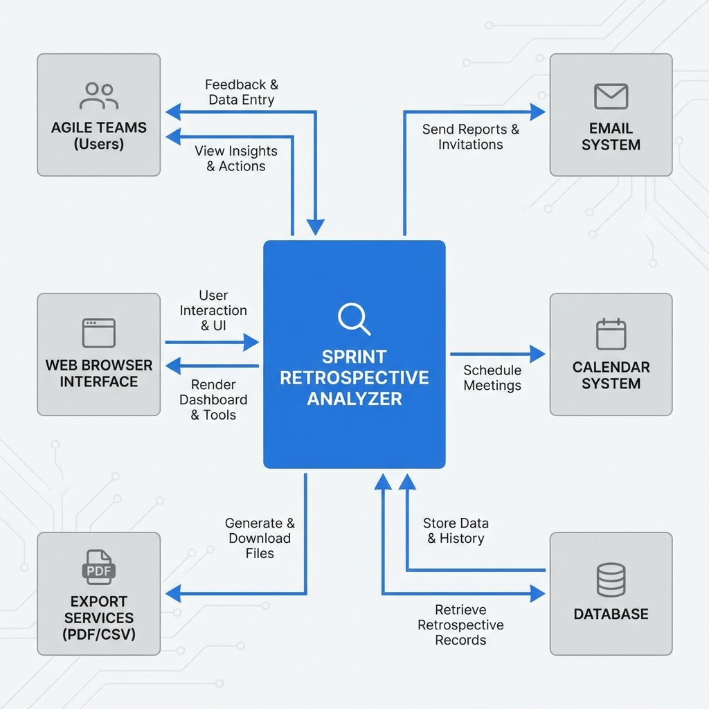

# Software Requirements Specification (SRS)
## Overall Description
### Sprint Retrospective Analyzer

**Document Version:** 1.0  
**Date:** January 27, 2026  
**Project:** Sprint Retrospective Analyzer

---

## 1. Product Perspective

### 1.1 System Context

The Sprint Retrospective Analyzer is a **standalone web-based system** designed to integrate into existing Agile workflows without disrupting current tools and processes. It operates as an independent platform that complements, rather than replaces, existing project management tools.

### 1.2 System Interfaces

The system interfaces with the following external components:

#### External Systems Integration

| **System** | **Interface Type** | **Purpose** | **Phase** |
|------------|-------------------|-------------|-----------|
| **Email System** | SMTP | Send notifications and reports | Phase 1 |
| **Calendar System** | iCal/CalDAV | Read sprint schedules | Phase 1 |
| **Web Browser** | HTTP/HTTPS | User interface delivery | Phase 1 |
| **Database** | SQL | Data persistence | Phase 1 |
| **Export Services** | File Generation | PDF/CSV export | Phase 1 |
| **Jira/Azure DevOps** | REST API | Sprint data import | Phase 2 |
| **Slack/Teams** | Webhooks | Team notifications | Phase 2 |

### 1.3 Product Position

**Market Position:**
- Fills a gap between basic retrospective tools (whiteboards, sticky notes) and complex analytics platforms
- First-to-market solution focused exclusively on retrospective intelligence
- Designed for mid-size to large Agile organizations (5-100 teams)

**Competitive Advantages:**
1. **Pattern Recognition**: Advanced text analysis to identify recurring issues
2. **Action Item Effectiveness**: Unique capability to measure if actions actually solved problems
3. **Longitudinal Analysis**: Track improvement over months and years
4. **Simplicity**: Easy to use, minimal training required

### 1.4 Design and Implementation Constraints

#### Technology Constraints

> [!WARNING]
> **Mandatory Technology Stack:**
> - Frontend: React.js with TypeScript
> - Backend: Node.js with Express
> - Database: PostgreSQL
> - Cloud Platform: AWS or Azure (client preference)

#### Regulatory Constraints

> [!IMPORTANT]
> **Data Privacy Compliance:**
> - Must comply with GDPR for European users
> - Must comply with CCPA for California users
> - Data encryption in transit (TLS 1.2+) and at rest (AES-256)

#### Performance Constraints

- System must support 500 concurrent users
- Page load time < 2 seconds
- API response time < 500ms for 95th percentile
- Database queries must complete in < 200ms

#### Security Constraints

- Role-based access control (RBAC) mandatory
- Password complexity requirements enforced
- Session timeout after 30 minutes of inactivity
- Audit logging for all data modifications

---

## 2. Product Functions

### 2.1 High-Level Feature Overview

The Sprint Retrospective Analyzer provides the following major functions:

#### 🎯 Core Functions

1. **Retrospective Management**
   - Create and manage sprint retrospectives
   - Structured feedback capture (What went well, What didn't, Actions)
   - Team collaboration on feedback entries

2. **Pattern Analysis**
   - Automated keyword extraction
   - Recurring theme identification
   - Sentiment analysis on feedback
   - Trend detection across sprints

3. **Action Item Tracking**
   - Create action items from retrospectives
   - Assign owners and due dates
   - Track completion status
   - Measure effectiveness (did the issue recur?)

4. **Reporting & Visualization**
   - Team health dashboard
   - Trend charts and graphs
   - Recurring issue reports
   - Sprint comparison views

5. **User & Access Management**
   - User authentication and profile management
   - Team and project organization
   - Role-based permissions

### 2.2 Detailed Feature Breakdown

#### Feature 1: Retrospective Data Entry

**Description:** Allows team members to contribute feedback during or after retrospectives

**Capabilities:**
- Multi-category feedback (Positive, Negative, Action Items)
- Tagging and categorization
- Anonymous submission option
- Rich text formatting support
- Attachment uploads (screenshots, logs)

**User Roles:** Team Member, Scrum Master, Manager

---

#### Feature 2: Automated Pattern Recognition

**Description:** Analyzes retrospective text to identify patterns and recurring issues

**Capabilities:**
- Keyword frequency analysis
- Similarity detection across feedback entries
- Clustering of related issues
- Automatic tagging of common themes
- Highlighting of issues mentioned in 3+ consecutive sprints

**User Roles:** All users (automatic background process)

---

#### Feature 3: Action Item Management

**Description:** Tracks action items from creation to resolution

**Capabilities:**
- Action item creation linked to specific feedback
- Assignment to team members
- Due date tracking
- Status workflow (Open → In Progress → Done → Verified)
- Effectiveness scoring (based on issue recurrence)

**User Roles:** Team Member, Scrum Master

---

#### Feature 4: Dashboard & Analytics

**Description:** Provides visual insights into team retrospectives

**Capabilities:**
- Team health score over time
- Most common issues (last 3, 6, 12 months)
- Action item completion rate
- Sentiment trend analysis
- Sprint-over-sprint comparison
- Custom date range filtering

**User Roles:** Scrum Master, Manager

---

#### Feature 5: Reporting & Export

**Description:** Generates reports and exports data

**Capabilities:**
- PDF report generation (retrospective summaries)
- CSV data export (for external analysis)
- Scheduled email reports
- Custom report templates

**User Roles:** Scrum Master, Manager

---

## 3. User Characteristics

### 3.1 User Roles and Personas

#### 👤 Persona 1: Team Member (Developer/Tester)

**Demographics:**
- Age: 24-45
- Experience: 1-10 years in software development
- Tech Savvy: High

**Characteristics:**
- Participates in sprint retrospectives
- Wants retrospectives to be quick and valuable
- Prefers simple, intuitive interfaces
- Values seeing that feedback leads to change

**Technical Expertise:**
- Comfortable with web applications
- Expects responsive, modern UI
- Minimal training time tolerance (< 15 minutes)

**Goals:**
- Submit feedback quickly (< 5 minutes)
- See that previous concerns were addressed
- Track action items assigned to them

**Frustrations:**
- Repetitive retrospectives with no visible improvement
- Complex tools with steep learning curves
- Lack of follow-through on action items

---

#### 👤 Persona 2: Scrum Master

**Demographics:**
- Age: 28-50
- Experience: 3-15 years in Agile coaching
- Tech Savvy: Medium to High

**Characteristics:**
- Facilitates retrospectives for 1-3 teams
- Responsible for driving continuous improvement
- Needs data to guide team improvement
- Reports to management on team health

**Technical Expertise:**
- Comfortable with dashboard tools
- Values data visualization
- Needs export and reporting features

**Goals:**
- Identify patterns across retrospectives
- Track action item completion
- Demonstrate team improvement to stakeholders
- Facilitate more effective retrospectives

**Frustrations:**
- Inability to prove retrospectives drive improvement
- Recurring issues that go unnoticed
- Manual analysis of retrospective notes

---

#### 👤 Persona 3: Engineering Manager

**Demographics:**
- Age: 32-55
- Experience: 5-20 years in software development and management
- Tech Savvy: Medium

**Characteristics:**
- Oversees 3-10 Agile teams
- Responsible for organizational process improvement
- Needs strategic insights from retrospective data
- Budget and resource decision maker

**Technical Expertise:**
- Prefers high-level dashboards
- Values executive summaries
- Needs data for decision-making

**Goals:**
- Identify systemic issues across teams
- Measure ROI of process improvements
- Understand team health trends
- Support Scrum Masters with data

**Frustrations:**
- Lack of quantitative data on retrospective effectiveness
- Inability to compare team performance
- No visibility into recurring organizational issues

---

### 3.2 User Expertise Levels

| **Role** | **System Expertise** | **Domain Expertise** | **Training Needed** |
|----------|---------------------|----------------------|---------------------|
| Team Member | Novice | Expert (Agile) | < 30 minutes |
| Scrum Master | Intermediate | Expert (Agile) | 1-2 hours |
| Manager | Novice | Advanced (Agile) | 1 hour |
| Admin | Advanced | Intermediate | 2-3 hours |

---

## 4. Operating Environment

### 4.1 Hardware Environment

**Client Side:**
- Desktop/Laptop with modern web browser
- Minimum screen resolution: 1280x720 pixels
- Recommended: 1920x1080 or higher
- Stable internet connection (minimum 1 Mbps)

**Server Side:**
- Cloud-based infrastructure (AWS/Azure)
- Scalable compute resources
- Redundant storage systems
- Load balancing for high availability

### 4.2 Software Environment

#### Client Requirements

| **Component** | **Requirement** |
|---------------|-----------------|
| **Web Browser** | Chrome 90+, Firefox 88+, Safari 14+, Edge 90+ |
| **JavaScript** | Enabled (required) |
| **Cookies** | Enabled (required for authentication) |
| **TLS/SSL** | TLS 1.2 or higher |

#### Server Requirements

| **Component** | **Technology** | **Version** |
|---------------|----------------|-------------|
| **Operating System** | Linux (Ubuntu) | 20.04 LTS+ |
| **Web Server** | Nginx | 1.18+ |
| **Application Server** | Node.js | 18 LTS+ |
| **Database** | PostgreSQL | 14+ |
| **Caching** | Redis | 6.2+ |
| **Email** | SMTP Server | Any |

### 4.3 Network Environment

- **Deployment**: Cloud-based (AWS or Azure)
- **Accessibility**: Internet-facing (HTTPS only)
- **CDN**: CloudFront or Azure CDN for static assets
- **Backup**: Automated daily backups with 30-day retention

---

## 5. Assumptions and Dependencies

### 5.1 Assumptions

> [!NOTE]
> The following assumptions underpin the system requirements:

1. **User Access**: All users have access to modern web browsers and stable internet
2. **Agile Practice**: Teams are already practicing Agile with regular retrospectives
3. **Language**: All users are proficient in English (Phase 1)
4. **Team Size**: Average team size is 5-10 members
5. **Sprint Length**: Sprints are typically 1-4 weeks
6. **Data Retention**: Organizations require retrospective data for at least 2 years
7. **Email Access**: All users have active email addresses for notifications
8. **Training**: Organizations can provide 1-2 hours of onboarding per user

### 5.2 Dependencies

#### External Dependencies

| **Dependency** | **Type** | **Risk Level** | **Mitigation** |
|----------------|----------|----------------|----------------|
| **Cloud Provider (AWS/Azure)** | Infrastructure | Low | Multi-region deployment plan |
| **Email Service (SMTP)** | External Service | Low | Fallback to multiple SMTP providers |
| **Third-Party Libraries** | Software | Medium | Version pinning, regular updates |
| **Calendar Integration** | External API | Medium | Graceful degradation if unavailable |
| **SSL Certificate** | Security | Low | Auto-renewal with Let's Encrypt |

#### Internal Dependencies

| **Dependency** | **Impact** | **Timeline** |
|----------------|-----------|--------------|
| **Database Schema Design** | High | Week 1-2 |
| **Authentication Module** | High | Week 2-3 |
| **Text Analysis Engine** | High | Week 4-6 |
| **UI Component Library** | Medium | Week 1-2 |
| **API Specification** | High | Week 1 |

---

## 6. System Constraints

### 6.1 Resource Constraints

**Budget Constraints:**
- Total development budget: $150,000
- Cloud infrastructure: $500/month initial allocation
- Third-party services: $200/month

**Timeline Constraints:**
- MVP delivery: 3 months from project start
- Full Phase 1: 6 months from project start

**Team Constraints:**
- Development team: 4-6 engineers
- QA team: 2 testers
- UX designer: 1 (part-time)

### 6.2 Regulatory Constraints

**Data Privacy:**
- GDPR compliance mandatory for European users
- CCPA compliance mandatory for California users
- Right to data deletion must be supported
- Data export on user request

**Accessibility:**
- WCAG 2.1 Level AA compliance
- Screen reader compatibility
- Keyboard navigation support

### 6.3 Technical Constraints

**Scalability Limits (Phase 1):**
- Maximum 50 teams per instance
- Maximum 500 concurrent users
- Maximum 10,000 retrospectives stored
- Maximum 5 MB per file upload

**Performance Constraints:**
- Page load time: < 2 seconds
- API response time: < 500ms (95th percentile)
- Database query time: < 200ms
- Report generation: < 10 seconds

---

## 7. Quality Attributes

### 7.1 Usability
- Intuitive interface requiring < 30 minutes training for basic use
- Consistent UI/UX across all pages
- Mobile-responsive design

### 7.2 Reliability
- 99.5% uptime (excluding planned maintenance)
- Automated failover for critical components
- Data backup every 24 hours

### 7.3 Security
- Industry-standard encryption (TLS 1.2+, AES-256)
- Role-based access control
- Audit logging for compliance

### 7.4 Maintainability
- Modular architecture for easy updates
- Comprehensive API documentation
- Automated testing (>80% code coverage)

---

**Document Control:**
- **Created By:** Requirements Analysis Team
- **Last Updated:** January 27, 2026
- **Status:** Draft for Review
- **Next Review:** February 3, 2026
- **Version History:** 1.0 (Initial Release)
