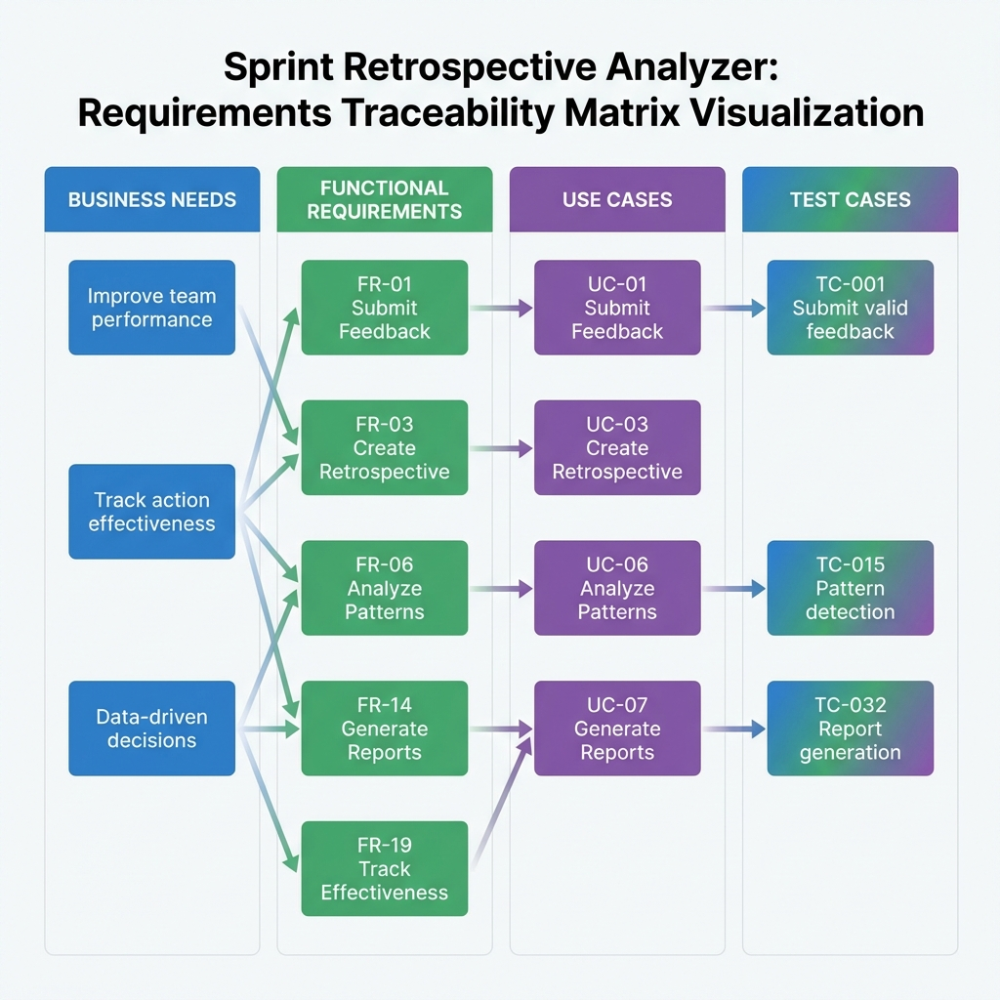

# Software Requirements Specification (SRS)
## Functional Requirements Documentation
### Sprint Retrospective Analyzer

**Document Version:** 1.0  
**Date:** January 27, 2026  
**Project:** Sprint Retrospective Analyzer

---

## 1. Introduction

This document details all functional requirements for the Sprint Retrospective Analyzer system. Each requirement includes:
- Unique identifier (FR-XX)
- Priority level (P1/P2/P3)
- Description
- Acceptance criteria
- Dependencies (if any)

---

## 2. User Management & Authentication

### FR-01: User Registration

**Priority:** P1 (High)  
**User Story:** As a new user, I want to create an account so that I can access the retrospective system.

**Description:**  
The system shall allow new users to register by providing email, password, full name, and role.

**Acceptance Criteria:**
- ✅ User can register with email, password (min 8 characters), full name, and role
- ✅ Email must be unique across the system
- ✅ Password must meet complexity requirements (1 uppercase, 1 lowercase, 1 number, 1 special character)
- ✅ Verification email sent to user upon registration
- ✅ Account activated only after email verification
- ✅ Error messages displayed for invalid inputs
- ✅ Registration completes in < 3 seconds

**Dependencies:** None

---

### FR-02: User Login

**Priority:** P1 (High)  
**User Story:** As a registered user, I want to log in securely so that I can access my retrospective data.

**Description:**  
The system shall authenticate users via email and password with session management.

**Acceptance Criteria:**
- ✅ User can log in with email and password
- ✅ Invalid credentials display appropriate error message
- ✅ Session created upon successful authentication
- ✅ Session expires after 30 minutes of inactivity
- ✅ "Remember Me" option extends session to 7 days
- ✅ Failed login attempts locked after 5 consecutive failures (15-minute lockout)
- ✅ Login process completes in < 2 seconds

**Dependencies:** FR-01

---

### FR-03: Password Reset

**Priority:** P1 (High)  
**User Story:** As a user, I want to reset my forgotten password so that I can regain access to my account.

**Description:**  
The system shall provide a secure password reset mechanism via email.

**Acceptance Criteria:**
- ✅ User can request password reset via email
- ✅ Reset link sent to registered email address
- ✅ Reset link valid for 1 hour
- ✅ User can set new password meeting complexity requirements
- ✅ All active sessions invalidated upon password reset
- ✅ Confirmation email sent after successful reset
- ✅ Reset link can only be used once

**Dependencies:** FR-01

---

### FR-04: Role-Based Access Control (RBAC)

**Priority:** P1 (High)  
**User Story:** As an administrator, I want to assign roles to users so that I can control access to features.

**Description:**  
The system shall implement role-based permissions for Team Member, Scrum Master, Manager, and Admin.

**Acceptance Criteria:**
- ✅ Four roles defined: Team Member, Scrum Master, Manager, Admin
- ✅ Team Member can: submit feedback, view team retrospectives, update own action items
- ✅ Scrum Master inherits Team Member rights + can: create retrospectives, assign action items, view reports
- ✅ Manager inherits Scrum Master rights + can: view all teams, access cross-team analytics
- ✅ Admin has full system access including user management
- ✅ Unauthorized access attempts logged and denied with 403 error
- ✅ Role changes effective immediately upon update

**Dependencies:** FR-01, FR-02

---

## 3. Retrospective Management

### FR-05: Create Retrospective

**Priority:** P1 (High)  
**User Story:** As a Scrum Master, I want to create a new retrospective for my team so that members can provide feedback.

**Description:**  
The system shall allow authorized users to create retrospectives with sprint details.

**Acceptance Criteria:**
- ✅ Scrum Master can create retrospective with: sprint number, start/end dates, team, optional notes
- ✅ Sprint number auto-increments based on last sprint
- ✅ Team selection from user's assigned teams
- ✅ Date validation (end date must be after start date)
- ✅ Retrospective status set to "Open" upon creation
- ✅ Email notification sent to all team members
- ✅ Retrospective appears in team dashboard immediately

**Dependencies:** FR-02, FR-04

---

### FR-06: Submit Feedback

**Priority:** P1 (High)  
**User Story:** As a team member, I want to submit feedback in three categories so that I can contribute to the retrospective.

**Description:**  
The system shall allow users to submit structured feedback in "What Went Well", "What Didn't Go Well", and "Action Items" categories.

**Acceptance Criteria:**
- ✅ Three feedback categories available: Went Well, Didn't Go Well, Actions
- ✅ Users can submit multiple entries per category
- ✅ Each entry supports rich text (bold, italic, lists, links)
- ✅ Character limit: 2000 characters per entry
- ✅ Optional anonymity toggle (hides author name)
- ✅ Auto-save draft every 30 seconds
- ✅ Timestamp recorded for each submission
- ✅ Users can edit/delete own feedback before retrospective closes

**Dependencies:** FR-05

---

### FR-07: Close Retrospective

**Priority:** P1 (High)  
**User Story:** As a Scrum Master, I want to close a retrospective so that feedback is finalized and analysis can begin.

**Description:**  
The system shall allow Scrum Masters to close retrospectives, preventing further edits.

**Acceptance Criteria:**
- ✅ Scrum Master can close retrospective with confirmation dialog
- ✅ Retrospective status changes to "Closed"
- ✅ No further feedback submissions allowed
- ✅ Existing feedback becomes read-only
- ✅ Pattern analysis automatically triggered upon closure
- ✅ Email summary sent to all participants
- ✅ Closed retrospective visible in historical view

**Dependencies:** FR-05, FR-06

---

### FR-08: View Retrospective History

**Priority:** P1 (High)  
**User Story:** As a team member, I want to view past retrospectives so that I can review previous discussions and actions.

**Description:**  
The system shall display a chronological list of retrospectives with filtering options.

**Acceptance Criteria:**
- ✅ Retrospectives displayed in reverse chronological order (newest first)
- ✅ List shows: sprint number, date range, status, number of feedback items
- ✅ Filter by: team, date range, status (open/closed)
- ✅ Search functionality by keyword across feedback text
- ✅ Pagination (20 retrospectives per page)
- ✅ Click to view full retrospective details
- ✅ Load time < 2 seconds for list view

**Dependencies:** FR-05

---

## 4. Pattern Analysis & Intelligence

### FR-09: Automated Keyword Extraction

**Priority:** P1 (High)  
**User Story:** As a user, I want the system to identify key themes from feedback so that I can see common issues.

**Description:**  
The system shall extract and rank keywords from retrospective feedback.

**Acceptance Criteria:**
- ✅ Top 10 keywords extracted from each retrospective
- ✅ Keywords ranked by frequency and relevance
- ✅ Common stop words excluded (the, and, is, etc.)
- ✅ Multi-word phrases detected (e.g., "deployment issues")
- ✅ Keywords displayed with occurrence count
- ✅ Keywords clickable to show related feedback items
- ✅ Analysis completes within 5 seconds of retrospective closure

**Dependencies:** FR-07

---

### FR-10: Recurring Issue Detection

**Priority:** P1 (High)  
**User Story:** As a Scrum Master, I want to see which issues appear in multiple sprints so that I can prioritize long-term solutions.

**Description:**  
The system shall identify and highlight feedback patterns that recur across 3+ consecutive sprints.

**Acceptance Criteria:**
- ✅ Issues mentioned in 3+ consecutive sprints flagged as "Recurring"
- ✅ Recurring issues highlighted in dashboard with warning icon
- ✅ Severity levels: Minor (3-4 sprints), Moderate (5-7), Critical (8+)
- ✅ Recurrence count displayed for each issue
- ✅ List of sprints where issue appeared (clickable links)
- ✅ Similar feedback items grouped using text similarity (>70% match)
- ✅ Manual override to mark/unmark issues as recurring

**Dependencies:** FR-08, FR-09

---

### FR-11: Sentiment Analysis

**Priority:** P2 (Medium)  
**User Story:** As a manager, I want to see the overall sentiment of retrospectives so that I can gauge team morale.

**Description:**  
The system shall analyze feedback sentiment and categorize as Positive, Neutral, or Negative.

**Acceptance Criteria:**
- ✅ Each feedback entry scored: Positive (+1 to +5), Neutral (0), Negative (-5 to -1)
- ✅ Overall retrospective sentiment calculated as average score
- ✅ Sentiment displayed with color coding (green/yellow/red)
- ✅ Sentiment trend chart over last 6 sprints
- ✅ Sentiment breakdown per category (Went Well, Didn't Go Well, Actions)
- ✅ Accuracy rate ≥ 75% for sentiment classification
- ✅ Analysis completes within 5 seconds

**Dependencies:** FR-07

---

### FR-12: Trend Visualization

**Priority:** P2 (Medium)  
**User Story:** As a Scrum Master, I want to see trend charts so that I can visualize improvement over time.

**Description:**  
The system shall generate visual charts showing trends across multiple sprints.

**Acceptance Criteria:**
- ✅ Charts available: Sentiment trend, Issue frequency, Action item completion rate
- ✅ Time ranges: Last 3, 6, 12 months
- ✅ Interactive charts (hover for details, zoom, pan)
- ✅ Export charts as PNG images
- ✅ Color-coded for easy interpretation
- ✅ Charts render in < 2 seconds
- ✅ Mobile-responsive chart layouts

**Dependencies:** FR-08, FR-11

---

## 5. Action Item Management

### FR-13: Create Action Item

**Priority:** P1 (High)  
**User Story:** As a Scrum Master, I want to create action items from retrospective feedback so that issues are addressed.

**Description:**  
The system shall allow creation of action items linked to specific feedback.

**Acceptance Criteria:**
- ✅ Action item fields: title, description, assignee, due date, priority, linked feedback
- ✅ Priority levels: High, Medium, Low
- ✅ Assignee selected from team members
- ✅ Due date must be a future date
- ✅ Optional tags for categorization
- ✅ Action item visible in assignee's task list
- ✅ Email notification sent to assignee upon creation

**Dependencies:** FR-06, FR-07

---

### FR-14: Update Action Item Status

**Priority:** P1 (High)  
**User Story:** As a team member, I want to update the status of my action items so that progress is tracked.

**Description:**  
The system shall provide a workflow for action item status updates.

**Acceptance Criteria:**
- ✅ Status workflow: Open → In Progress → Done → Verified
- ✅ Status update triggers timestamp recording
- ✅ Optional comment field on status change
- ✅ Scrum Master can verify completed items
- ✅ Overdue items highlighted in red
- ✅ Status change notifications sent to Scrum Master
- ✅ Status history maintained (audit trail)

**Dependencies:** FR-13

---

### FR-15: Action Item Effectiveness Tracking

**Priority:** P2 (Medium)  
**User Story:** As a Scrum Master, I want to see if completed actions resolved their issues so that I can measure effectiveness.

**Description:**  
The system shall track whether issues recur after related action items are completed.

**Acceptance Criteria:**
- ✅ Action items linked to specific issue themes
- ✅ System monitors next 3 sprints for issue recurrence
- ✅ Effectiveness score: Effective (issue not recurring), Ineffective (issue recurred)
- ✅ Effectiveness rate calculated per team (% of effective actions)
- ✅ Ineffective actions flagged for review
- ✅ Dashboard widget showing action effectiveness trends
- ✅ Effectiveness visible 3 sprints after action completion

**Dependencies:** FR-10, FR-14

---

## 6. Dashboard & Reporting

### FR-16: Team Dashboard

**Priority:** P1 (High)  
**User Story:** As a team member, I want a dashboard showing my team's retrospective insights so that I can track improvement.

**Description:**  
The system shall provide a customizable dashboard with key retrospective metrics.

**Acceptance Criteria:**
- ✅ Dashboard widgets: Recent retrospectives, Recurring issues, My action items, Sentiment trend
- ✅ Date range filter (last 3, 6, 12 months)
- ✅ Widget layout customizable (drag-and-drop)
- ✅ Real-time data updates (no page refresh needed)
- ✅ Mobile-responsive layout
- ✅ Dashboard loads in < 3 seconds
- ✅ Export dashboard as PDF report

**Dependencies:** FR-08, FR-11, FR-12

---

### FR-17: Generate Reports

**Priority:** P2 (Medium)  
**User Story:** As a manager, I want to generate comprehensive reports so that I can share insights with stakeholders.

**Description:**  
The system shall generate PDF and CSV reports on retrospective data.

**Acceptance Criteria:**
- ✅ Report types: Sprint summary, Recurring issues, Action item effectiveness, Cross-team comparison
- ✅ Customizable date range and team selection
- ✅ PDF includes: charts, tables, executive summary
- ✅ CSV exports raw data for external analysis
- ✅ Scheduled reports (weekly, monthly) via email
- ✅ Report generation completes in < 10 seconds
- ✅ Reports downloadable from archive (30-day retention)

**Dependencies:** FR-08, FR-12, FR-15

---

### FR-18: Search Functionality

**Priority:** P2 (Medium)  
**User Story:** As a user, I want to search across all retrospectives so that I can find specific feedback or issues.

**Description:**  
The system shall provide full-text search across retrospective data.

**Acceptance Criteria:**
- ✅ Search bar accessible from all pages
- ✅ Search across: feedback text, action items, keywords
- ✅ Filters: team, date range, category, author
- ✅ Results ranked by relevance
- ✅ Highlighting of search terms in results
- ✅ Search completes in < 1 second
- ✅ Export search results to CSV

**Dependencies:** FR-06, FR-08

---

## 7. Team & Project Management

### FR-19: Create Team

**Priority:** P1 (High)  
**User Story:** As an admin, I want to create teams so that I can organize users and retrospectives.

**Description:**  
The system shall allow admins to create and manage team structures.

**Acceptance Criteria:**
- ✅ Admin can create team with: name, description, Scrum Master
- ✅ Team name must be unique
- ✅ Scrum Master assigned from registered users
- ✅ Team members added via email invitation
- ✅ Team visibility settings: Public (all users see) or Private (members only)
- ✅ Team archive functionality (preserves data, hides from active lists)
- ✅ Team creation completes in < 2 seconds

**Dependencies:** FR-04

---

### FR-20: Manage Team Members

**Priority:** P1 (High)  
**User Story:** As a Scrum Master, I want to add/remove team members so that the team roster is current.

**Description:**  
The system shall allow team member management by Scrum Masters.

**Acceptance Criteria:**
- ✅ Scrum Master can add members via email or username
- ✅ Invitation email sent to new members
- ✅ Members can accept/decline invitation
- ✅ Scrum Master can remove members (with confirmation)
- ✅ Removed members retain access to past retrospectives (read-only)
- ✅ Team member list sortable by name, role, join date
- ✅ Maximum 50 members per team

**Dependencies:** FR-19

---

## 8. Notifications

### FR-21: Email Notifications

**Priority:** P1 (High)  
**User Story:** As a user, I want to receive email notifications so that I stay informed about retrospectives and action items.

**Description:**  
The system shall send email notifications for key events.

**Acceptance Criteria:**
- ✅ Notification triggers: New retrospective, Action item assigned, Action item due soon (3 days), Retrospective closing soon (1 day)
- ✅ Users can configure notification preferences
- ✅ Unsubscribe link included in all emails
- ✅ Emails sent within 5 minutes of trigger event
- ✅ HTML and plain-text versions of emails
- ✅ Digest option (daily summary instead of individual emails)
- ✅ Retry logic for failed email deliveries

**Dependencies:** FR-05, FR-13

---

### FR-22: In-App Notifications

**Priority:** P2 (Medium)  
**User Story:** As a user, I want in-app notifications so that I can see updates without checking email.

**Description:**  
The system shall display in-app notifications for important events.

**Acceptance Criteria:**
- ✅ Notification bell icon in header with unread count
- ✅ Dropdown shows recent notifications (last 30 days)
- ✅ Notifications marked as read/unread
- ✅ Click notification to navigate to related item
- ✅ Clear all notifications option
- ✅ Real-time updates (no page refresh required)
- ✅ Notifications load in < 1 second

**Dependencies:** FR-05, FR-13

---

## 9. Data Export & Integration

### FR-23: Export Retrospective Data

**Priority:** P2 (Medium)  
**User Story:** As a Scrum Master, I want to export retrospective data so that I can analyze it externally.

**Description:**  
The system shall allow data export in multiple formats.

**Acceptance Criteria:**
- ✅ Export formats: CSV, JSON, PDF
- ✅ Export options: Single retrospective, Multiple retrospectives, All team data
- ✅ CSV includes: sprint details, feedback, action items, metadata
- ✅ JSON preserves full data structure for API consumption
- ✅ PDF formatted for printing/sharing
- ✅ Export file size limit: 50 MB
- ✅ Export completes in < 30 seconds

**Dependencies:** FR-08

---

### FR-24: Calendar Integration

**Priority:** P2 (Medium)  
**User Story:** As a Scrum Master, I want to sync sprint schedules with my calendar so that retrospective dates are visible.

**Description:**  
The system shall integrate with calendar systems to display sprint schedules.

**Acceptance Criteria:**
- ✅ iCal/ICS feed URL generated per team
- ✅ Feed includes: Sprint start/end dates, Retrospective meetings
- ✅ Compatible with Google Calendar, Outlook, Apple Calendar
- ✅ Feed updates automatically when retrospectives created
- ✅ Optional: Send calendar invites for retrospective meetings
- ✅ Feed secure (authentication required)
- ✅ Feed refresh interval: 15 minutes

**Dependencies:** FR-05

---

## 9. Requirements Traceability

### 9.1 Traceability Matrix Visualization

### 9.2 Traceability to Use Cases

| **Functional Requirement** | **Use Case ID** | **Test Case ID** |
|----------------------------|-----------------|------------------|
| FR-01: User Registration | UC-10 | TC-001 to TC-003 |
| FR-02: User Login | UC-10 | TC-004 to TC-006 |
| FR-03: Password Reset | UC-10 | TC-007 to TC-008 |
| FR-05: Create Retrospective | UC-03 | TC-015 to TC-018 |
| FR-06: Submit Feedback | UC-01 | TC-019 to TC-024 |
| FR-07: Close Retrospective | UC-04 | TC-025 to TC-027 |
| FR-09: Keyword Extraction | UC-06 | TC-035 to TC-037 |
| FR-10: Recurring Issue Detection | UC-06 | TC-038 to TC-040 |
| FR-13: Create Action Item | UC-05 | TC-045 to TC-048 |
| FR-14: Update Action Item Status | UC-05 | TC-049 to TC-051 |
| FR-17: Generate Reports | UC-07 | TC-065 to TC-070 |

---

## 10. Summary Table

| **ID** | **Requirement** | **Priority** | **Dependencies** |
|--------|----------------|--------------|------------------|
| FR-01 | User Registration | P1 | None |
| FR-02 | User Login | P1 | FR-01 |
| FR-03 | Password Reset | P1 | FR-01 |
| FR-04 | Role-Based Access Control | P1 | FR-01, FR-02 |
| FR-05 | Create Retrospective | P1 | FR-02, FR-04 |
| FR-06 | Submit Feedback | P1 | FR-05 |
| FR-07 | Close Retrospective | P1 | FR-05, FR-06 |
| FR-08 | View Retrospective History | P1 | FR-05 |
| FR-09 | Automated Keyword Extraction | P1 | FR-07 |
| FR-10 | Recurring Issue Detection | P1 | FR-08, FR-09 |
| FR-11 | Sentiment Analysis | P2 | FR-07 |
| FR-12 | Trend Visualization | P2 | FR-08, FR-11 |
| FR-13 | Create Action Item | P1 | FR-06, FR-07 |
| FR-14 | Update Action Item Status | P1 | FR-13 |
| FR-15 | Action Item Effectiveness | P2 | FR-10, FR-14 |
| FR-16 | Team Dashboard | P1 | FR-08, FR-11, FR-12 |
| FR-17 | Generate Reports | P2 | FR-08, FR-12, FR-15 |
| FR-18 | Search Functionality | P2 | FR-06, FR-08 |
| FR-19 | Create Team | P1 | FR-04 |
| FR-20 | Manage Team Members | P1 | FR-19 |
| FR-21 | Email Notifications | P1 | FR-05, FR-13 |
| FR-22 | In-App Notifications | P2 | FR-05, FR-13 |
| FR-23 | Export Retrospective Data | P2 | FR-08 |
| FR-24 | Calendar Integration | P2 | FR-05 |

---

**Document Control:**
- **Created By:** Requirements Analysis Team
- **Last Updated:** January 27, 2026
- **Status:** Draft for Review
- **Next Review:** February 3, 2026
- **Version History:** 1.0 (Initial Release)
- **Total Requirements:** 24 Functional Requirements
