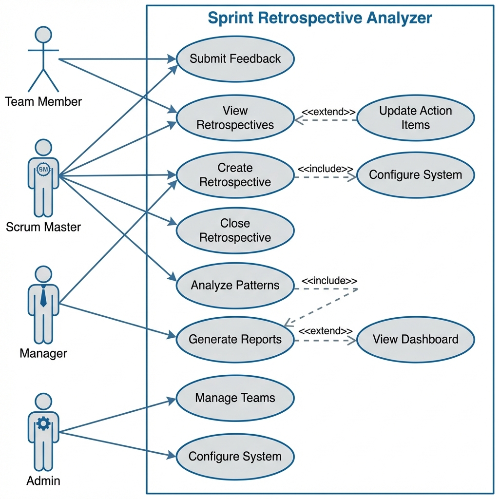

# Use Case Diagrams
## Sprint Retrospective Analyzer

**Document Version:** 1.0  
**Date:** January 27, 2026  
**Project:** Sprint Retrospective Analyzer

---

## 1. Introduction

This document presents the use case diagrams for the Sprint Retrospective Analyzer system. Use case diagrams provide a high-level view of system functionality and the relationships between actors and use cases.

### 1.1 Purpose

Use case diagrams serve to:
- Visualize system functionality from a user perspective
- Identify actors and their interactions with the system
- Show relationships between use cases (include, extend, generalization)
- Communicate requirements to stakeholders
- Guide system design and testing

### 1.2 Diagram Notation

| **Element** | **Notation** | **Description** |
|-------------|--------------|-----------------|
| **Actor** | Stick figure | External entity interacting with the system |
| **Use Case** | Oval/Ellipse | Specific functionality or goal |
| **System Boundary** | Rectangle | Defines system scope |
| **Association** | Solid line | Actor-to-use case relationship |
| **Include** | Dashed arrow `<<include>>` | Required dependency |
| **Extend** | Dashed arrow `<<extend>>` | Optional extension |
| **Generalization** | Solid arrow | Inheritance relationship |

---

## 2. Actors

### 2.1 Actor Definitions

| **Actor** | **Description** | **Primary Goals** |
|-----------|-----------------|-------------------|
| **Team Member** | Software developer, tester, designer | Submit feedback, track action items |
| **Scrum Master** | Agile team facilitator | Create retrospectives, analyze patterns |
| **Manager** | Engineering manager, team lead | Oversee team health, generate reports |
| **Admin** | System administrator | Configure system, manage users/teams |
| **System** | Automated processes | Trigger analysis, send notifications |

### 2.2 Actor Hierarchy

```
User (Abstract)
├── Team Member
├── Scrum Master (inherits Team Member)
├── Manager (inherits Scrum Master)
└── Admin (standalone)
```

> [!NOTE]
> Scrum Master inherits all Team Member capabilities plus additional privileges. Manager inherits Scrum Master capabilities.

---

## 3. Main Use Case Diagram

### 3.1 System Overview



### 3.2 Use Case Descriptions

#### UC-01: Submit Feedback
- **Actors:** Team Member, Scrum Master, Manager
- **Description:** User submits retrospective feedback in three categories
- **Includes:** Authenticate User
- **Extends:** Add Attachment (optional)

#### UC-02: View Retrospectives
- **Actors:** Team Member, Scrum Master, Manager
- **Description:** User views current and historical retrospectives
- **Includes:** Authenticate User
- **Extends:** Filter by Date/Team, Search Feedback

#### UC-03: Update Action Items
- **Actors:** Team Member, Scrum Master
- **Description:** User updates status of assigned action items
- **Includes:** Authenticate User
- **Extends:** Add Comment, Mark Complete

#### UC-04: Create Retrospective
- **Actors:** Scrum Master, Manager
- **Description:** User creates new retrospective for a sprint
- **Includes:** Select Team, Add Sprint Details
- **Extends:** Set Custom Templates (Phase 2)

#### UC-05: Close Retrospective
- **Actors:** Scrum Master, Manager
- **Description:** User finalizes retrospective, triggering analysis
- **Includes:** Trigger Pattern Analysis
- **Extends:** Send Summary Email

#### UC-06: Analyze Patterns
- **Actors:** Manager (manually), System (automatically)
- **Description:** System identifies recurring themes and issues
- **Includes:** Extract Keywords, Detect Sentiment
- **Extends:** Generate Recommendations (Phase 2)

#### UC-07: Generate Reports
- **Actors:** Scrum Master, Manager
- **Description:** User creates PDF/CSV reports on retrospective data
- **Includes:** Select Date Range, Select Metrics
- **Extends:** Schedule Recurring Reports

#### UC-08: View Dashboard
- **Actors:** Team Member, Scrum Master, Manager
- **Description:** User views customizable dashboard with key metrics
- **Includes:** Load Team Data
- **Extends:** Customize Widget Layout, Export Dashboard

#### UC-09: Manage Teams
- **Actors:** Admin, Scrum Master (limited)
- **Description:** User creates teams and manages membership
- **Includes:** Authenticate User
- **Extends:** Archive Team, Transfer Ownership

#### UC-10: Configure System
- **Actors:** Admin
- **Description:** User configures system settings and policies
- **Includes:** Authenticate User
- **Extends:** Set Data Retention, Configure Notifications

---

## 4. Detailed Use Case Diagrams

### 4.1 Retrospective Management

```
Retrospective Management Subsystem

Actors:
- Team Member
- Scrum Master
- System

Use Cases:
- Create Retrospective
  <<include>> Add Sprint Details
  <<include>> Select Team
  <<extend>> Invite External Participants
  
- Submit Feedback
  <<include>> Authenticate User
  <<extend>> Submit Anonymously
  <<extend>> Add Attachment
  
- Close Retrospective
  <<include>> Trigger Pattern Analysis
  <<include>> Lock Feedback Editing
  <<extend>> Send Notification Email
```

**Relationships:**
- **Create Retrospective** includes **Add Sprint Details** and **Select Team** (mandatory)
- **Submit Feedback** extends to **Submit Anonymously** (optional)
- **Close Retrospective** includes **Trigger Pattern Analysis** (automatic)

---

### 4.2 Action Item Management

```
Action Item Management Subsystem

Actors:
- Team Member
- Scrum Master
- System

Use Cases:
- Create Action Item
  <<include>> Link to Feedback
  <<include>> Assign Owner
  <<extend>> Set Due Date
  
- Update Action Item
  <<include>> Change Status
  <<extend>> Add Comment
  <<extend>> Modify Assignee
  
- Track Effectiveness
  <<include>> Monitor Issue Recurrence
  <<extend>> Calculate Effectiveness Score
```

**Relationships:**
- **Create Action Item** requires **Link to Feedback** and **Assign Owner**
- **Update Action Item** always includes **Change Status**
- **Track Effectiveness** automatically monitors recurrence

---

### 4.3 Analytics & Reporting

```
Analytics & Reporting Subsystem

Actors:
- Scrum Master
- Manager
- System

Use Cases:
- Analyze Patterns
  <<include>> Extract Keywords
  <<include>> Detect Sentiment
  <<include>> Identify Recurring Issues
  <<extend>> Generate Recommendations
  
- Generate Reports
  <<include>> Select Metrics
  <<include>> Select Date Range
  <<extend>> Export to PDF
  <<extend>> Export to CSV
  <<extend>> Schedule Report
  
- View Dashboard
  <<include>> Load Team Data
  <<extend>> Customize Layout
  <<extend>> Filter by Team
```

**Relationships:**
- **Analyze Patterns** includes multiple analysis types (keywords, sentiment, recurring issues)
- **Generate Reports** can extend to multiple export formats
- **View Dashboard** allows optional customization

---

### 4.4 User & Team Management

```
User & Team Management Subsystem

Actors:
- Admin
- Scrum Master
- Team Member

Use Cases:
- Register User
  <<include>> Verify Email
  <<extend>> Assign to Team
  
- Manage Team
  <<include>> Add Members
  <<include>> Remove Members
  <<extend>> Assign Scrum Master
  <<extend>> Set Team Visibility
  
- Manage Permissions
  <<include>> Assign Role
  <<extend>> Grant Special Permissions
```

**Relationships:**
- **Register User** requires **Verify Email** before activation
- **Manage Team** includes member management, extends to role assignment
- **Manage Permissions** is admin-only functionality

---

## 5. Use Case Relationships Matrix

| **Use Case** | **Includes** | **Extends** | **Generalization** |
|--------------|-------------|-------------|---------------------|
| Submit Feedback | Authenticate User | Add Attachment, Submit Anonymously | - |
| Create Retrospective | Select Team, Add Sprint Details | Set Custom Template | - |
| Close Retrospective | Trigger Analysis, Lock Editing | Send Email Summary | - |
| Update Action Item | Change Status | Add Comment, Modify Assignee | - |
| Analyze Patterns | Extract Keywords, Detect Sentiment | Generate Recommendations | - |
| Generate Reports | Select Metrics, Date Range | Export PDF/CSV, Schedule | - |
| View Dashboard | Load Team Data | Customize Layout, Filter | - |
| Manage Team | Add/Remove Members | Assign Scrum Master | - |
| Register User | Verify Email | Assign to Team | - |

---

## 6. Use Case Scenarios

### 6.1 Scenario 1: Conducting a Sprint Retrospective

**Actors:** Scrum Master, Team Members

**Flow:**
1. Scrum Master creates retrospective (UC-04)
2. System sends notification to team members
3. Team members submit feedback (UC-01)
4. Team members create action items from feedback (UC-13 from FR doc)
5. Scrum Master closes retrospective (UC-05)
6. System automatically analyzes patterns (UC-06)
7. Scrum Master views dashboard to review insights (UC-08)

**Result:** Retrospective completed with actionable insights

---

### 6.2 Scenario 2: Tracking Action Item Effectiveness

**Actors:** Scrum Master, Team Member, System

**Flow:**
1. Team member updates action item to "Done" (UC-03)
2. Scrum Master verifies action item completion
3. System monitors next 3 sprints for issue recurrence (automatic)
4. System calculates effectiveness score (UC-06 extend)
5. Scrum Master views effectiveness trends on dashboard (UC-08)

**Result:** Evidence whether actions resolved underlying issues

---

### 6.3 Scenario 3: Manager Reviews Team Health

**Actors:** Manager

**Flow:**
1. Manager logs into system (authenticate)
2. Manager views dashboard with cross-team metrics (UC-08)
3. Manager generates monthly report (UC-07)
4. Manager exports report as PDF for stakeholders
5. Manager schedules recurring monthly reports

**Result:** Data-driven insights for organizational improvement

---

## 7. Use Case Priority Matrix

| **Use Case** | **Priority** | **Phase** | **Complexity** |
|--------------|-------------|-----------|----------------|
| Submit Feedback | P1 (High) | Phase 1 | Low |
| View Retrospectives | P1 (High) | Phase 1 | Low |
| Create Retrospective | P1 (High) | Phase 1 | Medium |
| Close Retrospective | P1 (High) | Phase 1 | Medium |
| Update Action Items | P1 (High) | Phase 1 | Low |
| Analyze Patterns | P1 (High) | Phase 1 | High |
| View Dashboard | P1 (High) | Phase 1 | Medium |
| Manage Teams | P1 (High) | Phase 1 | Medium |
| Generate Reports | P2 (Medium) | Phase 1 | Medium |
| Configure System | P2 (Medium) | Phase 1 | Low |

---

## 8. Traceability to Requirements

### 8.1 Use Case to Functional Requirement Mapping

| **Use Case** | **Related Functional Requirements** |
|--------------|--------------------------------------|
| UC-01: Submit Feedback | FR-06 |
| UC-02: View Retrospectives | FR-08, FR-18 |
| UC-03: Update Action Items | FR-14 |
| UC-04: Create Retrospective | FR-05 |
| UC-05: Close Retrospective | FR-07 |
| UC-06: Analyze Patterns | FR-09, FR-10, FR-11 |
| UC-07: Generate Reports | FR-17, FR-23 |
| UC-08: View Dashboard | FR-16 |
| UC-09: Manage Teams | FR-19, FR-20 |
| UC-10: Configure System | FR-04, FR-21 |

---

## 9. Notes and Assumptions

> [!NOTE]
> **Design Decisions:**
> - All use cases require authentication except "Register User"
> - Scrum Master role inherits Team Member capabilities
> - Manager role inherits Scrum Master capabilities
> - System actor represents automated background processes

> [!IMPORTANT]
> **Constraints:**
> - Maximum 15 team members can participate in a single retrospective
> - Retrospectives automatically close after 7 days of inactivity
> - Pattern analysis triggered only on retrospective closure (not real-time)

---

**Document Control:**
- **Created By:** System Design Team
- **Last Updated:** January 27, 2026
- **Status:** Draft for Review
- **Next Review:** February 3, 2026
- **Version History:** 1.0 (Initial Release)
- **Diagrams:** 1 Main Use Case Diagram (additional detailed diagrams to be rendered)
