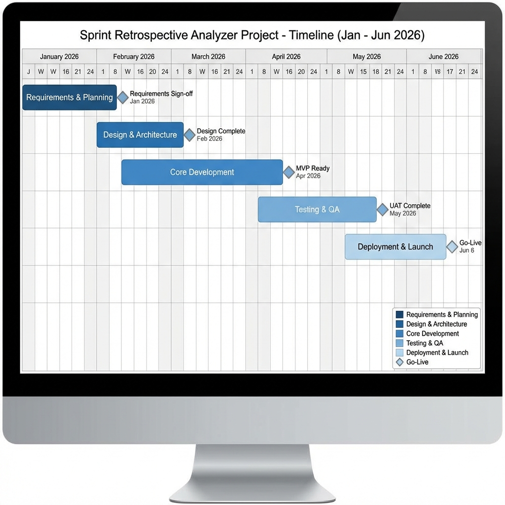

# Project Charter
## Sprint Retrospective Analyzer

**Document Version:** 1.0  
**Date:** January 27, 2026  
**Project Name:** Sprint Retrospective Analyzer  
**Project Code:** SRA-2026-001

---

## 1. Executive Summary

### 1.1 Project Overview

The Sprint Retrospective Analyzer is a comprehensive web-based platform designed to transform how Agile teams conduct, analyze, and learn from sprint retrospectives. By providing structured data collection, automated pattern recognition, and actionable insights, the system addresses a critical gap in Agile software development: the lack of evidence-based continuous improvement.

### 1.2 Business Justification

**Problem:**  
Current retrospective practices are informal and inefficient, relying on whiteboards, sticky notes, and basic documents that are reviewed once and forgotten. This results in:
- Lost insights over time
- Recurring issues going unnoticed
- Inability to measure improvement
- Action items without accountability

**Solution:**  
A data-driven retrospective intelligence system that captures feedback, identifies patterns, tracks action item effectiveness, and provides measurable improvement metrics.

**Expected Benefits:**
- 30% increase in action item completion rates
- 50% reduction in recurring issues
- Quantifiable improvement in team health scores
- Evidence-based process improvement decisions

---

## 2. Project Objectives

### 2.1 Primary Objectives

| **#** | **Objective** | **Success Criteria** | **Target Date** |
|-------|---------------|----------------------|-----------------|
| **1** | Deliver MVP with core retrospective management | All P1 functional requirements implemented | April 30, 2026 |
| **2** | Implement pattern recognition engine | 90%+ accuracy in identifying recurring issues | April 30, 2026 |
| **3** | Achieve high user adoption | 80% of teams using system within 3 months of launch | September 30, 2026 |
| **4** | Demonstrate measurable improvement | Teams show 30% increase in action item completion | September 30, 2026 |
| **5** | Ensure system reliability | 99.5% uptime after launch | Ongoing |

### 2.2 Secondary Objectives

- Reduce time spent on retrospective administration by 40%
- Establish foundation for future AI/ML enhancements
- Create reusable pattern recognition framework
- Build scalable cloud infrastructure supporting 50+ teams

---

## 3. Project Scope

### 3.1 In-Scope Deliverables

#### Phase 1 (Months 1-6): MVP Launch

**Core Features:**
- ✅ User authentication and RBAC
- ✅ Retrospective creation and management
- ✅ Structured feedback submission (3 categories)
- ✅ Action item tracking with status workflow
- ✅ Automated keyword extraction
- ✅ Recurring issue detection
- ✅ Sentiment analysis
- ✅ Team dashboard with trend visualization
- ✅ PDF/CSV report generation
- ✅ Email notifications
- ✅ Team and user management

**Technical Infrastructure:**
- ✅ Cloud-based deployment (AWS/Azure)
- ✅ PostgreSQL database with replication
- ✅ RESTful API architecture
- ✅ Responsive web UI (React.js)
- ✅ Automated daily backups

**Documentation:**
- ✅ SRS document (8-12 pages)
- ✅ System design documentation
- ✅ API documentation
- ✅ User guide and training materials
- ✅ Admin manual

### 3.2 Out-of-Scope

**Explicitly NOT Included in Phase 1:**
- ❌ Native mobile applications (iOS/Android)
- ❌ Real-time collaboration features
- ❌ Direct integration with Jira/Azure DevOps
- ❌ Advanced AI-powered predictive analytics
- ❌ Video conferencing or chat features
- ❌ Single Sign-On (SSO) integration
- ❌ Multi-language support
- ❌ Custom retrospective templates

> [!NOTE]
> Out-of-scope items are deferred to Phase 2+ based on user feedback and business priorities.

---

## 4. Stakeholders

### 4.1 Project Sponsor

**Name:** [To be filled]  
**Organization:** [To be filled]  
**Role:** Executive Sponsor  
**Responsibilities:**
- Provide executive oversight and strategic direction
- Approve budget and resource allocation
- Resolve escalated issues
- Champion project at leadership level

### 4.2 Product Owner

**Name:** [To be filled]  
**Organization:** [To be filled]  
**Role:** Product Owner  
**Responsibilities:**
- Define and prioritize product backlog
- Accept or reject completed work
- Make scope and priority decisions
- Represent user needs and business value

### 4.3 Project Manager

**Name:** [To be filled]  
**Organization:** [To be filled]  
**Role:** Project Manager  
**Responsibilities:**
- Plan and track project schedule
- Manage resources and budget
- Identify and mitigate risks
- Report progress to stakeholders

### 4.4 Key Stakeholder Groups

| **Stakeholder Group** | **Interest** | **Influence** | **Engagement Strategy** |
|-----------------------|--------------|---------------|-------------------------|
| **Development Team** | Build quality system | High | Daily standups, sprint planning |
| **End Users (Agile Teams)** | Usable, valuable tool | Medium | User testing, feedback sessions |
| **Scrum Masters** | Effective facilitation tool | High | Beta testing, training sessions |
| **Engineering Managers** | Team health insights | High | Demos, monthly reviews |
| **IT Operations** | Reliable, secure system | Medium | Technical reviews, SLAs |

---

## 5. Project Timeline and Milestones

### 5.1 High-Level Timeline



### 5.2 Key Milestones

| **Milestone** | **Description** | **Target Date** | **Deliverables** |
|---------------|-----------------|-----------------|------------------|
| **M1: Project Kickoff** | Project formally initiated | January 27, 2026 | Project charter, stakeholder register |
| **M2: Requirements Sign-off** | SRS approved by stakeholders | February 10, 2026 | Signed SRS document |
| **M3: Design Complete** | System architecture finalized | February 28, 2026 | Architecture diagrams, database schema |
| **M4: MVP Ready** | Core features implemented | April 30, 2026 | Working MVP system |
| **M5: UAT Complete** | User acceptance testing passed | May 31, 2026 | UAT test results, bug fixes |
| **M6: Go-Live** | Production launch | June 15, 2026 | Production system, user documentation |

### 5.3 Phase Breakdown

#### **Phase 1: Requirements & Planning** (3 weeks)
- Week 1-2: Requirements gathering, stakeholder interviews
- Week 2-3: SRS documentation, use case development
- Week 3: Requirements review and sign-off

#### **Phase 2: Design & Architecture** (3 weeks)
- Week 4-5: System architecture design, technology selection
- Week 5-6: Database schema design, API specification
- Week 6: Design review and approval

#### **Phase 3: Core Development** (10 weeks)
- Week 7-10: Authentication, user management, team management
- Week 11-14: Retrospective management, feedback submission
- Week 15-16: Pattern recognition engine, analytics

#### **Phase 4: Testing & QA** (4 weeks)
- Week 17-18: Unit and integration testing
- Week 19-20: User acceptance testing
- Week 20: Bug fixes and performance tuning

#### **Phase 5: Deployment & Launch** (2 weeks)
- Week 21: Production deployment, final configuration
- Week 22: User training, go-live support

---

## 6. Project Budget

### 6.1 Budget Summary

| **Category** | **Estimated Cost** | **% of Budget** |
|--------------|--------------------|-----------------|
| **Personnel** | $120,000 | 80% |
| **Infrastructure** | $6,000 | 4% |
| **Software/Tools** | $9,000 | 6% |
| **Training & Documentation** | $10,000 | 7% |
| **Contingency (10%)** | $14,500 | 10% |
| **TOTAL** | **$150,000** | **100%** |

### 6.2 Detailed Budget Breakdown

#### Personnel Costs

| **Role** | **FTE** | **Duration** | **Rate** | **Cost** |
|----------|---------|--------------|----------|----------|
| Senior Engineer (Lead) | 1.0 | 6 months | $100/hr | $48,000 |
| Software Engineers (x3) | 3.0 | 6 months | $75/hr | $54,000 |
| QA Engineers (x2) | 2.0 | 3 months | $60/hr | $14,400 |
| UX Designer | 0.5 | 3 months | $80/hr | $9,600 |
| Project Manager | 0.25 | 6 months | $90/hr | $10,800 |
| **Subtotal** | | | | **$120,000** |

#### Infrastructure Costs (6 months)

| **Item** | **Monthly Cost** | **Total** |
|----------|------------------|-----------|
| AWS/Azure Cloud Hosting | $500 | $3,000 |
| Database (PostgreSQL RDS) | $200 | $1,200 |
| Email Service (SendGrid) | $100 | $600 |
| Monitoring (CloudWatch) | $50 | $300 |
| SSL Certificates | $15 | $90 |
| **Subtotal** | | **$5,190** |

#### Software & Tools

| **Item** | **Cost** |
|----------|----------|
| Development Tools (IDEs, licenses) | $2,000 |
| CASE Tools (StarUML, Visual Paradigm) | $1,500 |
| Testing Tools (Selenium, JMeter) | $1,000 |
| Project Management (Jira) | $500/month x 6 = $3,000 |
| Design Tools (Figma) | $500 |
| **Subtotal** | **$8,000** |

---

## 7. Success Criteria

### 7.1 Project Success Metrics

The project will be considered successful when the following criteria are met:

| **Metric** | **Target** | **Measurement Method** |
|------------|-----------|------------------------|
| **On-Time Delivery** | Go-live by June 15, 2026 | Project schedule tracking |
| **On-Budget Delivery** | Within $150,000 budget (+/- 10%) | Financial tracking |
| **Functional Completeness** | 100% of P1 requirements implemented | Requirements traceability matrix |
| **Quality** | < 5 critical bugs at launch | Bug tracking system |
| **Performance** | Page load < 2 seconds, API < 500ms | Performance testing results |
| **Uptime** | 99.5% availability post-launch | Uptime monitoring (first 3 months) |
| **User Adoption** | 50% of target teams using within 1 month | Usage analytics |
| **User Satisfaction** | ≥ 4.0/5.0 SUS score | User satisfaction survey |

### 7.2 Business Success Metrics (Post-Launch)

| **Metric** | **Baseline** | **3-Month Target** | **6-Month Target** |
|------------|--------------|--------------------|--------------------|
| Action Item Completion Rate | 45% | 58% (+30%) | 65% (+45%) |
| Recurring Issues | 100% | 75% (-25%) | 50% (-50%) |
| Time per Retrospective | 90 minutes | 75 minutes | 60 minutes |
| Team Satisfaction | 3.2/5.0 | 3.8/5.0 | 4.2/5.0 |

---

## 8. Risks and Mitigation Strategies

### 8.1 High-Priority Risks

| **Risk** | **Probability** | **Impact** | **Mitigation Strategy** | **Contingency Plan** |
|----------|-----------------|------------|-------------------------|----------------------|
| **Requirements Creep** | High | High | Formal change control process, prioritization | Defer P2/P3 features to Phase 2 |
| **Resource Availability** | Medium | High | Resource commitment agreements upfront | Contract additional resources if needed |
| **Integration Complexity** | Medium | Medium | Early prototyping, phased integration | Simplify integrations, reduce scope |
| **User Adoption** | Medium | High | Early user involvement, training program | Extended beta period, marketing campaign |
| **Performance Issues** | Low | High | Early load testing, performance benchmarks | Infrastructure scaling, code optimization |
| **Security Vulnerabilities** | Low | Critical | Security reviews, penetration testing | Rapid patching process, security audit |

### 8.2 Technical Risks

- **Pattern Recognition Accuracy**: Mitigation through algorithm testing and baseline establishment
- **Cloud Service Dependency**: Mitigation through multi-region deployment and provider SLA review
- **Data Migration**: Mitigation through comprehensive migration scripts and testing

---

## 9. Assumptions and Constraints

### 9.1 Assumptions

> [!NOTE]
> The following assumptions are critical to project planning:

1. **Resource Availability**: Development team fully allocated for 6 months
2. **Stakeholder Engagement**: Product Owner available for weekly reviews
3. **Technical Environment**: AWS/Azure cloud infrastructure accessible
4. **User Access**: Target users have modern browsers and internet access
5. **Data Availability**: Sample retrospective data available for development/testing
6. **Organizational Support**: Management supports user training and adoption

### 9.2 Constraints

> [!WARNING]
> The following constraints limit project execution:

1. **Budget**: Fixed budget of $150,000 (no additional funding)
2. **Timeline**: Hard deadline of June 15, 2026 for go-live
3. **Technology Stack**: Must use React.js, Node.js, PostgreSQL (organizational standard)
4. **Team Size**: Maximum 6 development team members
5. **Compliance**: Must meet GDPR and CCPA requirements from day 1
6. **Scalability**: Phase 1 must support 50 teams maximum

---

## 10. Project Governance

### 10.1 Governance Structure

```
Steering Committee
└── Project Sponsor
    └── Product Owner
        └── Project Manager
            └── Development Team
```

### 10.2 Decision-Making Authority

| **Decision Type** | **Authority** | **Escalation Path** |
|-------------------|---------------|---------------------|
| **Scope Changes (Minor)** | Product Owner | Project Sponsor |
| **Scope Changes (Major)** | Project Sponsor | Steering Committee |
| **Budget Allocation** | Project Sponsor | Steering Committee |
| **Technical Decisions** | Development Lead | Product Owner |
| **Risk Acceptance** | Project Manager | Project Sponsor |

### 10.3 Communication Plan

| **Audience** | **Format** | **Frequency** | **Owner** |
|--------------|------------|---------------|-----------|
| **Steering Committee** | Status Report | Monthly | Project Sponsor |
| **Product Owner** | Sprint Review | Bi-weekly | Project Manager |
| **Development Team** | Daily Standup | Daily | Scrum Master |
| **End Users** | Newsletter | Monthly | Product Owner |
| **All Stakeholders** | Milestone Updates | Per Milestone | Project Manager |

---

## 11. Project Deliverables

### 11.1 Documentation Deliverables

- [x] Project Charter (this document)
- [ ] Stakeholder Register
- [ ] Software Requirements Specification (SRS)
- [ ] System Architecture Document
- [ ] Database Design Document
- [ ] API Specification (OpenAPI/Swagger)
- [ ] User Guide
- [ ] Administrator Manual
- [ ] Test Plan and Test Cases
- [ ] Deployment Guide

### 11.2 Software Deliverables

- [ ] Web Application (Frontend - React.js)
- [ ] Backend API (Node.js)
- [ ] Database Schema (PostgreSQL)
- [ ] Pattern Recognition Engine
- [ ] Deployment Scripts
- [ ] Automated Test Suite

### 11.3 Infrastructure Deliverables

- [ ] Production Environment (AWS/Azure)
- [ ] Staging Environment
- [ ] Development Environment
- [ ] CI/CD Pipeline
- [ ] Monitoring and Alerting Setup

---

## 12. Authorization and Approval

### 12.1 Project Charter Approval

This project charter authorizes the Sprint Retrospective Analyzer project and grants the Project Manager authority to apply organizational resources to project activities.

**Signatures:**

| **Role** | **Name** | **Signature** | **Date** |
|----------|----------|---------------|----------|
| **Project Sponsor** | _______________ | _______________ | _______ |
| **Product Owner** | _______________ | _______________ | _______ |
| **Project Manager** | _______________ | _______________ | _______ |
| **Development Lead** | _______________ | _______________ | _______ |

---

### 12.2 Change Log

| **Version** | **Date** | **Author** | **Changes** |
|-------------|----------|------------|-------------|
| 1.0 | Jan 27, 2026 | Project Team | Initial release |

---

**Document Control:**
- **Created By:** Project Management Team
- **Last Updated:** January 27, 2026
- **Status:** Pending Approval
- **Distribution:** All Stakeholders
- **Confidentiality:** Internal Use Only
