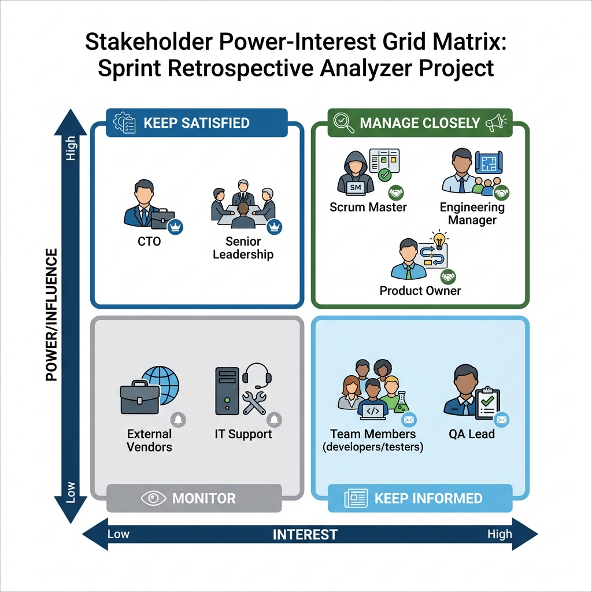

# Stakeholder Register
## Sprint Retrospective Analyzer

**Document Version:** 1.0  
**Date:** January 27, 2026  
**Project:** Sprint Retrospective Analyzer  
**Project Code:** SRA-2026-001

---

## 1. Introduction

### 1.1 Purpose

This Stakeholder Register identifies all individuals, groups, and organizations that have an interest in or influence over the Sprint Retrospective Analyzer project. It documents their roles, interests, expectations, and engagement strategies to ensure effective stakeholder management throughout the project lifecycle.

### 1.2 Document Scope

This register includes:
- Primary and secondary stakeholders
- Stakeholder interests and influence levels
- Communication preferences and requirements
- Engagement strategies
- RACI matrix for key deliverables

---

## 2. Stakeholder Identification

### 2.1 Primary Stakeholders

| **ID** | **Name/Role** | **Organization** | **Position** | **Contact** |
|--------|---------------|------------------|--------------|-------------|
| **SH-01** | Project Sponsor | [Organization] | Executive VP Engineering | sponsor@example.com |
| **SH-02** | Product Owner | [Organization] | Product Management Director | po@example.com |
| **SH-03** | Project Manager | [Organization] | Senior Project Manager | pm@example.com |
| **SH-04** | Development Lead | [Organization] | Principal Engineer | devlead@example.com |
| **SH-05** | QA Lead | [Organization] | QA Manager | qalead@example.com |
| **SH-06** | UX Designer | [Organization] | Senior UX Designer | ux@example.com |

### 2.2 Secondary Stakeholders

| **ID** | **Name/Role** | **Organization** | **Position** | **Contact** |
|--------|---------------|------------------|--------------|-------------|
| **SH-07** | Scrum Master Community | [Organization] | Scrum Masters (10-15 individuals) | scrummasters@example.com |
| **SH-08** | Engineering Managers | [Organization] | Engineering Managers (5-10 individuals) | emgrs@example.com |
| **SH-09** | Development Teams | [Organization] | Software Developers, Testers | teams@example.com |
| **SH-10** | IT Operations | [Organization] | IT Operations Manager | itops@example.com |
| **SH-11** | Security Team | [Organization] | Information Security Officer | security@example.com |
| **SH-12** | Data Privacy Officer | [Organization] | Legal/Compliance | dpo@example.com |
| **SH-13** | Finance Department | [Organization] | Finance Manager | finance@example.com |
| **SH-14** | Training & Enablement | [Organization] | Training Manager | training@example.com |

---

## 3. Stakeholder Analysis

### 3.1 Interest and Influence Matrix

| **Stakeholder ID** | **Name/Role** | **Interest** | **Influence** | **Quadrant** |
|--------------------|---------------|--------------|---------------|--------------|
| **SH-01** | Project Sponsor | High | High | **Manage Closely** |
| **SH-02** | Product Owner | High | High | **Manage Closely** |
| **SH-03** | Project Manager | High | High | **Manage Closely** |
| **SH-04** | Development Lead | High | High | **Manage Closely** |
| **SH-05** | QA Lead | High | Medium | **Keep Satisfied** |
| **SH-06** | UX Designer | Medium | Medium | **Keep Informed** |
| **SH-07** | Scrum Master Community | High | Medium | **Keep Satisfied** |
| **SH-08** | Engineering Managers | High | High | **Manage Closely** |
| **SH-09** | Development Teams | High | Low | **Keep Informed** |
| **SH-10** | IT Operations | Medium | Medium | **Keep Informed** |
| **SH-11** | Security Team | Medium | High | **Keep Satisfied** |
| **SH-12** | Data Privacy Officer | Medium | High | **Keep Satisfied** |
| **SH-13** | Finance Department | Low | Medium | **Monitor** |
| **SH-14** | Training & Enablement | Medium | Low | **Keep Informed** |

#### Quadrant Definitions:
- **High Interest, High Influence (Manage Closely)**: Engage actively, frequent communication, decision involvement
- **High Interest, Low Influence (Keep Informed)**: Regular updates, gather feedback, ensure satisfaction
- **Low Interest, High Influence (Keep Satisfied)**: Strategic updates, win support, address concerns promptly
- **Low Interest, Low Influence (Monitor)**: General communications, minimal effort

### 3.2 Power-Interest Grid Visualization

---

### 3.2 Detailed Stakeholder Profiles

#### SH-01: Project Sponsor

**Role:** Executive VP of Engineering  
**Interest Level:** High  
**Influence Level:** High

**Interests:**
- Strategic alignment with organizational goals
- Return on investment (ROI)
- Risk mitigation
- On-time, on-budget delivery

**Expectations:**
- Monthly executive summaries
- Escalation of major issues
- Budget adherence
- Demonstration of business value

**Potential Concerns:**
- Budget overruns
- Timeline delays
- Low user adoption post-launch
- Competing organizational priorities

**Engagement Strategy:**
- Monthly executive briefings (30 minutes)
- Immediate escalation of critical risks
- Quarterly steering committee meetings
- Milestone reviews and approvals

---

#### SH-02: Product Owner

**Role:** Product Management Director  
**Interest Level:** High  
**Influence Level:** High

**Interests:**
- User value and satisfaction
- Feature prioritization and backlog management
- Market fit and competitive positioning
- Product roadmap alignment

**Expectations:**
- Weekly product backlog reviews
- Sprint planning and review participation
- User feedback incorporation
- Requirements clarity and traceability

**Potential Concerns:**
- Feature creep and scope management
- User acceptance and adoption
- Balancing user requests with technical constraints
- Time-to-market pressures

**Engagement Strategy:**
- Weekly sprint reviews (1 hour)
- Ad-hoc requirement clarification sessions
- User feedback review meetings
- Quarterly product roadmap planning

---

#### SH-03: Project Manager

**Role:** Senior Project Manager  
**Interest Level:** High  
**Influence Level:** High

**Interests:**
- Project schedule adherence
- Resource allocation and utilization
- Risk and issue management
- Stakeholder satisfaction

**Expectations:**
- Daily team progress updates
- Timely risk identification and mitigation
- Clear communication with all stakeholders
- Accurate project status reporting

**Potential Concerns:**
- Resource constraints
- Scope creep
- Dependency management
- Team velocity fluctuations

**Engagement Strategy:**
- Daily standups with development team
- Weekly status reports to sponsor and PO
- Bi-weekly risk review sessions
- Monthly stakeholder communications

---

#### SH-04: Development Lead

**Role:** Principal Engineer  
**Interest Level:** High  
**Influence Level:** High

**Interests:**
- Technical architecture quality
- Clean, maintainable codebase
- Team skill development
- Technology stack decisions

**Expectations:**
- Technical decision-making authority
- Adequate time for design and architecture
- Access to necessary tools and resources
- Collaboration with UX and QA

**Potential Concerns:**
- Technical debt accumulation
- Unrealistic timelines
- Technology constraints
- Team skill gaps

**Engagement Strategy:**
- Daily technical standups
- Weekly architecture review sessions
- Technology spike time allocation
- Mentoring and pair programming support

---

#### SH-07: Scrum Master Community

**Role:** Scrum Masters (Future System Users)  
**Interest Level:** High  
**Influence Level:** Medium

**Interests:**
- Ease of retrospective facilitation
- Actionable insights from retrospective data
- Time savings in retrospective administration
- Demonstrable team improvement

**Expectations:**
- User-friendly, intuitive interface
- Mobile accessibility (at minimum, responsive design)
- Quick retrospective setup (< 5 minutes)
- Meaningful pattern recognition

**Potential Concerns:**
- Learning curve for new tool
- Integration with existing workflows
- Value vs. effort (ROI on time investment)
- Data privacy and team feedback sensitivity

**Engagement Strategy:**
- Monthly beta testing sessions
- User feedback surveys (bi-weekly during beta)
- Training workshops (pre-launch)
- Office hours for questions and support

---

#### SH-08: Engineering Managers

**Role:** Engineering Managers (Decision Makers)  
**Interest Level:** High  
**Influence Level:** High

**Interests:**
- Team health and productivity metrics
- Evidence-based decision making
- Cross-team insights and benchmarking
- Process improvement ROI

**Expectations:**
- High-level dashboards and reports
- Cross-team comparison capabilities
- Data export for further analysis
- Privacy controls for sensitive feedback

**Potential Concerns:**
- Data accuracy and reliability
- Potential for metrics misuse (performance reviews)
- Team trust and psychological safety
- Implementation effort vs. benefit

**Engagement Strategy:**
- Monthly demos of analytics features
- Quarterly manager feedback sessions
- Best practices sharing forums
- Executive summary reports

---

#### SH-09: Development Teams

**Role:** Software Developers, Testers, Designers (End Users)  
**Interest Level:** High  
**Influence Level:** Low

**Interests:**
- Quick, easy feedback submission
- Visible impact from retrospectives
- Transparency in action item tracking
- Improved team processes

**Expectations:**
- Minimal time investment (< 15 minutes per retrospective)
- Simple, intuitive UI
- Anonymity options for sensitive feedback
- Evidence that feedback leads to change

**Potential Concerns:**
- Yet another tool to learn
- Feedback not acted upon
- Lack of anonymity leading to reduced honesty
- Time overhead

**Engagement Strategy:**
- User acceptance testing (UAT) participation
- Usability testing sessions
- Town hall Q&A sessions
- Feedback channels (Slack, email)

---

#### SH-11: Security Team

**Role:** Information Security Officer  
**Interest Level:** Medium  
**Influence Level:** High

**Interests:**
- Data security and privacy
- Compliance with security standards
- Vulnerability management
- Access control and authentication

**Expectations:**
- Security review and approval
- Penetration testing participation
- Compliance documentation
- Incident response planning

**Potential Concerns:**
- Data breach risks
- Insufficient access controls
- Unencrypted sensitive data
- Compliance violations (GDPR, CCPA)

**Engagement Strategy:**
- Security design review (pre-development)
- Penetration testing (pre-launch)
- Monthly security status updates
- Incident response plan co-development

---

#### SH-12: Data Privacy Officer

**Role:** Legal/Compliance  
**Interest Level:** Medium  
**Influence Level:** High

**Interests:**
- GDPR/CCPA compliance
- User consent and data rights
- Data retention and deletion policies
- Privacy by design principles

**Expectations:**
- Privacy impact assessment
- Data processing agreements
- User consent mechanisms
- Right to deletion implementation

**Potential Concerns:**
- Non-compliance penalties
- Inadequate user consent
- Data retention violations
- Cross-border data transfer issues

**Engagement Strategy:**
- Privacy impact assessment (design phase)
- Quarterly compliance reviews
- Legal documentation support
- Pre-launch compliance audit

---

## 4. Communication Plan

### 4.1 Communication Matrix

| **Stakeholder** | **Method** | **Frequency** | **Content** | **Owner** |
|-----------------|------------|---------------|-------------|-----------|
| **Project Sponsor** | Executive Briefing | Monthly | Status, risks, budget, milestones | Project Manager |
| **Product Owner** | Sprint Review | Bi-weekly | Demo, backlog, user feedback | Scrum Master |
| **Project Manager** | Status Report | Weekly | Progress, blockers, risks | Development Lead |
| **Development Lead** | Technical Standup | Daily | Code progress, technical issues | Team |
| **QA Lead** | Test Status Report | Weekly | Test results, defects, quality metrics | QA Team |
| **Scrum Masters** | Beta Feedback Session | Monthly | Feature demos, feedback collection | Product Owner |
| **Engineering Managers** | Manager Dashboard Demo | Quarterly | Analytics, insights, roadmap | Product Owner |
| **Development Teams** | Town Hall | As needed | Updates, Q&A, training | Project Manager |
| **IT Operations** | Technical Review | As needed | Infrastructure, deployment, monitoring | Development Lead |
| **Security Team** | Security Review | Quarterly | Security posture, vulnerabilities | Development Lead |
| **Data Privacy Officer** | Compliance Review | Quarterly | Privacy compliance, data handling | Product Owner |
| **All Stakeholders** | Newsletter | Monthly | General updates, success stories | Project Manager |

---

## 5. RACI Matrix

### 5.1 Key Deliverables

| **Deliverable** | **Sponsor** | **PO** | **PM** | **Dev Lead** | **QA Lead** | **UX** | **IT Ops** | **Security** |
|-----------------|-------------|--------|--------|--------------|-------------|--------|------------|--------------|
| **Project Charter** | A | R | C | C | I | I | I | I |
| **SRS Document** | A | R | C | C | I | C | I | I |
| **Architecture Design** | A | C | I | R | I | I | C | C |
| **UI/UX Design** | I | A | I | I | I | R | I | I |
| **Code Development** | I | A | I | R | C | I | I | I |
| **Test Plan** | I | A | I | C | R | I | I | I |
| **Security Review** | I | C | I | C | C | I | C | R |
| **Production Deployment** | A | C | C | R | C | I | R | C |
| **User Training** | I | A | R | I | I | I | I | I |
| **Go-Live Approval** | A | R | C | C | C | I | C | C |

**Legend:**
- **R** (Responsible): Does the work
- **A** (Accountable): Ultimately answerable, decision authority
- **C** (Consulted): Provides input, two-way communication
- **I** (Informed): Kept updated, one-way communication

---

## 6. Stakeholder Engagement Strategies

### 6.1 High Interest, High Influence (Manage Closely)

**Stakeholders:** Project Sponsor, Product Owner, Project Manager, Development Lead, Engineering Managers

**Strategy:**
- Proactive, frequent communication
- Early involvement in decision-making
- Address concerns immediately
- Seek input on major decisions
- Schedule dedicated 1-on-1 meetings

**Success Indicators:**
- High satisfaction scores
- Active participation in reviews
- Timely decision-making
- Advocacy for the project

---

### 6.2 High Interest, Low Influence (Keep Informed)

**Stakeholders:** Development Teams, UX Designer, Training & Enablement

**Strategy:**
- Regular progress updates
- Feedback mechanisms (surveys, forums)
- Transparent communication
- Celebrate milestones and wins

**Success Indicators:**
- Positive feedback on communications
- Active participation in UAT
- Smooth adoption post-launch

---

### 6.3 Low Interest, High Influence (Keep Satisfied)

**Stakeholders:** Security Team, Data Privacy Officer, QA Lead, Scrum Master Community

**Strategy:**
- Strategic, concise updates
- Focus on areas of concern
- Involve in critical reviews
- Demonstrate compliance and quality

**Success Indicators:**
- Approvals granted on time
- No major objections or blockers
- Positive sentiment about project

---

### 6.4 Low Interest, Low Influence (Monitor)

**Stakeholders:** Finance Department

**Strategy:**
- General communications (newsletters)
- Minimal dedicated effort
- Monitor for changes in interest/influence

**Success Indicators:**
- No negative feedback
- Awareness of project existence

---

## 7. Stakeholder Management Plan

### 7.1 Engagement Activities

| **Activity** | **Target Stakeholders** | **Frequency** | **Objective** |
|--------------|-------------------------|---------------|---------------|
| **Executive Briefings** | Sponsor | Monthly | Strategic alignment, risk management |
| **Sprint Reviews** | PO, Dev Lead, QA | Bi-weekly | Demo progress, gather feedback |
| **Beta Testing** | Scrum Masters, Teams | 2-week period | User validation, usability testing |
| **Security Reviews** | Security, Privacy | Quarterly | Compliance, vulnerability management |
| **Town Halls** | All Stakeholders | Quarterly | Transparency, Q&A, engagement |
| **Training Sessions** | End Users | Pre-launch | User enablement, adoption |

### 7.2 Risk Mitigation

| **Stakeholder Risk** | **Mitigation** |
|----------------------|----------------|
| **Low Sponsor Engagement** | Schedule regular meetings, escalate early |
| **Product Owner Unavailability** | Designate backup decision-maker, async approvals |
| **User Resistance to Change** | Early involvement, training, champions program |
| **Security/Privacy Concerns** | Proactive reviews, compliance documentation |

---

## 8. Change Management

### 8.1 Onboarding New Stakeholders

When new stakeholders join the project:
1. Add to this register with unique ID
2. Conduct onboarding session (project overview)
3. Add to appropriate communication channels
4. Update RACI matrix if impacts deliverables

### 8.2 Stakeholder Feedback Loop

- Quarterly stakeholder satisfaction surveys
- Continuous monitoring of engagement levels
- Adjust strategies based on feedback
- Escalate issues to Project Sponsor as needed

---

## 9. Document Control

### 9.1 Maintenance

This Stakeholder Register is a living document and will be updated:
- When new stakeholders are identified
- When stakeholder roles, interests, or influence changes
- Monthly during project reviews
- At project milestones

### 9.2 Approval

| **Role** | **Name** | **Signature** | **Date** |
|----------|----------|---------------|----------|
| **Project Sponsor** | _______________ | _______________ | _______ |
| **Product Owner** | _______________ | _______________ | _______ |
| **Project Manager** | _______________ | _______________ | _______ |

---

**Document Control:**
- **Created By:** Project Management Team
- **Last Updated:** January 27, 2026
- **Status:** Approved
- **Next Review:** February 27, 2026
- **Version History:** 1.0 (Initial Release)
