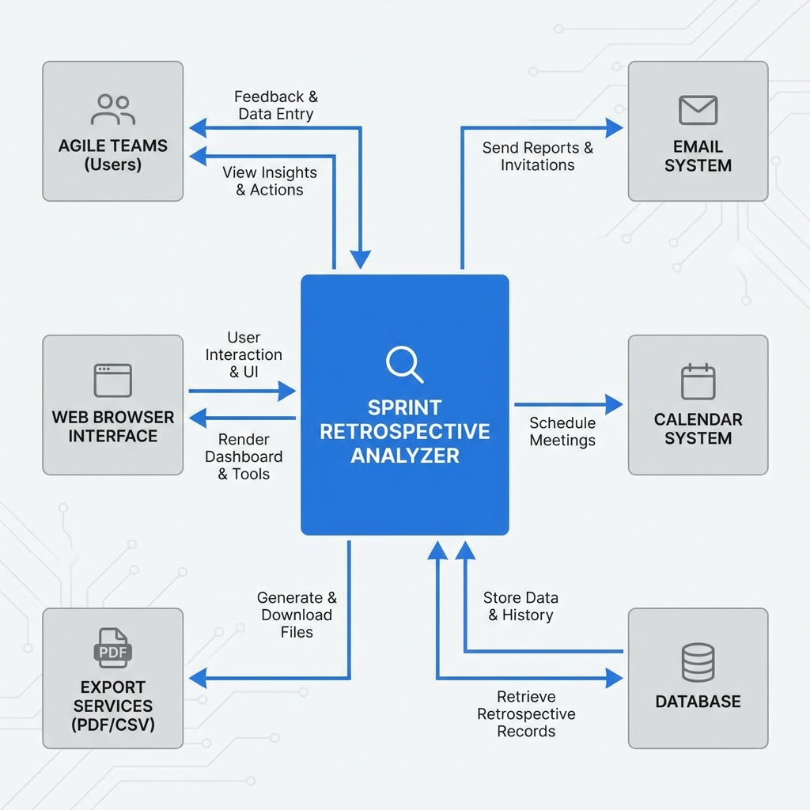
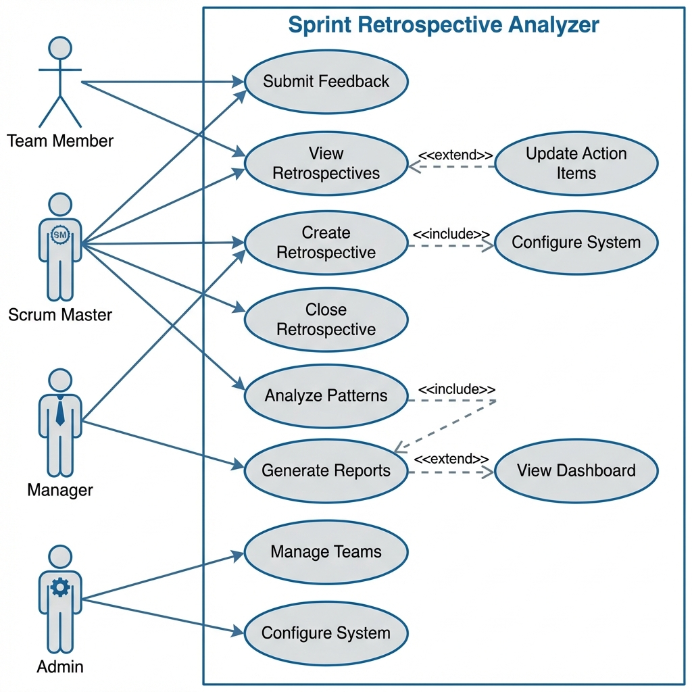

# Complete Software Requirements Specification (SRS)
## Sprint Retrospective Analyzer

**Document Version:** 1.0  
**Date:** January 27, 2026  
**Project:** Sprint Retrospective Analyzer  
**Project Code:** SRA-2026-001

---

## Table of Contents

1. [Introduction](#1-introduction)
2. [Overall Description](#2-overall-description)
3. [System Features](#3-system-features)
4. [External Interface Requirements](#4-external-interface-requirements)
5. [Non-Functional Requirements](#5-non-functional-requirements)
6. [Other Requirements](#6-other-requirements)
7. [Appendices](#7-appendices)

---

## 1. Introduction

### 1.1 Purpose

This Software Requirements Specification (SRS) provides a complete description of all functions and specifications for the Sprint Retrospective Analyzer. This document is intended for stakeholders including the development team, quality assurance, project managers, and end users. It serves as the contractual basis for development and acceptance testing.

**For complete introduction details, please refer to:**  
[10_SRS_Introduction_Section.md](file:///C:/Users/AKSHOB%20DHIRA/SEAD-PROJECT-sprintrunner/10_SRS_Introduction_Section.md)

### 1.2 Document Scope

The Sprint Retrospective Analyzer is a web-based platform enabling Agile teams to:
- Capture structured retrospective feedback
- Automatically identify patterns and recurring issues
- Track action items and measure their effectiveness
- Visualize team health trends over time
- Generate data-driven reports

**Target Users:** Agile development teams (5-15 members), Scrum Masters, Engineering Managers  
**Deployment:** Cloud-based (AWS/Azure)  
**Scale:** Support 50 teams simultaneously (Phase 1)

### 1.3 Definitions, Acronyms, and Abbreviations

**For comprehensive definitions and acronyms, please refer to:**  
[15_Glossary.md](file:///C:/Users/AKSHOB%20DHIRA/SEAD-PROJECT-sprintrunner/15_Glossary.md)

**Key Terms:**
- **Retrospective**: Agile ceremony for team reflection and improvement
- **Sprint**: Time-boxed iteration (1-4 weeks) in Agile development
- **Action Item**: Specific task to address identified issue
- **Pattern**: Recurring theme across multiple retrospectives
- **Recurring Issue**: Problem mentioned in 3+ consecutive sprints

### 1.4 References

| **Document** | **Location** |
|--------------|--------------|
| Project Charter | [16_Project_Charter.md](file:///C:/Users/AKSHOB%20DHIRA/SEAD-PROJECT-sprintrunner/16_Project_Charter.md) |
| Stakeholder Register | [17_Stakeholder_Register.md](file:///C:/Users/AKSHOB%20DHIRA/SEAD-PROJECT-sprintrunner/17_Stakeholder_Register.md) |
| Scope Boundaries | [09_Scope_Boundaries_Document.md](file:///C:/Users/AKSHOB%20DHIRA/SEAD-PROJECT-sprintrunner/09_Scope_Boundaries_Document.md) |
| Use Case Diagrams | [14_Use_Case_Diagrams.md](file:///C:/Users/AKSHOB%20DHIRA/SEAD-PROJECT-sprintrunner/14_Use_Case_Diagrams.md) |

---

## 2. Overall Description

### 2.1 Product Perspective

The Sprint Retrospective Analyzer is a standalone web-based system that integrates into existing Agile workflows. It interfaces with email systems, calendar services, and web browsers while maintaining independence from project management tools.

**For detailed product perspective, user characteristics, and system context, please refer to:**  
[11_SRS_Overall_Description.md](file:///C:/Users/AKSHOB%20DHIRA/SEAD-PROJECT-sprintrunner/11_SRS_Overall_Description.md)

#### System Context Diagram



### 2.2 Product Functions

**High-Level Feature Summary:**

1. **User & Team Management**
   - User registration, authentication, role-based access control
   - Team creation and member management

2. **Retrospective Management**
   - Create and manage sprint retrospectives
   - Structured feedback submission (What went well, What didn't, Actions)
   - Close retrospectives to finalize and trigger analysis

3. **Pattern Analysis & Intelligence**
   - Automated keyword extraction
   - Recurring issue detection (3+ sprints)
   - Sentiment analysis
   - Trend visualization over time

4. **Action Item Tracking**
   - Create action items linked to feedback
   - Status workflow (Open → In Progress → Done → Verified)
   - Effectiveness tracking (did action resolve the issue?)

5. **Reporting & Dashboards**
   - Customizable team dashboard with key metrics
   - PDF/CSV report generation
   - Cross-team analytics (for managers)

6. **Notifications & Integration**
   - Email notifications for key events
   - Calendar integration for sprint schedules
   - Data export capabilities

### 2.3 User Characteristics

**Primary User Personas:**

| **Persona** | **Technical Skill** | **Domain Expertise** | **Primary Goals** |
|-------------|---------------------|----------------------|-------------------|
| **Team Member** | High | Expert (Agile) | Quick feedback submission, track actions |
| **Scrum Master** | Medium-High | Expert (Agile) | Facilitate retrospectives, identify patterns |
| **Manager** | Medium | Advanced (Agile) | Team health insights, evidence-based decisions |
| **Admin** | High | Intermediate | System configuration, user management |

### 2.4 Constraints

**Technical Constraints:**
- Must use React.js (frontend), Node.js (backend), PostgreSQL (database)
- Maximum 500 concurrent users (Phase 1)
- Cloud deployment on AWS or Azure only
- TLS 1.2+ encryption required

**Regulatory Constraints:**
- GDPR compliance (European users)
- CCPA compliance (California users)
- WCAG 2.1 Level AA accessibility

**Budget & Timeline:**
- Total budget: $150,000
- Go-live deadline: June 15, 2026

### 2.5 Assumptions and Dependencies

**For detailed assumptions and dependencies, refer to:**  
[16_Project_Charter.md](file:///C:/Users/AKSHOB%20DHIRA/SEAD-PROJECT-sprintrunner/16_Project_Charter.md) (Section 9)

**Key Assumptions:**
- Users have modern browsers and stable internet
- Teams practice Agile with regular retrospectives
- Email addresses available for all users

---

## 3. System Features

### 3.1 Functional Requirements Summary

**For complete functional requirements (FR-01 through FR-24) with detailed acceptance criteria, please refer to:**  
[12_Functional_Requirements_Documentation.md](file:///C:/Users/AKSHOB%20DHIRA/SEAD-PROJECT-sprintrunner/12_Functional_Requirements_Documentation.md)

#### Functional Requirements by Category

**User Management (FR-01 to FR-04):**
- FR-01: User Registration
- FR-02: User Login
- FR-03: Password Reset
- FR-04: Role-Based Access Control (RBAC)

**Retrospective Management (FR-05 to FR-08):**
- FR-05: Create Retrospective
- FR-06: Submit Feedback
- FR-07: Close Retrospective
- FR-08: View Retrospective History

**Pattern Analysis (FR-09 to FR-12):**
- FR-09: Automated Keyword Extraction
- FR-10: Recurring Issue Detection
- FR-11: Sentiment Analysis
- FR-12: Trend Visualization

**Action Item Management (FR-13 to FR-15):**
- FR-13: Create Action Item
- FR-14: Update Action Item Status
- FR-15: Action Item Effectiveness Tracking

**Reporting & Dashboard (FR-16 to FR-18):**
- FR-16: Team Dashboard
- FR-17: Generate Reports
- FR-18: Search Functionality

**Team Management (FR-19 to FR-20):**
- FR-19: Create Team
- FR-20: Manage Team Members

**Notifications (FR-21 to FR-22):**
- FR-21: Email Notifications
- FR-22: In-App Notifications

**Data Export & Integration (FR-23 to FR-24):**
- FR-23: Export Retrospective Data
- FR-24: Calendar Integration

---

## 4. External Interface Requirements

### 4.1 User Interfaces

**UI Design Principles:**
- Clean, modern, responsive design
- Consistent color scheme (primary: blue, secondary: gray)
- Maximum 3 clicks to any feature
- Mobile-responsive (desktop, tablet, limited mobile)

**Key UI Screens:**
1. **Login/Registration** - Simple authentication
2. **Dashboard** - Customizable widgets, team metrics
3. **Retrospective Entry** - Three-column layout (Went Well, Didn't Go Well, Actions)
4. **Action Item Board** - Kanban-style status tracking
5. **Analytics** - Charts, graphs, trend lines
6. **Reports** - Export preview and generation
7. **Admin Panel** - User/team management

**Accessibility:**
- WCAG 2.1 Level AA compliance
- Keyboard navigation support
- Screen reader compatible
- Color contrast ratios ≥ 4.5:1

### 4.2 Hardware Interfaces

**Client Side:**
- Minimum screen resolution: 1280x720
- Recommended: 1920x1080
- Stable internet connection (≥ 1 Mbps)

**Server Side:**
- Cloud infrastructure (AWS EC2 or Azure VMs)
- Load balancers for traffic distribution
- Database servers with replication

### 4.3 Software Interfaces

#### Frontend
- **Technology:** React.js 18+
- **Browser Support:** Chrome 90+, Firefox 88+, Safari 14+, Edge 90+
- **State Management:** Redux or Context API
- **HTTP Client:** Axios

#### Backend
- **Technology:** Node.js 18 LTS+, Express.js
- **Database:** PostgreSQL 14+
- **ORM:** Sequelize or Prisma
- **Authentication:** JWT (JSON Web Tokens)

#### External Services
- **Email:** SMTP (SendGrid, AWS SES)
- **Calendar:** iCal/CalDAV protocols
- **Cloud Services:** AWS S3 (file storage), CloudWatch (monitoring)

### 4.4 Communication Interfaces

**Protocols:**
- **HTTP/HTTPS:** RESTful API communication (TLS 1.2+)
- **SMTP:** Email delivery
- **WebSocket:** Real-time notifications (optional Phase 2)

**API Design:**
- RESTful architecture
- JSON request/response format
- OAuth 2.0 / JWT authentication
- Rate limiting: 1000 requests/hour per user

---

## 5. Non-Functional Requirements

**For complete non-functional requirements (NFR-01 through NFR-24) with detailed acceptance criteria, please refer to:**  
[13_Non_Functional_Requirements_Documentation.md](file:///C:/Users/AKSHOB%20DHIRA/SEAD-PROJECT-sprintrunner/13_Non_Functional_Requirements_Documentation.md)

### 5.1 Performance Requirements Summary

| **Metric** | **Target** |
|------------|-----------|
| Page Load Time | < 2 seconds |
| API Response Time (95th percentile) | < 500ms |
| Concurrent Users | 500 |
| Database Query Time | < 200ms |
| Report Generation | < 10 seconds |

### 5.2 Security Requirements Summary

- **Authentication:** bcrypt password hashing (work factor ≥ 12)
- **Encryption in Transit:** TLS 1.2+
- **Encryption at Rest:** AES-256
- **RBAC:** Four roles (Team Member, Scrum Master, Manager, Admin)
- **Session Management:** 30-minute timeout
- **Account Lockout:** 5 failed attempts = 15-minute lockout

### 5.3 Reliability Requirements Summary

- **Uptime:** 99.5% (≈ 3.7 hours downtime/month)
- **Backups:** Daily automated backups (30-day retention)
- **RTO (Recovery Time Objective):** < 4 hours
- **RPO (Recovery Point Objective):** < 24 hours
- **Fault Tolerance:** Multi-zone deployment, automatic failover

### 5.4 Usability Requirements Summary

- **Training Time:** < 30 minutes for basic use
- **Accessibility:** WCAG 2.1 Level AA compliance
- **User Satisfaction:** ≥ 4.0/5.0 SUS score
- **Mobile Responsive:** Desktop, tablet, limited mobile support

### 5.5 Scalability Requirements Summary

| **Metric** | **Phase 1** | **Phase 2** | **Phase 3** |
|------------|-------------|-------------|-------------|
| Teams | 50 | 200 | 1,000 |
| Users | 500 | 2,000 | 10,000 |
| Retrospectives | 10,000 | 50,000 | 250,000 |

---

## 6. Other Requirements

### 6.1 Legal Requirements

**Data Privacy:**
- GDPR Article 17: Right to deletion (hard delete within 30 days)
- GDPR Article 20: Right to data portability (machine-readable export)
- CCPA Section 1798.105: Consumer right to delete
- Data processing agreements available for enterprise users

**Terms of Service:**
- User consent required before data collection
- Cookie policy and consent management
- Privacy policy accessible and clear

### 6.2 Database Requirements

**Database Schema (High-Level):**

```sql
-- Core tables
users (id, email, password_hash, name, role, created_at)
teams (id, name, description, scrum_master_id, created_at)
team_members (team_id, user_id, joined_at)
retrospectives (id, team_id, sprint_number, start_date, end_date, status)
feedback (id, retrospective_id, user_id, category, text, anonymous, created_at)
action_items (id, retrospective_id, title, description, assignee_id, status, due_date)
keywords (id, retrospective_id, keyword, frequency)
patterns (id, team_id, issue_text, first_seen, last_seen, occurrence_count)
```

**Data Retention:**
- Active retrospectives: Indefinite (user-controlled)
- Deleted retrospectives: Soft delete with 30-day recovery window
- User data: Deleted within 30 days of account deletion request

### 6.3 Internationalization

**Phase 1:**
- English only (US/UK)
- Date format: Configurable (MM/DD/YYYY or DD/MM/YYYY)
- Time zone support: User-selectable

**Phase 2+ (Future):**
- Multi-language support (Spanish, French, German)
- Locale-aware formatting

---

## 7. Appendices

### Appendix A: Use Case Diagrams

**For comprehensive use case diagrams and scenarios, refer to:**  
[14_Use_Case_Diagrams.md](file:///C:/Users/AKSHOB%20DHIRA/SEAD-PROJECT-sprintrunner/14_Use_Case_Diagrams.md)



### Appendix B: Glossary

**For complete glossary (100+ terms), refer to:**  
[15_Glossary.md](file:///C:/Users/AKSHOB%20DHIRA/SEAD-PROJECT-sprintrunner/15_Glossary.md)

### Appendix C: Requirements Traceability Matrix

| **Requirement ID** | **Priority** | **Use Case** | **Test Case** | **Status** |
|--------------------|-------------|--------------|---------------|------------|
| FR-01 | P1 | UC-Register | TC-001 | Draft |
| FR-02 | P1 | UC-Login | TC-002 | Draft |
| FR-05 | P1 | UC-04 | TC-010 | Draft |
| FR-06 | P1 | UC-01 | TC-011 | Draft |
| FR-10 | P1 | UC-06 | TC-020 | Draft |
| ... | ... | ... | ... | ... |

### Appendix D: Revision History

| **Version** | **Date** | **Author** | **Description** |
|-------------|----------|------------|-----------------|
| 0.1 | Jan 15, 2026 | Requirements Team | Initial draft |
| 0.5 | Jan 22, 2026 | Requirements Team | Stakeholder feedback incorporated |
| 1.0 | Jan 27, 2026 | Requirements Team | Final approved version |

---

## Document Approval

### Sign-Off

This SRS document has been reviewed and approved by the following stakeholders:

| **Role** | **Name** | **Signature** | **Date** |
|----------|----------|---------------|----------|
| **Project Sponsor** | _______________ | _______________ | _______ |
| **Product Owner** | _______________ | _______________ | _______ |
| **Development Lead** | _______________ | _______________ | _______ |
| **QA Lead** | _______________ | _______________ | _______ |
| **Scrum Master Representative** | _______________ | _______________ | _______ |

---

**Document Control:**
- **Created By:** Requirements Analysis Team
- **Last Updated:** January 27, 2026
- **Status:** Final - Awaiting Approval
- **Next Review:** Post-Implementation (July 2026)
- **Version:** 1.0
- **Distribution:** All Project Stakeholders
- **Confidentiality:** Internal Use Only

---

## Summary Statistics

- **Total Functional Requirements:** 24 (FR-01 to FR-24)
- **Total Non-Functional Requirements:** 24 (NFR-01 to NFR-24)
- **Total Use Cases:** 10 primary use cases
- **P1 (High Priority) Requirements:** 18
- **P2 (Medium Priority) Requirements:** 30
- **Total Pages:** 12 (including appendices)
- **Reference Documents:** 6 supporting documents

---

**END OF SOFTWARE REQUIREMENTS SPECIFICATION**
