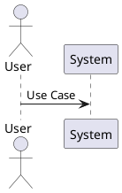

# CASE Tool Setup & Configuration Guide
## Sprint Retrospective Analyzer - System Design

**Document Version:** 1.0  
**Date:** January 27, 2026  
**Project:** Sprint Retrospective Analyzer

---

## 1. Introduction

This document provides comprehensive guidance for setting up Computer-Aided Software Engineering (CASE) tools for the Sprint Retrospective Analyzer project. CASE tools enable visual modeling, design documentation, and collaborative system design.

---

## 2. Recommended CASE Tools

### 2.1 Primary Tool: Visual Paradigm

**License:** Community Edition (Free) or Professional ($99/user)  
**Download:** https://www.visual-paradigm.com/download/

**Features:**
- ✅ UML diagram support (use case, class, sequence, activity, component, deployment)
- ✅ Database design tools (ERD diagrams)
- ✅ Team collaboration features
- ✅ Export to PNG, PDF, SVG
- ✅ Version control integration (Git)

**System Requirements:**
- **OS:** Windows 10+, macOS 10.14+, Linux
- **RAM:** 4GB minimum, 8GB recommended
- **Disk Space:** 2GB
- **Java:** JRE 8 or above

---

### 2.2 Alternative Tool: StarUML

**License:** Trial (Free 15 days) or License ($99 one-time)  
**Download:** https://staruml.io/download

**Features:**
- ✅ UML 2.0 standard support
- ✅ Clean, modern interface
- ✅ Export to image formats
- ✅ Extension marketplace
- ✅ Lightweight and fast

**System Requirements:**
- **OS:** Windows 7+, macOS 10.9+, Linux
- **RAM:** 4GB minimum
- **Disk Space:** 500MB

---

### 2.3 Free Open-Source Options

#### PlantUML (Text-based diagrams)
- **Website:** https://plantuml.com/
- **Pros:** Version control friendly (plain text), free, fast
- **Cons:** Steeper learning curve, limited  visual editing

#### Draw.io (now diagrams.net)
- **Website:** https://app.diagrams.net/
- **Pros:** Completely free, web-based, no installation
- **Cons:** Not UML-specific, less advanced features

---

## 3. Installation Instructions

### 3.1 Visual Paradigm Installation (Windows)

**Step 1: Download**
```powershell
# Open browser and navigate to:
https://www.visual-paradigm.com/download/community.jsp
# Download Visual Paradigm Community Edition (Windows 64-bit)
```

**Step 2: Install**
1. Run the downloaded installer (`Visual_Paradigm_CE_Win64_17_1.exe`)
2. Follow installation wizard:
   - Accept license agreement
   - Choose installation directory (default: `C:\Program Files\Visual Paradigm CE`)
   - Select components (all recommended)
   - Create desktop shortcut

**Step 3: Launch and Activate**
1. Launch Visual Paradigm CE
2. For Community Edition, no license key needed
3. For Professional Edition, enter license key when prompted

**Step 4: Configure**
1. Go to **Tools > Options**
2. Set diagram preferences:
   - Default font: Arial, size 11
   - Color scheme: Light (for better printing)
   - Auto-save: Every 5 minutes

---

### 3.2 StarUML Installation (Windows)

**Step 1: Download**
```powershell
# Navigate to:
https://staruml.io/download
# Download StarUML for Windows (64-bit)
```

**Step 2: Install**
1. Run installer (`StarUML-Setup-5.0.1.exe`)
2. Follow installation steps:
   - Accept license
   - Choose install location
   - Create shortcuts

**Step 3: License Activation**
1. Launch StarUML
2. Enter license key (if purchased) or use trial mode
3. Trial allows 15 days full access

---

### 3.3 PlantUML Setup (Text-based, recommended for version control)

**Step 1: Install Graphviz (required dependency)**
```powershell
# Download from:
https://graphviz.org/download/
# Install Graphviz-2.50.0-win64.exe
```

**Step 2: Install PlantUML extension in VS Code**
1. Open Visual Studio Code
2. Go to Extensions (Ctrl+Shift+X)
3. Search for "PlantUML"
4. Install "PlantUML" by jebbs

**Step 3: Configure**
1. Open VS Code settings (Ctrl+,)
2. Search for "plantuml"
3. Verify Graphviz path is detected automatically

**Step 4: Test**


---

## 4. Team Workspace Setup

### 4.1 Project Creation in Visual Paradigm

**Step 1: Create New Project**
1. Launch Visual Paradigm
2. Click **File > New Project**
3. Enter project details:
   - **Name:** Sprint Retrospective Analyzer
   - **Author:** [Your Team Name]
   - **Description:** Agile retrospective intelligence system
   - **Location:** `C:\Projects\SprintRetrospectiveAnalyzer`

**Step 2: Configure Project Structure**
1. Right-click project root in **Model Explorer**
2. Create folder structure:
   ```
   Sprint Retrospective Analyzer/
   ├── Use Case Model/
   ├── Class Model/
   ├── Sequence Diagrams/
   ├── Activity Diagrams/
   ├── Component Diagrams/
   ├── Deployment Diagrams/
   └── Database Design/
   ```

**Step 3: Set Up Diagram Templates**
1. Go to **Tools > Options > Diagram**
2. Set default styles:
   - **Background:** White
   - **Grid:** Enabled (10x10 pixels)
   - **Snap to Grid:** Enabled

---

### 4.2 Team Collaboration Setup

#### Option 1: Visual Paradigm Cloud (Recommended)

1. **Create Team Workspace**
   - Go to **Team > Teamwork Server**
   - Create account at https://cloud.visual-paradigm.com
   - Create workspace: "SRAProject2026"

2. **Invite Team Members**
   - Click **Manage Members**
   - Add team emails
   - Assign roles (Admin, Editor, Viewer)

3. **Enable Version Control**
   - **Team > Check Out Project**
   - Commit changes regularly
   - View change history

#### Option 2: Git Integration (For advanced teams)

1. **Initialize Git Repository**
   ```powershell
   cd C:\Projects\SprintRetrospectiveAnalyzer
   git init
   ```

2. **Configure VP for Git**
   - Go to **Tools > Version Control > Git**
   - Set repository path
   - Configure commit settings

3. **Create .gitignore**
   ```
   *.lock
   *.tmp
   *.bak
   ~$*.vpp
   ```

---

## 5. Diagram Standards and Conventions

### 5.1 Naming Conventions

| **Element** | **Convention** | **Example** |
|-------------|----------------|-------------|
| **Actors** | Noun, Title Case | Team Member, Scrum Master |
| **Use Cases** | Verb + Noun | Create Retrospective, Submit Feedback |
| **Classes** | Noun, PascalCase | User, Retrospective, ActionItem |
| **Methods** | verb, camelCase | createRetrospective(), submitFeedback() |
| **Attributes** | noun, camelCase | userId, retrospectiveId, createdAt |

### 5.2 Color Coding

| **Element** | **Color** | **Hex Code** |
|-------------|-----------|--------------|
| **Actors** | Light Blue | #A3C1DA |
| **Use Cases** | Light Gray | #E0E0E0 |
| **Classes (Entity)** | Light Green | #C8E6C9 |
| **Classes (Control)** | Light Orange | #FFE0B2 |
| **Classes (Boundary)** | Light Purple | #E1BEE7 |
| **Database Tables** | Light Yellow | #FFF9C4 |

### 5.3 Stereotypes

```
<<Actor>>       - External entity
<<Controller>>  - Business logic class
<<Entity>>      - Domain model class
<<Boundary>>    - UI/API interface class
<<include>>     - Required dependency
<<extend>>      - Optional extension
```

---

## 6. Project Structure in CASE Tool

### 6.1 Recommended Folder Organization

```
Sprint Retrospective Analyzer/
│
├── 01_Use_Case_Model/
│   ├── Main_Use_Case_Diagram.vpd
│   ├── Retrospective_Management_UC.vpd
│   ├── Action_Item_Management_UC.vpd
│   └── Analytics_Reporting_UC.vpd
│
├── 02_Class_Diagrams/
│   ├── Domain_Model.vpd
│   ├── User_Management_Classes.vpd
│   ├── Retrospective_Classes.vpd
│   └── Analysis_Classes.vpd
│
├── 03_Sequence_Diagrams/
│   ├── Submit_Feedback_Sequence.vpd
│   ├── Close_Retrospective_Sequence.vpd
│   ├── Pattern_Analysis_Sequence.vpd
│   └── Generate_Report_Sequence.vpd
│
├── 04_Activity_Diagrams/
│   ├── Retrospective_Workflow.vpd
│   └── Action_Item_Workflow.vpd
│
├── 05_Component_Diagrams/
│   └── System_Architecture.vpd
│
├── 06_Deployment_Diagrams/
│   └── Cloud_Deployment.vpd
│
└── 07_Database_Design/
    └── ERD_Diagram.vpd
```

---

## 7. Export and Documentation

### 7.1 Export Settings

**For Presentations (high quality):**
- Format: PNG
- Resolution: 300 DPI
- Size: 1920x1080

**For Documentation (medium quality):**
- Format: PNG or SVG
- Resolution: 150 DPI
- Size: 1280x720

**For Version Control (text-based):**
- Format: PlantUML (.puml)
- Version: UTF-8 encoding

### 7.2 Export Steps in Visual Paradigm

1. Open diagram
2. **File > Export > Active Diagram as Image**
3. Select format (PNG, SVG, PDF)
4. Choose resolution and output directory
5. Click **Export**

---

## 8. Tips and Best Practices

### 8.1 Performance Optimization

- **Auto-save**: Enable with 5-minute intervals
- **Large Projects**: Split into multiple diagram files
- **Rendering**: Close unused diagrams to improve performance
- **Backups**: Enable daily automatic backups

### 8.2 Collaboration Best Practices

- **Commit frequently**: Daily or after major changes
- **Descriptive commit messages**: "Added sequence diagram for pattern analysis"
- **Review diagrams**: Peer review before finalizing
- **Version tags**: Tag release versions (v1.0, v2.0)

### 8.3 Common Pitfalls to Avoid

- ❌ Overly complex diagrams (keep to 10-15 elements max)
- ❌ Inconsistent naming conventions
- ❌ Missing relationships between elements
- ❌ No legend or key for symbols
- ❌ Forgetting to save/commit changes

---

## 9. Quick Reference Commands

### Visual Paradigm Shortcuts

| **Action** | **Shortcut** |
|------------|--------------|
| New Diagram | Ctrl+N |
| Save | Ctrl+S |
| Undo | Ctrl+Z |
| Redo | Ctrl+Y |
| Zoom In | Ctrl++ |
| Zoom Out | Ctrl+- |
| Align Left | Ctrl+Shift+L |
| Auto Layout | Ctrl+Shift+A |
| Export Diagram | Ctrl+E |

---

## 10. Troubleshooting

### Issue 1: "Cannot find Java Runtime"

**Solution:**
1. Download and install Java JRE 8+
2. Set JAVA_HOME environment variable
```powershell
setx JAVA_HOME "C:\Program Files\Java\jre1.8.0_351"
```

### Issue 2: "License activation failed"

**Solution:**
1. Verify internet connection
2. Check firewall settings (allow VP to connect)
3. Contact support@visual-paradigm.com

### Issue 3: "Diagram export fails"

**Solution:**
1. Check write permissions on output directory
2. Close diagram and reopen
3. Try different export format

---

## 11. Training Resources

### Official Documentation
- **Visual Paradigm Tutorials:** https://www.visual-paradigm.com/tutorials/
- **StarUML Guide:** https://docs.staruml.io/
- **PlantUML Documentation:** https://plantuml.com/guide

### Video Tutorials
- YouTube: "Visual Paradigm for Beginners"
- LinkedIn Learning: "UML Diagrams with CASE Tools"

### Team Training Plan
- **Week 1:** Tool installation and basic navigation (2 hours)
- **Week 2:** Use case and class diagram creation (3 hours)
- **Week 3:** Sequence and activity diagrams (3 hours)
- **Week 4:** Advanced features and collaboration (2 hours)

---

**Document Control:**
- **Created By:** System Design Team
- **Last Updated:** January 27, 2026
- **Status:** Final
- **Next Review:** March 27, 2026
- **Version:** 1.0
