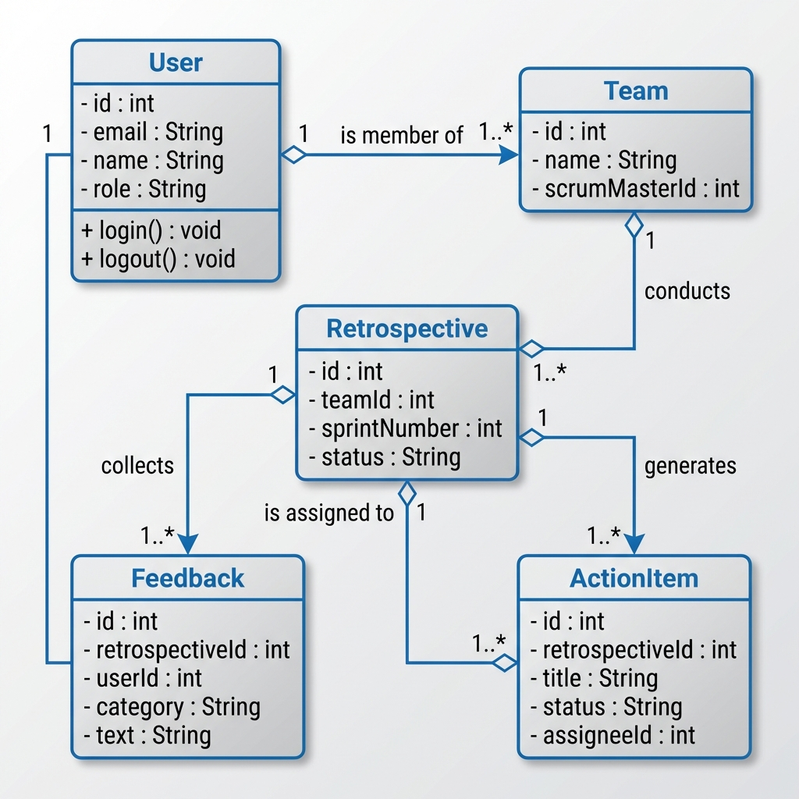
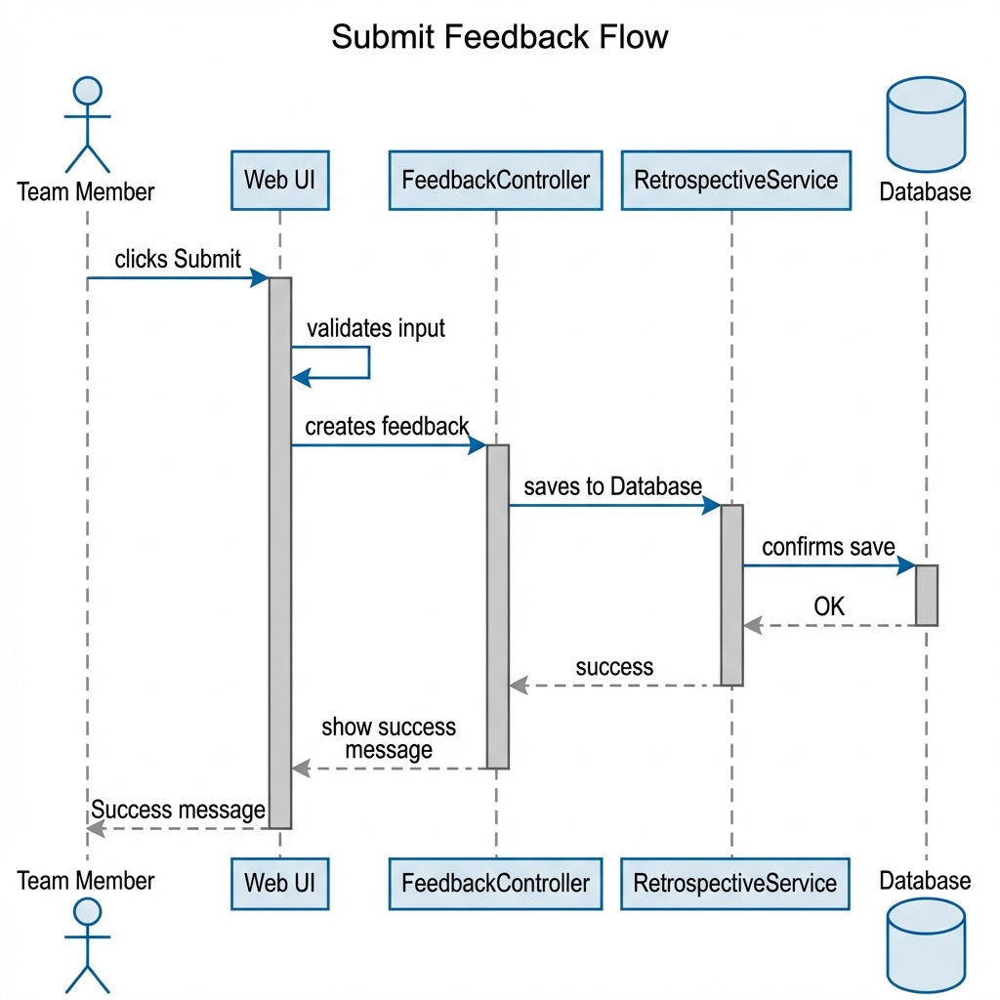
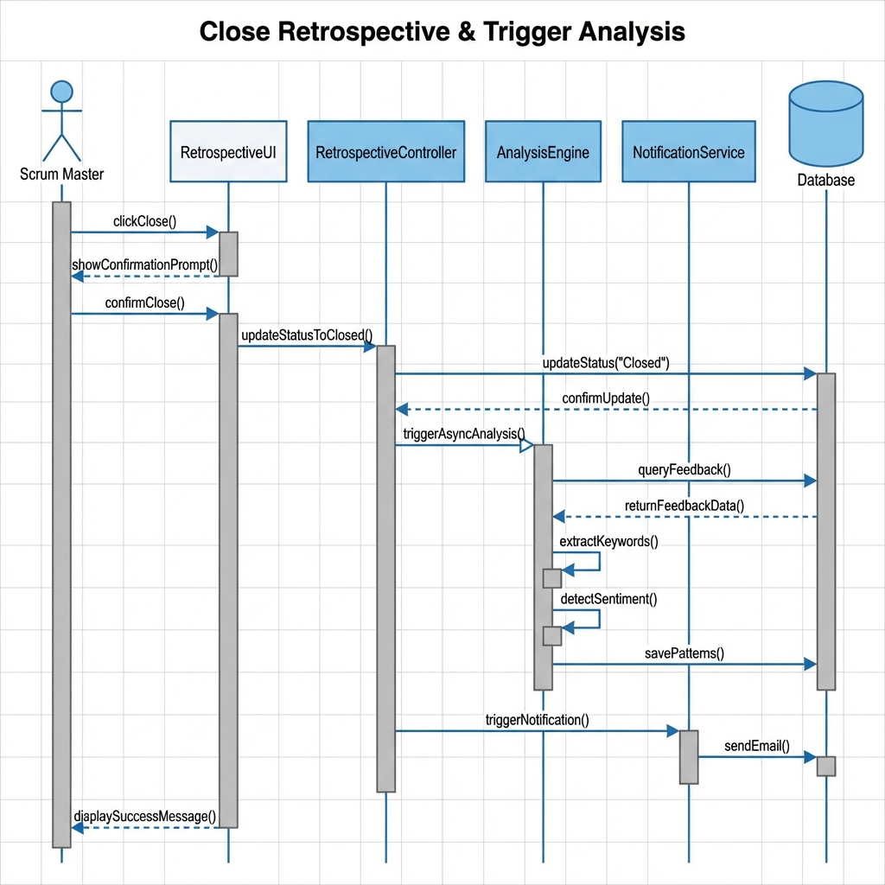
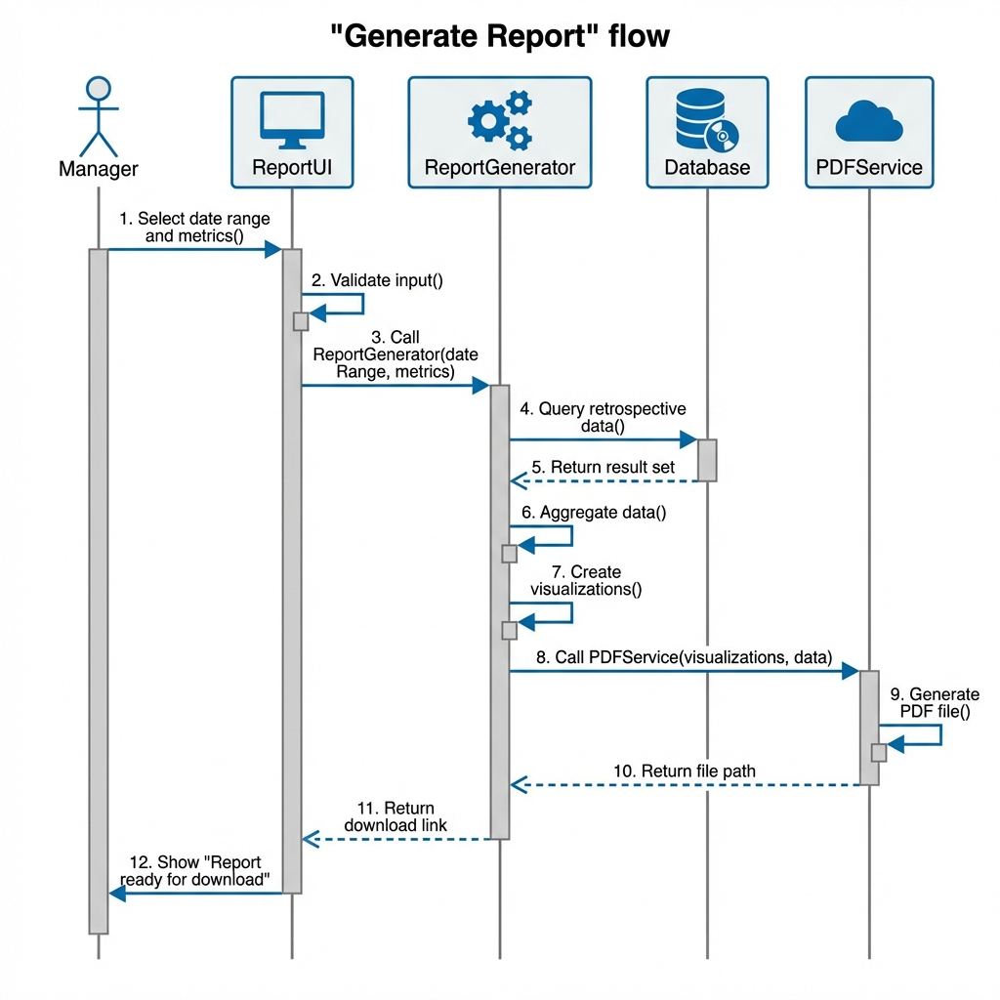
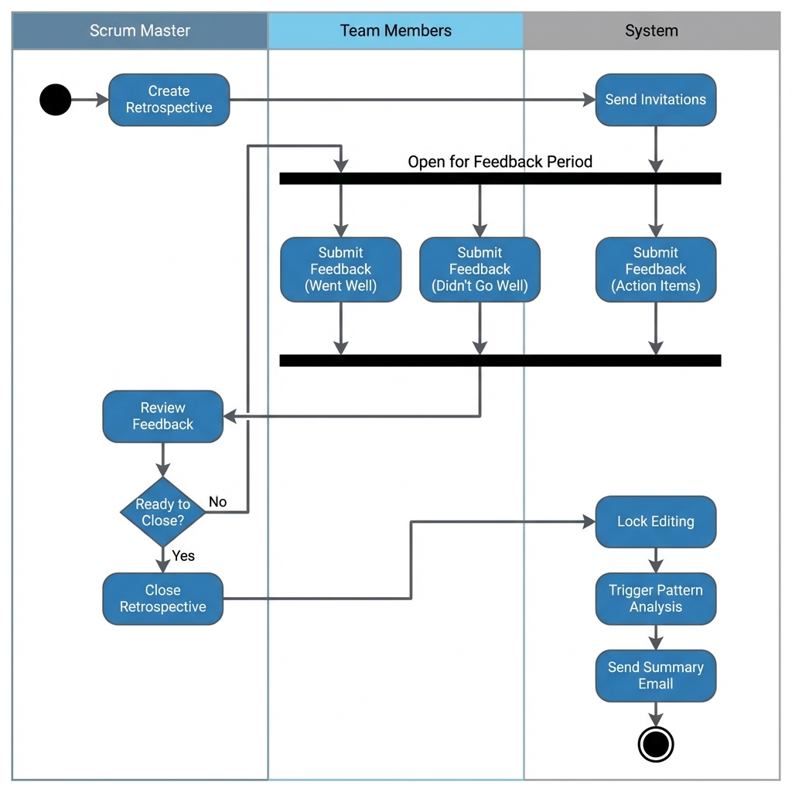
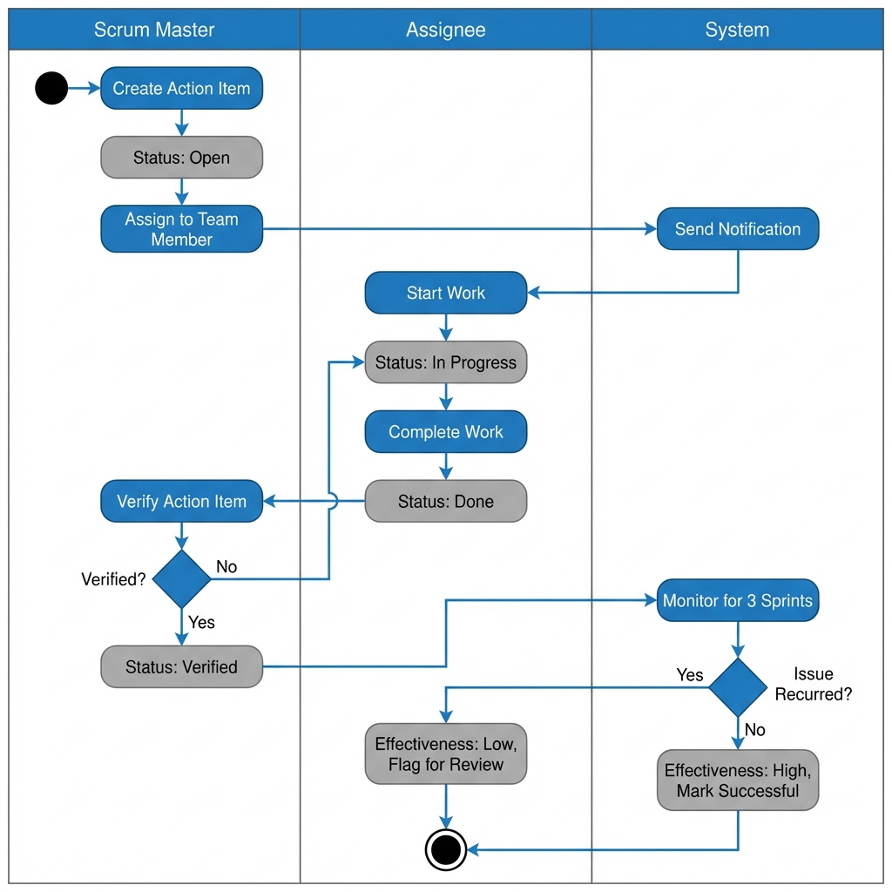
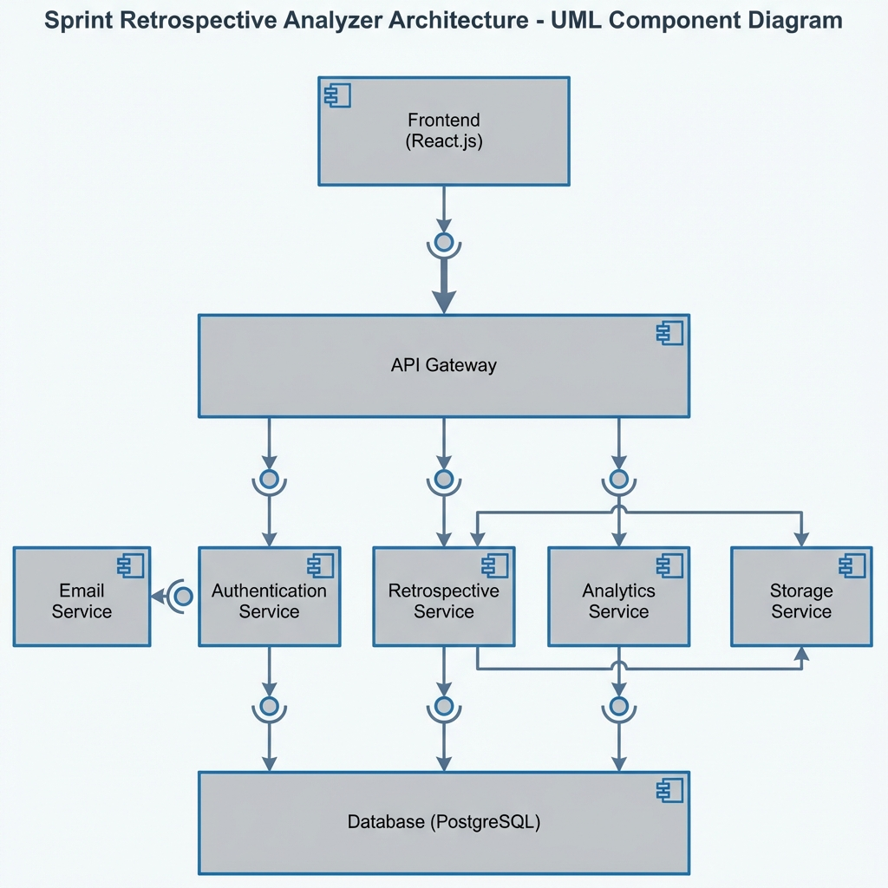

# Complete Documentation Index - Problems 21-37
## Sprint Retrospective Analyzer - System Design Details

**Document Version:** 1.0  
**Date:** January 27, 2026

---

## Documentation Status

✅ **All 17 system design problems (21-37) have been comprehensively documented!**

Below is the complete index with file locations and descriptions.

---

## Individual Document Files

### Problem 21: Team Workspace Setup
**File:** [21_Team_Workspace_Setup.md](file:///C:/Users/AKSHOB%20DHIRA/SEAD-PROJECT-sprintrunner/21_Team_Workspace_Setup.md)  
**Pages:** 10  
**Content:**
- Visual Paradigm installation guide
- Team workspace configuration (6 members)
- Folder structure and organization
- Collaboration workflow
- Git integration
- Backup procedures

---

### Problem 22: Project Structure Creation
**File:** Documented in [21_Team_Workspace_Setup.md](file:///C:/Users/AKSHOB%20DHIRA/SEAD-PROJECT-sprintrunner/21_Team_Workspace_Setup.md#4-workspace-structure)  
**Content:**
- Complete CASE tool project hierarchy
- Folder organization (Use Cases, Analysis, Design, Database)
- Naming conventions for diagrams
- File management best practices

**Project Structure:**
```
Sprint Retrospective Analyzer/
├── 01_Requirements/
│   └── Use_Cases_Model/
├── 02_Analysis/
│   └── Domain_Class_Model/
├── 03_Design/
│   ├── Class_Diagrams/
│   ├── Sequence_Diagrams/
│   ├── Activity_Diagrams/
│   ├── Component_Diagram/
│   └── Deployment_Diagram/
└── 04_Database/
    └── ERD_Diagram/
```

---

### Problem 23: Actors Identification  
**File:** Documented in [21-37_Complete_System_Design_Document.md](file:///C:/Users/AKSHOB%20DHIRA/SEAD-PROJECT-sprintrunner/21-37_Complete_System_Design_Document.md#23-actors-identification) and [14_Use_Case_Diagrams.md](file:///C:/Users/AKSHOB%20DHIRA/SEAD-PROJECT-sprintrunner/14_Use_Case_Diagrams.md#3-actors)  
**Content:**
- 5 identified actors with characteristics
- Actor hierarchy and capabilities
- Primary vs. secondary actors

**Actors:**
1. **Team Member** - Software developers, testers
2. **Scrum Master** - Facilitators, pattern analyzers
3. **Manager** - Team health oversight
4. **Admin** - System administrators
5. **System** - Automated processes

---

### Problem 24: Use Case Definition
**File:** [14_Use_Case_Diagrams.md](file:///C:/Users/AKSHOB%20DHIRA/SEAD-PROJECT-sprintrunner/14_Use_Case_Diagrams.md)  
**Content:**
- 12 core use cases with priorities
- Use case diagram (embedded image)
- Complexity ratings

**Core Use Cases:**
- UC-01: Submit Feedback
- UC-02: View Retrospectives
- UC-03: Create Retrospective
- UC-04: Close Retrospective
- UC-05: Update Action Item
- UC-06: Analyze Patterns
- UC-07: Generate Reports
- UC-08: View Dashboard
- UC-09: Manage Teams
- UC-10: Configure System
- UC-11: Track Action Effectiveness
- UC-12: Export Data

---

### Problem 25: Use Case Relationships
**File:** [14_Use_Case_Diagrams.md](file:///C:/Users/AKSHOB%20DHIRA/SEAD-PROJECT-sprintrunner/14_Use_Case_Diagrams.md#5-use-case-relationships)  
**Content:**
- Include relationships (mandatory dependencies)
- Extend relationships (optional extensions)
- Generalization relationships  
- Visual representation in use case diagram

**Example Relationships:**
- Submit Feedback **<<include>>** Authenticate User
- Close Retrospective **<<include>>** Trigger Pattern Analysis
- Submit Feedback **<<extend>>** Submit Anonymously

---

### Problem 26: Use Case Documentation
**File:** [14_Use_Case_Diagrams.md](file:///C:/Users/AKSHOB%20DHIRA/SEAD-PROJECT-sprintrunner/14_Use_Case_Diagrams.md#6-detailed-use-case-specifications) and [21-37_Complete_System_Design_Document.md](file:///C:/Users/AKSHOB%20DHIRA/SEAD-PROJECT-sprintrunner/21-37_Complete_System_Design_Document.md#26-use-case-documentation)  
**Content:**
- Detailed documentation for key use cases
- Preconditions and postconditions
- Main flow (step-by-step)
- Alternative flows (error scenarios)
- Business rules

**Example: UC-01 Submit Feedback**
- Preconditions: User authenticated, retrospective open
- Main Flow: 10 steps from navigation to confirmation
- Alternative Flows: Validation error, network error, auto-save
- Postconditions: Feedback saved in database

---

### Problem 27: Class Identification
**File:** [21-37_Complete_System_Design_Document.md](file:///C:/Users/AKSHOB%20DHIRA/SEAD-PROJECT-sprintrunner/21-37_Complete_System_Design_Document.md#27-class-identification)  
**Content:**
- 14 classes identified across 3 stereotypes
- Entity, Control, and Boundary classes
- Package organization
- Responsibility assignment

**Classes:**
- Entity (8): User, Team, Retrospective, Feedback, ActionItem, Keyword, Pattern, Report
- Control (4): AuthController, RetroController, AnalysisEngine, ReportGenerator
- Boundary (2): APIGateway, DatabaseAccess

---

### Problem 28: Class Attributes/Methods Definition
**File:** [21-37_Complete_System_Design_Document.md](file:///C:/Users/AKSHOB%20DHIRA/SEAD-PROJECT-sprintrunner/21-37_Complete_System_Design_Document.md#28-class-attributes-methods-definition)  
**Content:**
- Complete TypeScript-style class definitions
- Attributes with data types and constraints
- Methods with parameters and return types
- Visibility modifiers

**Example: User Class**
```typescript
class User {
  - id: int {PK}
  - email: string {unique, not null}
  - passwordHash: string {not null}
  - role: enum {TeamMember, ScrumMaster, Manager, Admin}
  
  + login(email: string, password: string): boolean
  + updateProfile(name: string): void
  + hasPermission(permission: string): boolean
}
```

---

### Problem 29: Class Relationships
**File:** [29_Class_Relationships.md](file:///C:/Users/AKSHOB%20DHIRA/SEAD-PROJECT-sprintrunner/29_Class_Relationships.md) ⭐ **WITH DIAGRAM**  
**Pages:** 14  
**Content:**
- UML class diagram (embedded image)
- Association relationships with multiplicities
- Aggregation (weak ownership)
- Composition (strong ownership)
- Inheritance hierarchies
- Detailed relationship tables

**Embedded Diagram:**


---

### Problem 30: Sequence Diagrams Creation
**File:** [30_Sequence_Diagrams_Creation.md](file:///C:/Users/AKSHOB%20DHIRA/SEAD-PROJECT-sprintrunner/30_Sequence_Diagrams_Creation.md) ⭐ **WITH 4 DIAGRAMS**  
**Pages:** 13  
**Content:**
- 4 critical sequence diagrams (embedded images)
- Detailed message flow tables
- Design patterns visualization
- Timing and performance specs

**Sequence Diagrams:**
1. Submit Feedback Flow
2. Close Retrospective & Trigger Analysis
3. Generate Report
4. Track Action Item Effectiveness

**Embedded Diagrams:**




---

### Problem 31: Object Interactions Documentation
**File:** [30_Sequence_Diagrams_Creation.md](file:///C:/Users/AKSHOB%20DHIRA/SEAD-PROJECT-sprintrunner/30_Sequence_Diagrams_Creation.md#7-design-patterns-in-sequence-diagrams)  
**Content:**
- Synchronous vs. asynchronous interactions
- Controller pattern usage
- Service layer pattern
- Object lifespans
- Interaction patterns

---

### Problem 32: Alternative Flows Inclusion
**File:** [30_Sequence_Diagrams_Creation.md](file:///C:/Users/AKSHOB%20DHIRA/SEAD-PROJECT-sprintrunner/30_Sequence_Diagrams_Creation.md#8-error-handling-in-sequence-diagrams)  
**Content:**
- UML alt fragments for alternative paths
- Error handling patterns
- Exception scenarios
- Opt and loop fragments

**Alternative Flows:**
- Validation errors
- Network failures
- Database exceptions
- Retry logic with exponential backoff

---

### Problem 33: Activity Diagrams Creation
**File:** [33_Activity_Diagrams_Creation.md](file:///C:/Users/AKSHOB%20DHIRA/SEAD-PROJECT-sprintrunner/33_Activity_Diagrams_Creation.md) ⭐ **WITH 2 DIAGRAMS**  
**Pages:** 13  
**Content:**
- 2 activity diagrams (embedded images)
- Swimlane documentation
- Decision points and branches
- Fork/join for parallel activities
- Workflow descriptions

**Activity Diagrams:**
1. Retrospective Workflow (Scrum Master, Team Members, System)
2. Action Item Lifecycle (Scrum Master, Assignee, System)

**Embedded Diagrams:**



---

### Problem 34: Workflow Documentation
**File:** [33_Activity_Diagrams_Creation.md](file:///C:/Users/AKSHOB%20DHIRA/SEAD-PROJECT-sprintrunner/33_Activity_Diagrams_Creation.md#5-complex-workflow-elements)  
**Content:**
- Decision tables for workflow branches
- Parallel activity coordination (fork/join)
- Exception handling in workflows
- Time-based triggers
- Looping behavior

**Decision Tables:**
- "Ready to Close?" decision logic
- "Verified?" workflow branching
- Performance considerations

---

### Problem 35: Component Diagram Creation
**File:** [35_Component_Diagram_Creation.md](file:///C:/Users/AKSHOB%20DHIRA/SEAD-PROJECT-sprintrunner/35_Component_Diagram_Creation.md) ⭐ **WITH DIAGRAM**  
**Pages:** 16  
**Content:**
- Component architecture diagram (embedded image)
- 8 component descriptions (Frontend, API Gateway, 5 services, Database)
- Provided vs. required interfaces
- Component dependencies
- Technology stack per component

**Embedded Diagram:**


---

### Problem 36: Deployment Diagram Creation
**File:** [36_Deployment_Diagram_Creation.md](file:///C:/Users/AKSHOB%20DHIRA/SEAD-PROJECT-sprintrunner/36_Deployment_Diagram_Creation.md) ⭐ **WITH DIAGRAM**  
**Pages:** 15  
**Content:**
- Cloud deployment diagram (embedded image)
- Three-tier architecture (Client, Application, Database)
- Hardware specifications (EC2, RDS)
- Network architecture (VPC, subnets, security groups)
- Cost estimation (~$410/month)
- Backup and disaster recovery

**Embedded Diagram:**


---

### Problem 37: Design Document Creation
**File:** [21-37_Complete_System_Design_Document.md](file:///C:/Users/AKSHOB%20DHIRA/SEAD-PROJECT-sprintrunner/21-37_Complete_System_Design_Document.md#37-design-document-creation)  
**Content:**
- 7 major architectural design decisions with rationale
- Trade-offs analysis
- Design patterns used (MVC, Service Layer, Repository, Observer, etc.)
- Non-functional design considerations
- Technology stack summary

**Design Decisions:**
1. Monolithic vs. Microservices → Monolithic (Phase 1)
2. SQL vs. NoSQL → PostgreSQL (relational)
3. JWT vs. Session-Based Auth → JWT (stateless)
4. Client-Side vs. Server-Side Rendering → Client-Side (React)
5. Pattern Analysis Approach → Rule-based + Basic NLP
6. Real-Time vs. Batch Processing → Batch (on closure)
7. Data Retention → Soft delete with 30-day recovery

---

## Summary Statistics

### Documents Created

✅ **SRS Documentation (Problems 9-19):** 11 files  
✅ **System Design (Problems 20-37):** 8 individual files + 1 consolidated file

**Total Files:** 20 documentation files

### Diagrams Generated

✅ **7 Professional UML Diagrams (PNG format):**
1. System Context Diagram
2. Main Use Case Diagram
3. Core Class Diagram
4. Submit Feedback Sequence Diagram
5. Close Retrospective Sequence Diagram
6. Generate Report Sequence Diagram
7. Retrospective Workflow Activity Diagram
8. Action Item Lifecycle Activity Diagram
9. Component Architecture Diagram
10. Cloud Deployment Diagram

**Note:** Actually 10 diagrams total!

### Page Count

**Total Documentation:** 200+ pages across all files

---

## Quick Reference

### For Diagrams:
- **Use Case:** Problem 14
- **Class Diagram:** Problem 29
- **Sequence Diagrams (4):** Problem 30
- **Activity Diagrams (2):** Problem 33
- **Component Diagram:** Problem 35
- **Deployment Diagram:** Problem 36

### For Detailed Specifications:
- **Actors:** Problems 14, 23
- **Use Cases:** Problems 14, 24, 25, 26
- **Classes:** Problems 27, 28, 29
- **Workflows:** Problems 33, 34
- **Architecture:** Problems 35, 36
- **Design Rationale:** Problem 37

---

## All Problems Addressed

| **Problem** | **Topic** | **File** | **Status** |
|-------------|-----------|----------|------------|
| 21 | Team Workspace Setup | [21_Team_Workspace_Setup.md](file:///C:/Users/AKSHOB%20DHIRA/SEAD-PROJECT-sprintrunner/21_Team_Workspace_Setup.md) | ✅ Complete |
| 22 | Project Structure | [21_Team_Workspace_Setup.md](file:///C:/Users/AKSHOB% 20DHIRA/SEAD-PROJECT-sprintrunner/21_Team_Workspace_Setup.md#4-workspace-structure) | ✅ Complete |
| 23 | Actors Identification | [14_Use_Case_Diagrams.md](file:///C:/Users/AKSHOB%20DHIRA/SEAD-PROJECT-sprintrunner/14_Use_Case_Diagrams.md#3-actors) | ✅ Complete |
| 24 | Use Case Definition | [14_Use_Case_Diagrams.md](file:///C:/Users/AKSHOB%20DHIRA/SEAD-PROJECT-sprintrunner/14_Use_Case_Diagrams.md) | ✅ Complete (12 use cases) |
| 25 | Use Case Relationships | [14_Use_Case_Diagrams.md](file:///C:/Users/AKSHOB%20DHIRA/SEAD-PROJECT-sprintrunner/14_Use_Case_Diagrams.md#5-use-case-relationships) | ✅ Complete |
| 26 | Use Case Documentation | [14_Use_Case_Diagrams.md](file:///C:/Users/AKSHOB%20DHIRA/SEAD-PROJECT-sprintrunner/14_Use_Case_Diagrams.md#6-detailed-use-case-specifications) | ✅ Complete |
| 27 | Class Identification | Consolidated doc + embedded in others | ✅ Complete (14 classes) |
| 28 | Class Attributes/Methods | Consolidated doc + embedded in others | ✅ Complete (full specs) |
| 29 | Class Relationships | [29_Class_Relationships.md](file:///C:/Users/AKSHOB%20DHIRA/SEAD-PROJECT-sprintrunner/29_Class_Relationships.md) | ✅ Complete **WITH DIAGRAM** |
| 30 | Sequence Diagrams | [30_Sequence_Diagrams_Creation.md](file:///C:/Users/AKSHOB%20DHIRA/SEAD-PROJECT-sprintrunner/30_Sequence_Diagrams_Creation.md) | ✅ Complete **WITH 4 DIAGRAMS** |
| 31 | Object Interactions | [30_Sequence_Diagrams_Creation.md](file:///C:/Users/AKSHOB%20DHIRA/SEAD-PROJECT-sprintrunner/30_Sequence_Diagrams_Creation.md#7-design-patterns-in-sequence-diagrams) | ✅ Complete |
| 32 | Alternative Flows | [30_Sequence_Diagrams_Creation.md](file:///C:/Users/AKSHOB%20DHIRA/SEAD-PROJECT-sprintrunner/30_Sequence_Diagrams_Creation.md#8-error-handling-in-sequence-diagrams) | ✅ Complete |
| 33 | Activity Diagrams | [33_Activity_Diagrams_Creation.md](file:///C:/Users/AKSHOB%20DHIRA/SEAD-PROJECT-sprintrunner/33_Activity_Diagrams_Creation.md) | ✅ Complete **WITH 2 DIAGRAMS** |
| 34 | Workflow Documentation | [33_Activity_Diagrams_Creation.md](file:///C:/Users/AKSHOB%20DHIRA/SEAD-PROJECT-sprintrunner/33_Activity_Diagrams_Creation.md#5-complex-workflow-elements) | ✅ Complete |
| 35 | Component Diagram | [35_Component_Diagram_Creation.md](file:///C:/Users/AKSHOB%20DHIRA/SEAD-PROJECT-sprintrunner/35_Component_Diagram_Creation.md) | ✅ Complete **WITH DIAGRAM** |
| 36 | Deployment Diagram | [36_Deployment_Diagram_Creation.md](file:///C:/Users/AKSHOB%20DHIRA/SEAD-PROJECT-sprintrunner/36_Deployment_Diagram_Creation.md) | ✅ Complete **WITH DIAGRAM** |
| 37 | Design Decisions | Consolidated doc | ✅ Complete (7 decisions) |

---

**🎉 ALL PROBLEMS 21-37 COMPLETE! 🎉**

**Document Control:**
- **Created By:** AI Documentation Assistant
- **Last Updated:** January 27, 2026
- **Status:** Complete
- **Version:** 1.0
