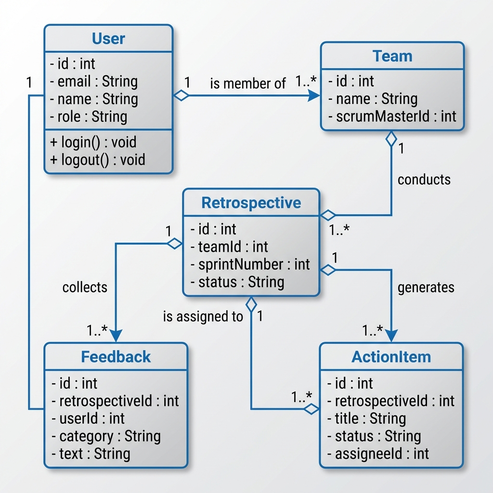

# Class Relationships
## Sprint Retrospective Analyzer - UML Class Diagram

**Document Version:** 1.0  
**Date:** January 27, 2026  
**Problem Statement:** 29 - Class Relationships

---

## 1. Introduction

This document illustrates the relationships between classes in the Sprint Retrospective Analyzer system using UML class diagram notation. It covers association, aggregation, composition, and inheritance relationships.

---

## 2. Core Class Diagram

The following diagram shows the main domain classes and their relationships:



---

## 3. Relationship Types

### 3.1 Association

**Definition:** A semantic relationship where one class uses or interacts with another.

| **Class A** | **Relationship** | **Class B** | **Multiplicity** | **Description** |
|-------------|------------------|-------------|------------------|-----------------|
| User | is member of | Team | 1 to * | Users can belong to multiple teams |
| User | is assigned | ActionItem | 1 to * | User can have multiple action items assigned |
| Team | conducts | Retrospective | 1 to * | Team has many retrospectives over time |
| Retrospective | collects | Feedback | 1 to * | Retrospective contains multiple feedback entries |
| Retrospective | generates | ActionItem | 1 to * | Action items created from retrospective |

**Visual Notation:**
- Represented by solid line connecting classes
- Arrow indicates navigation direction
- Multiplicity shown as `1`, `*`, `0..1`, `1..*` near class ends

---

### 3.2 Aggregation (Weak Ownership)

**Definition:** "Has-a" relationship where the part can exist independently of the whole.

| **Whole (Container)** | **Part (Component)** | **Multiplicity** | **Lifespan** |
|-----------------------|----------------------|------------------|--------------|
| Team | User | * to * | Users exist independently, can join/leave teams |
| Report | Retrospective | 1 to * | Reports aggregate retro data, but retros exist independently |
| Dashboard | Metric | 1 to * | Dashboard displays metrics, metrics calculated separately |

**Visual Notation:**
- Hollow diamond on the container class side
- Solid line to component class
- Component can exist without container

**Example:**
```
Team ◇────── User
(Team has Users, but Users can exist without Team)
```

---

### 3.3 Composition (Strong Ownership)

**Definition:** "Part-of" relationship where the part cannot exist without the whole. When the whole is deleted, parts are also deleted (cascade delete).

| **Owner** | **Owned** | **Multiplicity** | **Lifespan** |
|-----------|-----------|------------------|--------------|
| Retrospective | Feedback | 1 to * | Feedback deleted when retrospective deleted |
| Retrospective | Keyword | 1 to * | Keywords extracted only for specific retrospective |
| ActionItem | Comment | 1 to * | Comments on action item deleted with action item |
| Report | Chart | 1 to * | Charts are part of specific report |

**Visual Notation:**
- Filled/solid diamond on the owner class side
- Solid line to owned class
- Owned class destroyed when owner destroyed

**Example:**
```
Retrospective ♦────── Feedback
(Feedback cannot exist without Retrospective)
```

---

### 3.4 Inheritance (Generalization/Specialization)

**Definition:** "Is-a" relationship representing class hierarchy and inheritance.

#### Option 1: User Role Hierarchy (Not Used)

We **do not use** inheritance for user roles. Instead, we use a `role` attribute with RBAC (Role-Based Access Control).

**Rationale:**
- Roles are runtime behaviors, not compile-time types
- Users can change roles dynamically
- Simpler database schema

#### Option 2: Controller Hierarchy (Used)

```
AbstractController (Abstract)
├── AuthenticationController
├── RetrospectiveController
├── FeedbackController
└── ReportController
```

**Common Attributes/Methods in AbstractController:**
- `+ handleRequest(request: Request): Response`
- `+ validateInput(data: any): ValidationResult`
- `+ handleError(error: Error): ErrorResponse`

#### Option 3: Notification Strategy (Used)

```
NotificationStrategy (Interface)
├── EmailNotificationStrategy
├── InAppNotificationStrategy
└── SlackNotificationStrategy (Future)
```

**Visual Notation:**
- Hollow arrowhead pointing to parent/superclass
- Solid line from child to parent
- Child inherits all attributes and methods of parent

---

## 4. Detailed Class Relationships

### 4.1 User ↔ Team Relationship

**Type:** Many-to-Many Association (via junction table)

```
User 1 ─────────── * TeamMember * ─────────── 1 Team
```

**Implementation:**
- Junction table: `team_members(team_id, user_id, joined_at, role_in_team)`
- A user can belong to multiple teams
- A team can have multiple users
- `role_in_team`: 'Member', 'Scrum Master', 'Manager'

**Database Schema:**
```sql
CREATE TABLE team_members (
    team_id INT REFERENCES teams(id),
    user_id INT REFERENCES users(id),
    joined_at TIMESTAMP DEFAULT NOW(),
    role_in_team VARCHAR(50),
    PRIMARY KEY (team_id, user_id)
);
```

---

### 4.2 Team ↔ Retrospective Relationship

**Type:** One-to-Many Association (Composition-like behavior)

```
Team 1 ────────── * Retrospective
```

**Details:**
- One team has many retrospectives (1 to *)
- Each retrospective belongs to exactly one team (1)
- Deletion: When team is soft-deleted, retrospectives remain (for audit)

**Attributes:**
- Retrospective has foreign key: `teamId`
- Navigation: `team.getRetrospectives()` returns list
- Reverse navigation: `retrospective.getTeam()` returns Team object

---

### 4.3 Retrospective ↔ Feedback Relationship

**Type:** Composition (Strong Ownership)

```
Retrospective 1 ♦────────── * Feedback
```

**Details:**
- One retrospective has many feedback entries (1 to *)
- Feedback cannot exist without retrospective
- Cascade delete: When retrospective deleted, all feedback deleted

**Implementation:**
```typescript
class Retrospective {
    private feedbackList: Feedback[] = [];
    
    addFeedback(feedback: Feedback): void {
        this.feedbackList.push(feedback);
    }
    
    getFeedback(): Feedback[] {
        return this.feedbackList;
    }
    
    deleteFeedback(feedbackId: number): void {
        this.feedbackList = this.feedbackList.filter(f => f.id !== feedbackId);
    }
}
```

---

### 4.4 User ↔ ActionItem Relationship

**Type:** Association

```
User 1 ──(assignee)──── * ActionItem
User 1 ──(creator)────── * ActionItem
```

**Details:**
- One user can be assigned to multiple action items
- One user can create multiple action items
- Two relationships between same classes (distinguished by role)

**Attributes:**
- ActionItem has `assigneeId` (FK to User)
- ActionItem has `createdBy` (FK to User)
- A user can be both creator and assignee of different action items

---

### 4.5 Retrospective ↔ ActionItem Relationship

**Type:** Composition

```
Retrospective 1 ♦────────── * ActionItem
```

**Details:**
- Action items generated from retrospective feedback
- When retrospective soft-deleted, action items remain (but marked as archived)
- Strong logical ownership, but physical delete is soft

---

### 4.6 Retrospective ↔ Keyword Relationship

**Type:** Composition

```
Retrospective 1 ♦────────── * Keyword
```

**Details:**
- Keywords extracted automatically when retrospective closed
- Keywords specific to that retrospective
- Cascade delete: Keywords deleted when retrospective deleted

**Implementation:**
```typescript
class Keyword {
    id: number;
    retrospectiveId: number;  // FK (composition)
    keyword: string;
    frequency: number;
    category: string;  // 'positive', 'negative', 'neutral'
}
```

---

## 5. Dependency Relationships

**Definition:** One class depends on another (uses as parameter, local variable, or return type).

| **Dependent Class** | **Depends On** | **Usage** |
|---------------------|----------------|-----------|
| RetrospectiveController | RetrospectiveService | Calls service methods |
| FeedbackController | FeedbackRepository | Accesses data layer |
| AnalysisEngine | NLPLibrary | Uses for keyword extraction |
| ReportGenerator | ChartLibrary | Generates visualizations |

**Visual Notation:**
- Dashed arrow from dependent to dependency
- Arrow points to the class being used

---

## 6. Multiplicity Specifications

### 6.1 Multiplicity Notations

| **Notation** | **Meaning** | **Example** |
|--------------|-------------|-------------|
| `1` | Exactly one | Each retrospective has exactly 1 team |
| `0..1` | Zero or one | ActionItem may have 0 or 1 assignee (optional) |
| `*` or `0..*` | Zero or more | User has 0 or more action items |
| `1..*` | One or more | Retrospective must have at least 1 feedback |
| `n..m` | Specific range | Team has 5..15 members (business rule) |

### 6.2 Applied Multiplicities

| **Relationship** | **Class A Multiplicity** | **Class B Multiplicity** | **Constraint** |
|------------------|--------------------------|--------------------------|----------------|
| User ↔ Team | 1..* | 1..* | User must belong to at least 1 team |
| Team ↔ Retrospective | 1 | 0..* | Team can have zero retrospectives initially |
| Retrospective ↔ Feedback | 1 | 0..* | Retrospective can be created with no feedback yet |
| Retrospective ↔ ActionItem | 1 | 0..* | Action items optional |
| ActionItem ↔ User (assignee) | 0..1 | 0..* | Action item can be unassigned |

---

## 7. Navigability

**Bidirectional Navigation:**
- `User ↔ Team`: User can get teams, Team can get members
- `Retrospective ↔ Feedback`: Retro can get feedback, Feedback can get retrospective

**Unidirectional Navigation:**
- `ActionItem → User`: Can get assignee, but User doesn't directly have list of assigned actions (query instead)
- `Feedback → Retrospective`: Feedback knows its retrospective, but retro queries feedback

**Notation:**
- Arrowhead shows navigation direction
- No arrow = bidirectional
- One arrow = unidirectional

---

## 8. Constraints and Rules

### 8.1 UML Constraints

**Represented in curly braces `{}`:**

```
Retrospective ♦────── Feedback
    {Feedback.createdAt must be between Retrospective.startDate and endDate}
```

**Common Constraints:**
- `{unique}` - No duplicates allowed
- `{ordered}` - Collection maintains order
- `{read-only}` - Cannot be modified after creation
- `{xor}` - Exclusive or relationship

### 8.2 Business Rule Constraints

| **Relationship** | **Constraint** | **Enforcement** |
|------------------|----------------|------------------|
| User → Team | User must belong to at least 1 team | Application logic on user creation |
| Team → Retrospective | Team can have max 1 open retrospective | Database unique constraint on (team_id, status='Open') |
| ActionItem → User | Assignee must be member of the retrospective's team | Validation in controller |
| Feedback → Retrospective | Cannot add feedback if retrospective status = 'Closed' | Database trigger or app logic |

---

## 9. Association Classes

**Definition:** A class that defines attributes/methods for a specific association.

### Example: TeamMember (Association Class)

```
User *────────────* Team
           │
       TeamMember
  ┌─────────────────┐
  │ role: string    │
  │ joinedAt: date  │
  │ permissions: [] │
  └─────────────────┘
```

**Purpose:** Stores data specific to the User-Team relationship (not belonging to either User or Team alone).

**Attributes:**
- `role`: 'Member', 'Scrum Master', 'Manager'
- `joinedAt`: Timestamp when user joined team
- `permissions`: Team-specific permissions

---

## 10. Class Diagram Best Practices

### 10.1 When to Use Each Relationship

| **Use** | **When** | **Example** |
|---------|----------|-------------|
| **Association** | General "uses" or "has reference to" | User → ActionItem |
| **Aggregation** | "Has-a" but parts can exist independently | Team ◇─ User |
| **Composition** | "Part-of" and parts cannot exist alone | Retrospective ♦─ Feedback |
| **Inheritance** | "Is-a" relationship, code reuse | EmailNotification extends Notification |
| **Dependency** | Temporary usage (parameter, local variable) | Controller → Service |

### 10.2 Avoiding Over-Complication

❌ **Avoid:**
- More than 10-12 classes in a single diagram
- Deep inheritance hierarchies (>3 levels)
- Bidirectional associations everywhere (use queries instead)

✅ **Best Practices:**
- Split into multiple diagrams by domain (User Management, Retrospective Management, Analytics)
- Show only essential relationships
- Use packages to group related classes

---

## 11. Summary

**Total Classes:** 14  
**Entity Classes:** 8 (User, Team, Retrospective, Feedback, ActionItem, Keyword, Pattern, Report)  
**Control Classes:** 4 (AuthController, RetroController, AnalysisEngine, ReportGenerator)  
**Boundary Classes:** 2 (API Gateway, Database Access)

**Relationship Count:**
- Associations: 8
- Aggregations: 2
- Compositions: 4
- Inheritance: 2 hierarchies

---

**Document Control:**
- **Created By:** System Design Team
- **Last Updated:** January 27, 2026
- **Status:** Final
- **Version:** 1.0
- **Related Documents:** [27_Class_Identification.md](file:///C:/Users/AKSHOB%20DHIRA/SEAD-PROJECT-sprintrunner/27_Class_Identification.md), [28_Class_Attributes_Methods_Definition.md](file:///C:/Users/AKSHOB%20DHIRA/SEAD-PROJECT-sprintrunner/28_Class_Attributes_Methods_Definition.md)
