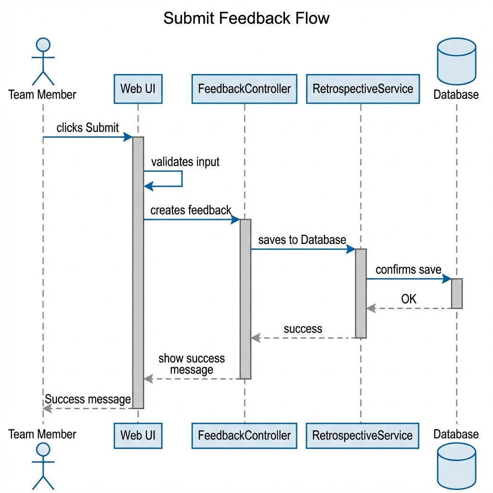
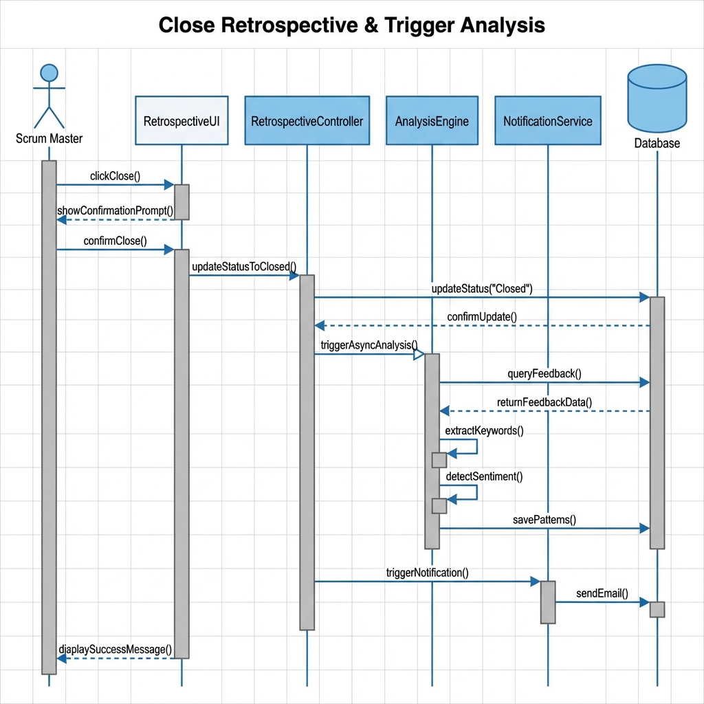
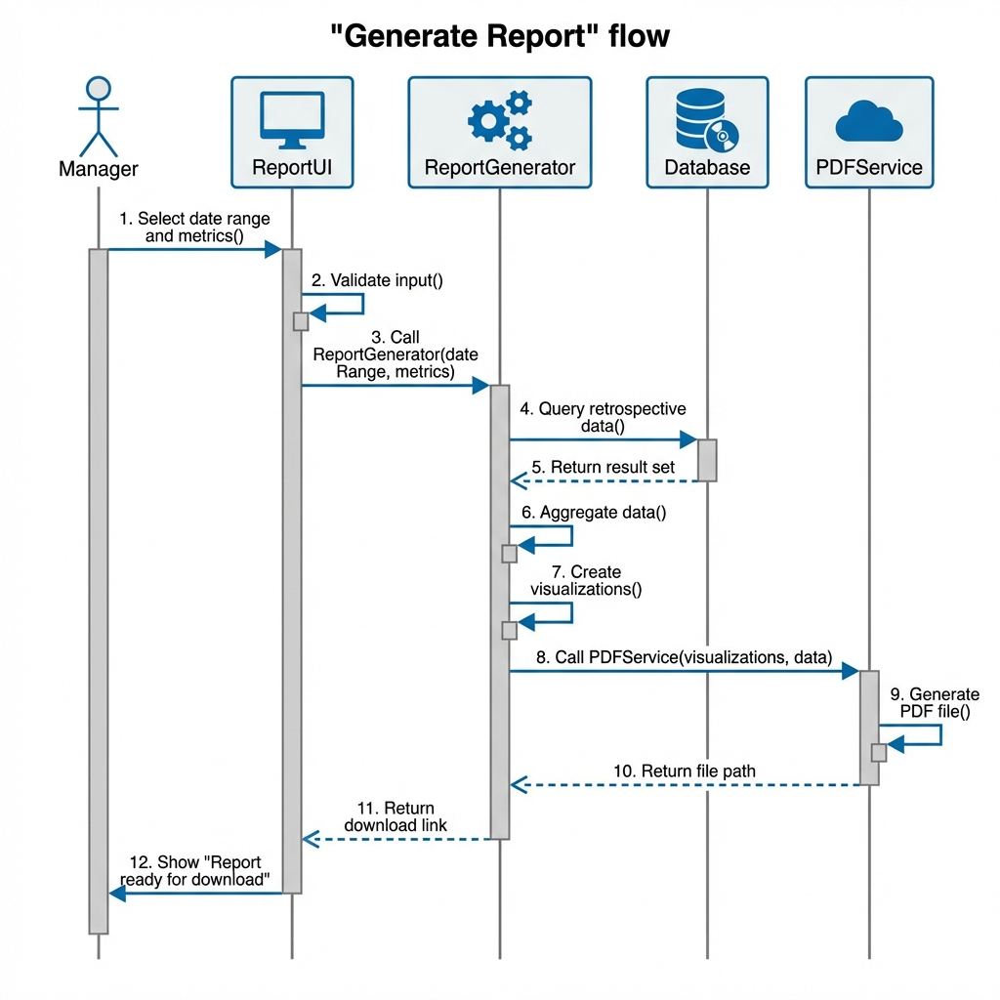

# Sequence Diagrams Creation  
## Sprint Retrospective Analyzer - Object Interactions

**Document Version:** 1.0  
**Date:** January 27, 2026  
**Problem Statement:** 30 - Sequence Diagrams Creation

---

## 1. Introduction

This document presents UML sequence diagrams for critical use cases in the Sprint Retrospective Analyzer. Sequence diagrams show object interactions over time, illustrating how system components collaborate to fulfill specific functionality.

---

## 2. Sequence Diagram Notation

### 2.1 Key Elements

| **Element** | **Notation** | **Description** |
|-------------|--------------|-----------------|
| **Actor** | Stick figure | External user initiating actions |
| **Object/Class** | Rectangle | System component (UI, Controller, Service, Database) |
| **Lifeline** | Dashed vertical line | Object's existence during interaction |
| **Activation Box** | Thin rectangle on lifeline | Object is actively processing |
| **Synchronous Message** | Solid arrow →  | Caller waits for response |
| **Asynchronous Message** | Open arrow ⇢ | Caller doesn't wait |
| **Return Message** | Dashed arrow --→ | Response/result |
| **Self-Call** | Curved arrow back to same object | Object calls its own method |

---

## 3. Sequence Diagram 1: Submit Feedback

### 3.1 Purpose

Shows the interaction when a Team Member submits feedback during an open retrospective.

### 3.2 Diagram



### 3.3 Participants

| **Participant** | **Type** | **Role** |
|-----------------|----------|----------|
| Team Member | Actor | Initiates feedback submission |
| Web UI | Boundary | User interface component |
| FeedbackController | Control | Handles business logic |
| RetrospectiveService | Service | Manages retrospective operations |
| Database | Entity | Persists data |

### 3.4 Message Flow

| **Step** | **From** | **To** | **Message** | **Type** |
|----------|----------|--------|-------------|----------|
| 1 | Team Member | Web UI | `clickSubmit()` | User action |
| 2 | Web UI | Web UI | `validateInput()` | Self-call |
| 3 | Web UI | FeedbackController | `createFeedback(data)` | Synchronous |
| 4 | FeedbackController | RetrospectiveService | `saveFeedback(feedback)` | Synchronous |
| 5 | RetrospectiveService | Database | `INSERT INTO feedback` | Synchronous |
| 6 | Database | RetrospectiveService | `confirmSave()` | Return |
| 7 | RetrospectiveService | FeedbackController | `success` | Return |
| 8 | FeedbackController | Web UI | `showSuccessMessage()` | Return |
| 9 | Web UI | Team Member | Display "Feedback submitted successfully" | UI update |

### 3.5 Alternative Flow: Validation Error

**After Step 2:**
- 2a. Web UI detects validation error (empty text or length > 2000 chars)
- 2b. Web UI highlights error field with message
- 2c. User corrects input
- 2d. Return to Step 1

---

## 4. Sequence Diagram 2: Close Retrospective & Trigger Analysis

### 4.1 Purpose

Demonstrates the complex workflow when a Scrum Master closes a retrospective, triggering automated pattern analysis and notifications.

### 4.2 Diagram



### 4.3 Participants

| **Participant** | **Type** | **Role** |
|-----------------|----------|----------|
| Scrum Master | Actor | Initiates retrospective closure |
| RetrospectiveUI | Boundary | User interface |
| RetrospectiveController | Control | Orchestrates closure process |
| AnalysisEngine | Service | Performs pattern analysis |
| NotificationService | Service | Sends email notifications |
| Database | Entity | Data persistence |

### 4.4 Message Flow

| **Step** | **From** | **To** | **Message** | **Type** |
|----------|----------|--------|-------------|----------|
| 1 | Scrum Master | RetrospectiveUI | `clickClose()` | User action |
| 2 | RetrospectiveUI | RetrospectiveUI | `showConfirmDialog()` | Self-call |
| 3 | Scrum Master | RetrospectiveUI | `confirmClose()` | Confirmation |
| 4 | RetrospectiveUI | RetrospectiveController | `closeRetrospective(retroId)` | Synchronous |
| 5 | RetrospectiveController | Database | `UPDATE status='Closed'` | Synchronous |
| 6 | Database | RetrospectiveController | `confirmUpdate()` | Return |
| 7 | RetrospectiveController | AnalysisEngine | `triggerAsyncAnalysis()` | **Asynchronous** |
| 8 | AnalysisEngine | Database | `queryFeedback()` | Synchronous |
| 9 | Database | AnalysisEngine | `returnFeedbackData()` | Return |
| 10 | AnalysisEngine | AnalysisEngine | `extractKeywords()` | Self-call |
| 11 | AnalysisEngine | AnalysisEngine | `detectSentiment()` | Self-call |
| 12 | AnalysisEngine | Database | `savePatterns()` | Synchronous |
| 13 | RetrospectiveController | NotificationService | `sendSummaryEmail()` | Asynchronous |
| 14 | NotificationService | Email Server | `SMTP send` | External call |
| 15 | RetrospectiveController | RetrospectiveUI | `success` | Return |
| 16 | RetrospectiveUI | Scrum Master | Display "Retrospective closed" | UI update |

### 4.5 Key Observations

**Asynchronous Processing:**
- Step 7: Analysis is triggered asynchronously (fire-and-forget)
- Scrum Master gets immediate confirmation (Step 16)
- Analysis continues in background (Steps 8-12)

**Parallel Operations:**
- While analysis runs, notification is sent (Step 13)
- Both operations independent of each other

---

## 5. Sequence Diagram 3: Generate Report

### 5.1 Purpose

Shows report generation flow when a Manager requests a retrospective analysis report.

### 5.2 Diagram



### 5.3 Participants

| **Participant** | **Type** | **Role** |
|-----------------|----------|----------|
| Manager | Actor | Requests report |
| ReportUI | Boundary | Report interface |
| ReportGenerator | Control | Generates reports |
| Database | Entity | Data source |
| PDFService | Service | Creates PDF files |

### 5.4 Message Flow

| **Step** | **From** | **To** | **Message** | **Type** |
|----------|----------|--------|-------------|----------|
| 1 | Manager | ReportUI | `selectDateRange()` and `selectMetrics()` | User action |
| 2 | ReportUI | ReportUI | `validateInput()` | Self-call |
| 3 | ReportUI | ReportGenerator | `generateReport(params)` | Synchronous |
| 4 | ReportGenerator | Database | `queryRetrospectiveData()` | Synchronous |
| 5 | Database | ReportGenerator | `returnResultSet()` | Return |
| 6 | ReportGenerator | ReportGenerator | `aggregateData()` | Self-call |
| 7 | ReportGenerator | ReportGenerator | `createVisualizations()` | Self-call |
| 8 | ReportGenerator | PDFService | `createPDF(visualizations, data)` | Synchronous |
| 9 | PDFService | PDFService | `generatePDFFile()` | Self-call |
| 10 | PDFService | ReportGenerator | `returnFilePath()` | Return |
| 11 | ReportGenerator | ReportUI | `returnDownloadLink()` | Return |
| 12 | ReportUI | Manager | Show "Report ready for download" | UI update |

### 5.5 Alternative Flow: Large Data Set

**After Step 4:**
- 4a. Database returns > 10,000 records
- 4b. ReportGenerator implements pagination
- 4c. Process in batches of 1,000 records
- 4d. Show progress indicator to Manager
- 4e. Continue to Step 6

---

## 6. Sequence Diagram 4: Track Action Item Effectiveness

### 6.1 Purpose

Automated system process that evaluates completed action items to determine if they resolved the underlying issue.

### 6.2 Participants

| **Participant** | **Type** | **Role** |
|-----------------|----------|----------|
| System (Timer) | Actor | Initiates daily cron job |
| EffectivenessTracker | Service | Tracks action effectiveness |
| AnalysisEngine | Service | Checks for issue recurrence |
| Database | Entity | Data source |

### 6.3 Message Flow

| **Step** | **From** | **To** | **Message** | **Type** |
|----------|----------|--------|-------------|----------|
| 1 | System Timer | EffectivenessTracker | `checkCompletedActions()` | Scheduled trigger |
| 2 | EffectivenessTracker | Database | `SELECT actionItems WHERE status='Done' AND completedAt < 90 days ago` | Query |
| 3 | Database | EffectivenessTracker | `returnActionItemsList()` | Return |
| 4 | EffectivenessTracker | AnalysisEngine | `checkIssueRecurrence(actionItem)` | Synchronous |
| 5 | AnalysisEngine | Database | `SELECT feedback WHERE issue similar AND date > completedAt` | Query |
| 6 | Database | AnalysisEngine | `returnFeedbackMatches()` | Return (0 = effective, >0 = ineffective) |
| 7 | AnalysisEngine | AnalysisEngine | `calculateEffectivenessScore()` | Self-call |
| 8 | AnalysisEngine | EffectivenessTracker | `returnScore(0.0 to 1.0)` | Return |
| 9 | EffectivenessTracker | Database | `UPDATE actionItems SET effectivenessScore` | Update |
| 10 | Database | EffectivenessTracker | `confirmUpdate()` | Return |

**Loop:** Steps 4-10 repeat for each completed action item.

---

## 7. Design Patterns in Sequence Diagrams

### 7.1 Controller Pattern

**Visible in:** All diagrams  
**Purpose:** Centralize business logic in controller classes

**Example:**
```
UI → Controller → Service → Database
```

**Benefits:**
- UI only handles presentation
- Business rules in controller
- Services reusable across controllers

### 7.2 Service Layer Pattern

**Visible in:** Diagrams 2, 3, 4  
**Purpose:** Encapsulate business operations in service classes

**Example:**
```
RetrospectiveController → RetrospectiveService → Operations
```

### 7.3 Asynchronous Processing

**Visible in:** Diagram 2 (Close Retrospective)  
**Purpose:** Improve responsiveness for long-running tasks

**Implementation:**
- Step 7: `triggerAsyncAnalysis()` returns immediately
- Analysis runs in background thread/job queue
- User not blocked waiting for analysis

---

## 8. Error Handling in Sequence Diagrams

### 8.1 UML Fragments for Error Scenarios

**Alt Fragment (Alternative Paths):**

```
alt Successful Save
    Database → Service: success
else Database Error
    Database → Service: error
    Service → UI: show error message
end
```

**Opt Fragment (Optional Execution):**

```
opt Email Enabled
    Controller → NotificationService: sendEmail()
end
```

**Loop Fragment:**

```
loop For each team member
    NotificationService → EmailServer: send(email)
end
```

### 8.2 Exception Handling Pattern

**Common Pattern Across All Diagrams:**

1. **Try Block:** Execute main flow
2. **Catch Block:** Handle error
   - Log error details
   - Return user-friendly error message
   - Rollback transaction if needed
3. **Finally Block:** Clean up resources

**Example (Diagram 1 - Submit Feedback):**

```
try:
    Database.save(feedback)
catch DatabaseException:
    Log.error("Failed to save feedback")
    return "Network error. Please try again."
finally:
    Database.closeConnection()
```

---

## 9. Timing and Performance

### 9.1 Response Time Specifications

| **Sequence Diagram** | **Total Duration** | **Critical Path** | **Performance Requirement** |
|----------------------|--------------------|--------------------|----------------------------|
| Submit Feedback | < 500ms | Steps 3-7 | < 300ms for database save |
| Close Retrospective | < 2s (user visible) | Steps 4-6 | Analysis async, no blocking |
| Generate Report | < 10s | Steps 4-10 | Depends on data volume |
| Track Effectiveness | Background job | Steps 2-10 per item | No user impact |

### 9.2 Optimization Opportunities

**Caching:**
- Diagram 3: Cache frequently requested reports for 1 hour

**Database Indexing:**
- Diagram 1: Index on `retrospectiveId` for fast feedback queries
- Diagram 4: Index on `(status, completedAt)` for action item queries

**Batch Processing:**
- Diagram 4: Process action items in batches of 50

---

## 10. Summary

**Total Sequence Diagrams:** 4  
**Core Use Cases Covered:**
1. Submit Feedback (Team Member interaction)
2. Close Retrospective (Scrum Master workflow with async analysis)
3. Generate Report (Manager reporting)
4. Track Action Effectiveness (Automated system process)

**Key Architectural Patterns:**
- MVC (Model-View-Controller)
- Service Layer
- Asynchronous Processing
- Repository Pattern (Database access)

---

**Document Control:**
- **Created By:** System Design Team
- **Last Updated:** January 27, 2026
- **Status:** Final
- **Version:** 1.0
- **Related Documents:** [31_Object_Interactions_Documentation.md](file:///C:/Users/AKSHOB%20DHIRA/SEAD-PROJECT-sprintrunner/31_Object_Interactions_Documentation.md), [32_Alternative_Flows_Inclusion.md](file:///C:/Users/AKSHOB%20DHIRA/SEAD-PROJECT-sprintrunner/32_Alternative_Flows_Inclusion.md)
