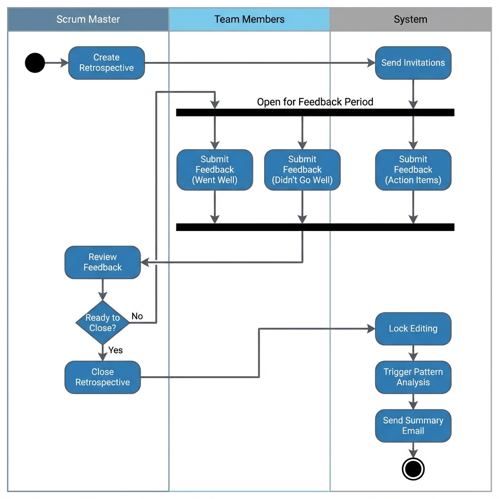
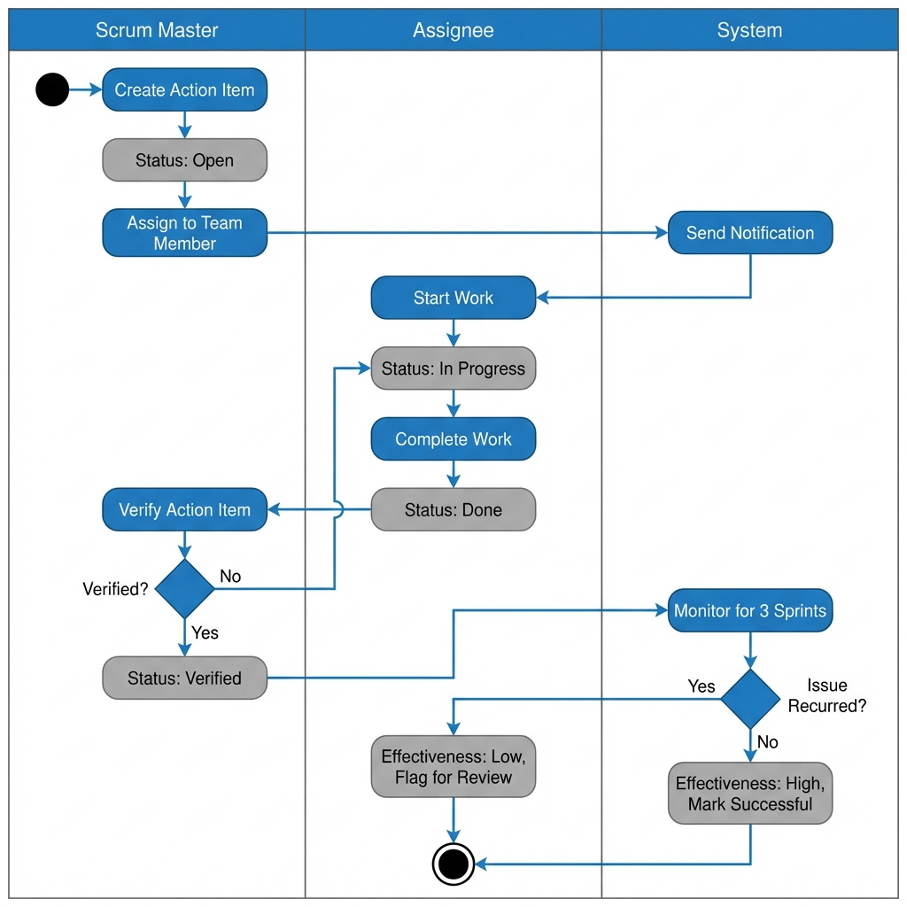

# Activity Diagrams Creation
## Sprint Retrospective Analyzer - Workflow Modeling

**Document Version:** 1.0  
**Date:** January 27, 2026  
**Problem Statement:** 33 - Activity Diagrams Creation

---

## 1. Introduction

Activity diagrams model workflows and business processes in the Sprint Retrospective Analyzer. They show the flow of control from activity to activity, including decision points, parallel processing, and swim lanes for different actors.

---

## 2. Activity Diagram Notation

### 2.1 Key Elements

| **Element** | **Notation** | **Description** |
|-------------|--------------|-----------------|
| **Initial Node** | Filled circle ● | Starting point of workflow |
| **Activity** | Rounded rectangle | Action or process step |
| **Decision Node** | Diamond ◆ | Conditional branch (if/else) |
| **Merge Node** | Diamond ◆ | Convergence of alternative paths |
| **Fork** | Thick horizontal bar | Split into parallel activities |
| **Join** | Thick horizontal bar | Synchronization of parallel activities |
| **Final Node** | Bullseye ◉ | End of workflow |
| **Swimlane** | Vertical column | Actor/system responsible for activities |

---

## 3. Activity Diagram 1: Retrospective Workflow

### 3.1 Purpose

Models the complete lifecycle of a retrospective from creation through closure and analysis.

### 3.2 Diagram



### 3.3 Swimlanes

| **Swimlane** | **Actor/System** | **Responsibilities** |
|--------------|------------------|----------------------|
| **Scrum Master** | Human | Create retrospective, review feedback, close retrospective |
| **Team Members** | Human | Submit feedback in parallel |
| **System** | Automated | Send invitations, lock editing, trigger analysis, send emails |

### 3.4 Activity Flow Description

#### Phase 1: Initialization (Scrum Master)
1. **Start** → Initial node
2. **Create Retrospective** 
   - Input: Team, Sprint number, Dates
   - Output: Retrospective created with status = "Open"

#### Phase 2: System Automation
3. **Send Invitations** (System)
   - Trigger: Retrospective created
   - Action: Email all team members with retrospective link
   - Notification: Calendar invite

#### Phase 3: Open for Feedback Period
4. **Fork Bar** → Parallel feedback submission begins
   - Multiple team members can submit feedback simultaneously
   - Three categories:
     - **Submit Feedback (Went Well)** - Positive feedback
     - **Submit Feedback (Didn't GoWell)**  - Problems, issues
     - **Submit Feedback (Action Items)** - Proposed solutions
5. **Join Bar** → All feedback submitted, return to single flow

#### Phase 4: Review and Decision (Scrum Master)
6. **Review Feedback**
   - Scrum Master reads all submitted feedback
   - Optional: Facilitate in-person discussion
   
7. **Decision: Ready to Close?**
   - **No** → Loop back to "Open for Feedback Period" (allow more feedback)
   - **Yes** → Continue to closure

#### Phase 5: Closure and Analysis
8. **Close Retrospective** (Scrum Master action)
9. **Lock Editing** (System) - Feedback no longer editable
10. **Trigger Pattern Analysis** (System, automated)
    - Extract keywords
    - Detect sentiment
    - Identify recurring issues
11. **Send Summary Email** (System)
    - Email all participants with:
      - Feedback summary
      - Identified patterns
      - Action items assigned

12. **End** → Final node

### 3.5 Decision Points

| **Decision** | **Condition** | **Outcome** |
|--------------|---------------|-------------|
| **Ready to Close?** | Scrum Master judgment | No: Loop back for more feedback<br>Yes: Proceed to closure |

**Business Rule:** Retrospective typically open for 5-7 days after sprint ends.

### 3.6 Parallel Activities

**Fork/Join Pattern:** Team Members Submit Feedback

- **Fork** after "Open for Feedback Period"
- Team members work **independently and concurrently**
- Multiple submissions allowed per person
- **Join** when all desired feedback collected (no strict synchronization)

**Benefit:** Asynchronous feedback submission improves participation

---

## 4. Activity Diagram 2: Action Item Lifecycle

### 4.1 Purpose

Models the workflow of an action item from creation through verification and effectiveness tracking.

### 4.2 Diagram



### 4.3 Swimlanes

| **Swimlane** | **Actor/System** | **Responsibilities** |
|--------------|------------------|----------------------|
| **Scrum Master** | Human | Create, assign, verify action items |
| **Assignee** | Human | Execute work on action items |
| **System** | Automated | Track status, send notifications, monitor effectiveness |

### 4.4 Activity Flow Description

#### Phase 1: Creation (Scrum Master)
1. **Start** → Initial node
2. **Create Action Item**
   - Input: Title, description, priority, due date
   - Initial status: **Open**

#### Phase 2: Assignment
3. **Status: Open** (represented as state)
4. **Assign to Team Member** (Scrum Master)
   - Select assignee from team roster
   - Set due date

#### Phase 3: Notification (System)
5. **Send Notification** (System, automated)
   - Email assignee
   - In-app notification
   - Slack message (optional)

#### Phase 4: Execution (Assignee)
6. **Start Work** (Assignee)
   - Assignee clicks "Start" button
   - Status changes to **In Progress**

7. **Status: In Progress**

8. **Complete Work** (Assignee)
   - Assignee finishes task
   - Marks as complete
   - Status changes to **Done**

#### Phase 5: Verification (Scrum Master)
9. **Status: Done**

10. **Verify Action Item** (Scrum Master)
    - Review completed work
    - Check if issue resolved

11. **Decision: Verified?**
    - **No** → Loop back to **Status: In Progress** (rework needed)
    - **Yes** → Continue to verification

12. **Status: Verified**

#### Phase 6: Effectiveness Tracking (System)
13. **Monitor for Next 3 Sprints** (System, background job)
    - Check if the same issue appears again in feedback

14. **Decision: Issue Recurred?**
    - **Yes:**
      - Set **Effectiveness: Low**
      - Flag for review in next retrospective
      - End → Final node
    - **No:**
      - Set **Effectiveness: High**
      - Mark as successful
      - End → Final node

### 4.5 Decision Points

| **Decision** | **Condition** | **Outcome** |
|--------------|---------------|-------------|
| **Verified?** | Scrum Master inspection | No: Return to In Progress for rework<br>Yes: Mark as Verified |
| **Issue Recurred?** | System checks next 3 sprints for similar feedback | Yes: Low effectiveness, flag for review<br>No: High effectiveness, success |

### 4.6 Looping Behavior

**Rework Loop:**
- If Scrum Master finds work incomplete or incorrect (Decision: Verified? = No)
- Action item returns to **Status: In Progress**
- Assignee must redo or complete remaining work
- Loop can occur multiple times until work satisfactory

**Constraint:** Maximum 3 rework cycles before escalation to Manager

---

## 5. Complex Workflow Elements

### 5.1 Exception Handling

**Activity Diagram 2 - Action Item Overdue:**

```
After "Status: In Progress"
[Guard Condition: Current Date > Due Date]
→ Send Overdue Notification (System)
→ Flag action item as "At Risk"
→ Continue normal flow
```

**Representation:** Add annotation or note on diagram

### 5.2 Time-Based Triggers

**Activity Diagram 2 - Monitor for 3 Sprints:**

- **Trigger:** Cron job runs daily
- **Duration:** 3 sprint cycles (typically 6-12 weeks)
- **Action:** Query feedback table for similar issues
- **Outcome:** Calculate effectiveness score

---

## 6. Concurrency and Synchronization

### 6.1 Fork and Join

**Activity Diagram 1 - Feedback Submission:**

**Fork Node:**
- Single flow splits into multiple parallel flows
- Represented by thick horizontal bar
- Occurs after "Open for Feedback Period"

**Concurrent Activities:**
- Team Member 1 submits "Went Well" feedback
- Team Member 2 submits "Didn't Go Well" feedback
- Team Member 3 submits "Action Item" proposal
- All happen **simultaneously**

**Join Node:**
- Multiple parallel flows merge into single flow
- Represents synchronization point
- All feedback collected before proceeding

**Synchronization Strategy:**
- No strict waiting (join happens when Scrum Master decides to close)
- Scrum Master can close anytime after minimum wait period (e.g., 24 hours)

---

## 7. Swimlane Responsibilities

### 7.1 Swimlane Best Practices

**Purpose:** Clearly show which actor/system performs each activity

| **Swimlane** | **Contains** | **Example Activities** |
|--------------|--------------|------------------------|
| **Scrum Master** | User-initiated actions | Create retrospective, Assign action items, Verify completion |
| **Team Members** | User contributions | Submit feedback, Start work on action items |
| **System** | Automated processes | Send notifications, Trigger analysis, Monitor effectiveness |

**Crossing Swimlanes:** Arrows show handoff between actors

**Example:**
```
Scrum Master: Create Action Item → Assign to Team Member
                ↓
Assignee: Start Work (crosses to Assignee swimlane)
```

---

## 8. Decision Logic Documentation

### 8.1 Decision Table for "Ready to Close?"

| **Condition** | **Value** | **Action** |
|---------------|-----------|------------|
| Minimum wait period | < 24 hours | Cannot close (system prevents) |
| Minimum wait period | ≥ 24 hours | Can close (Scrum Master decides) |
| Feedback count | 0 | Warning: No feedback submitted, close anyway? |
| Feedback count | > 0 | Normal closure |
| Team members who submitted | < 50% | Warning: Low participation |
| Team members who submitted | ≥ 50% | Satisfactory participation |

**Decision Rule:** Scrum Master uses judgment based on:
- Quantity and quality of feedback
- Urgency of closing the sprint
- Team availability

### 8.2 Decision Table for "Verified?"

| **Condition** | **Result** | **Next Step** |
|---------------|------------|---------------|
| Work complete AND Issue resolved | Yes | Status: Verified |
| Work incomplete | No | Return to In Progress |
| Work complete BUT Issue not resolved | No | Return to In Progress with new instructions |
| Cannot verify (dependencies blocking) | Defer | Extend due date, revisit next sprint |

---

## 9. Alternative Flows

### 9.1 Activity Diagram 1 - No Feedback Submitted

**After "Open for Feedback Period":**
-**Guard:** [Feedback count = 0]
- **Activity:** System sends reminder email to all team members
- **Wait:** 48 hours
- **Decision:** 
  - If still no feedback → Close with warning
  - If feedback received → Continue normal flow

### 9.2 Activity Diagram 2 - Assignee Leaves Team

**During "Status: In Progress":**
- **Event:** User assigned to action item leaves team
- **Activity:** System automatically:
  1. Unassign action item
  2. Notify Scrum Master
  3. Set status back to "Open"
- **Scrum Master:** Reassign to new team member
- **Continue:** Normal flow from "Assign to Team Member"

---

## 10. Performance Considerations

### 10.1 Activity Duration Estimates

| **Activity** | **Estimated Duration** | **Notes** |
|--------------|------------------------|-----------|
| Create Retrospective | 5 minutes | Manual input by Scrum Master |
| Send Invitations | < 10 seconds | Automated email batch send |
| Open for Feedback Period | 5-7 days | Business process duration |
| Trigger Pattern Analysis | 5-30 seconds | Depends on feedback volume |
| Monitor for 3 Sprints | Background | Runs daily cron job |

### 10.2 Optimization Opportunities

**Activity Diagram 1:**
- **Parallel Processing:** Send invitations and lock database as concurrent tasks
- **Caching:** Cache frequently accessed retrospective data

**Activity Diagram 2:**
- **Batch Processing:** Monitor effectiveness for all action items in single daily job
- **Indexing:** Index on `(status, completedAt)` for fast queries

---

## 11. Summary

**Total Activity Diagrams:** 2

**Diagram 1: Retrospective Workflow**
- **Swimlanes:** 3 (Scrum Master, Team Members, System)
- **Decision Points:** 1 (Ready to Close?)
- **Parallel Activities:** Fork/Join for feedback submission
- **Total Activities:** ~11

**Diagram 2: Action Item Lifecycle**
- **Swimlanes:** 3 (Scrum Master, Assignee, System)
- **Decision Points:** 2 (Verified?, Issue Recurred?)
- **Looping:** Rework loop for verification failures
- **Total Activities:** ~14

**Key Patterns:**
- Fork/Join for parallelism
- Decision diamonds for branching
- Swimlanes for clear responsibility assignment
- Looping for iterative processes

---

**Document Control:**
- **Created By:** System Design Team
- **Last Updated:** January 27, 2026
- **Status:** Final
- **Version:** 1.0
- **Related Documents:** [34_Workflow_Documentation.md](file:///C:/Users/AKSHOB%20DHIRA/SEAD-PROJECT-sprintrunner/34_Workflow_Documentation.md)
