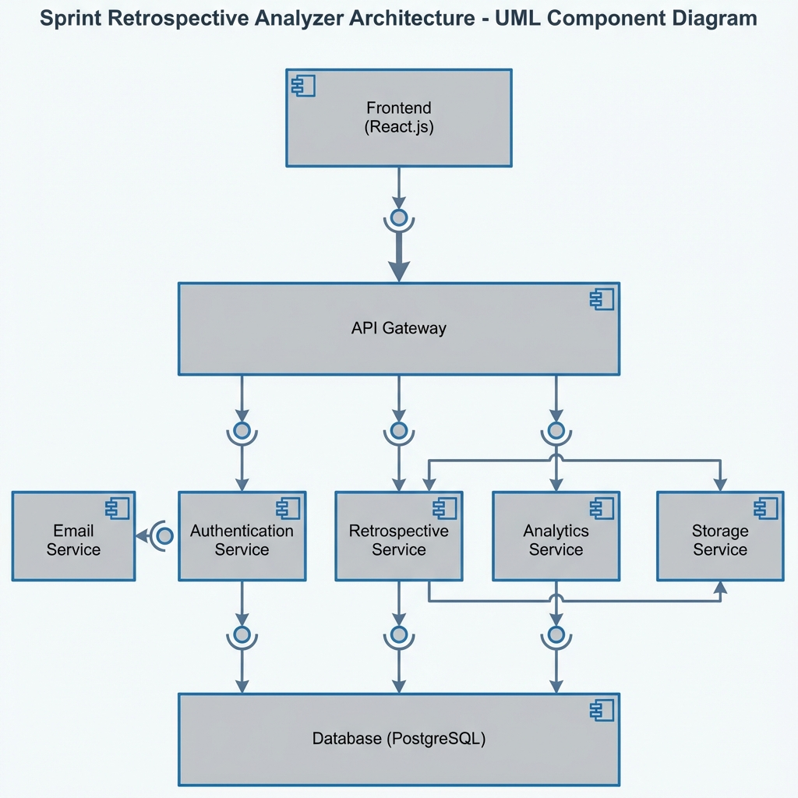

# Component Diagram Creation
## Sprint Retrospective Analyzer - System Architecture

**Document Version:** 1.0  
**Date:** January 27, 2026  
**Problem Statement:** 35 - Component Diagram Creation

---

## 1. Introduction

This document presents the component diagram for the Sprint Retrospective Analyzer, illustrating the system's high-level architecture, major components, their interfaces, and dependencies.

---

## 2. Component Diagram Overview

### 2.1 Purpose

Component diagrams show:
- **System structure:** How the system is decomposed into components
- **Interfaces:** Services provided and required by each component
- **Dependencies:** Relationships between components
- **Deployment units:** Logical groupings for deployment

### 2.2 Component Notation

| **Element** | **Notation** | **Description** |
|-------------|--------------|-----------------|
| **Component** | Rectangle with component icon ⚙ | Modular part of system |
| **Provided Interface** | Lollipop symbol ⊙ | Service the component offers |
| **Required Interface** | Socket symbol ⊃ | Service the component needs |
| **Dependency** | Dashed arrow → | Component depends on another |

---

## 3. System Architecture Component Diagram

### 3.1 Diagram



### 3.2 Architecture Overview

**Architecture Style:** Three-Tier Monolithic with Service-Oriented Design

**Tiers:**
1. **Presentation Tier:** Frontend (React.js)
2. **Application Tier:** API Gateway + Backend Services (Node.js)
3. **Data Tier:** Database (PostgreSQL)

**External Services:** Email Service, Storage Service

---

## 4. Component Descriptions

### 4.1 Frontend Component (React.js)

**Type:** Presentation Layer  
**Technology:** React.js 18+, TypeScript, Redux Toolkit

**Responsibilities:**
- Render user interface
- Handle user interactions
- Client-side state management
- Client-side validation
- HTTP requests to backend API

**Provided Interfaces:**
- **UI Display:** Visual interface for users

**Required Interfaces:**
- **RESTful API:** Consumes backend API endpoints
- **HTTP/HTTPS Protocol:** Communication with API Gateway

**Sub-Components:**
```
Frontend
├── Authentication Module
│   ├── LoginPage.tsx
│   ├── RegisterPage.tsx
│   └── PasswordResetPage.tsx
│
├── Dashboard Module
│   ├── TeamDashboard.tsx
│   ├── ManagerDashboard.tsx
│   └── CustomizableWidgets.tsx
│
├── Retrospective Module
│   ├── CreateRetrospective.tsx
│   ├── RetrospectiveForm.tsx
│   └── RetrospectiveHistory.tsx
│
├── Action Items Module
│   ├── ActionItemBoard.tsx
│   └── ActionItemDetails.tsx
│
└── Reports Module
    ├── ReportGenerator.tsx
    └── ReportViewer.tsx
```

**Key Libraries:**
- `axios` - HTTP client
- `react-router-dom` - Routing
- `redux-toolkit` - State management
- `chart.js` or `recharts` - Data visualization

---

### 4.2 API Gateway Component

**Type:** Application Layer (Entry Point)  
**Technology:** Node.js, Express.js

**Responsibilities:**
- Route incoming requests to appropriate backend services
- Request/response logging
- Rate limiting (1000 req/hour per user)
- API versioning (e.g., `/api/v1/retrospectives`)
- JWT token validation
- CORS handling

**Provided Interfaces:**
- **RESTful API:** HTTP/JSON endpoints
  - `GET /api/v1/retrospectives`
  - `POST /api/v1/feedback`
  - `PUT /api/v1/action-items/:id`
  - etc.

**Required Interfaces:**
- **Authentication Service:** For token validation
- **Retrospective Service:** For retrospective operations
- **Analytics Service:** For pattern analysis
- **Storage Service:** For file uploads

**Configuration:**
```javascript
// API Gateway Routes
router.use('/auth', authenticationServiceRoutes);
router.use('/retrospectives', retrospectiveServiceRoutes);
router.use('/action-items', actionItemServiceRoutes);
router.use('/analytics', analyticsServiceRoutes);
router.use('/reports', reportServiceRoutes);
```

---

### 4.3 Authentication Service Component

**Type:** Business Logic Layer  
**Technology:** Node.js, bcrypt, jsonwebtoken

**Responsibilities:**
- User registration and login
- Password hashing (bcrypt, work factor 12)
- JWT token generation and validation
- Session management (30-minute timeout)
- Password reset functionality
- Account lockout (5 failed attempts)

**Provided Interfaces:**
- **IAuthenticationService:**
  - `register(email, password, name): User`
  - `login(email, password): { token, user }`
  - `validateToken(token): boolean`
  - `resetPassword(email): void`
  - `changePassword(userId, oldPassword, newPassword): boolean`

**Required Interfaces:**
- **Database:** User credentials storage
- **Email Service:** Send password reset emails

**Security Features:**
- Salted password hashing
- JWT with expiration (30 min access token, 7 day refresh token)
- Rate limiting on login attempts
- Audit logging of authentication events

---

### 4.4 Retrospective Service Component

**Type:** Business Logic Layer  
**Technology:** Node.js, Sequelize ORM

**Responsibilities:**
- Create, read, update, delete (CRUD) retrospectives
- Manage feedback submissions
- Close retrospectives (trigger analysis)
- Retrieve retrospective history
- Validate permissions (only team members can submit feedback)

**Provided Interfaces:**
- **IRetrospectiveService:**
  - `createRetrospective(teamId, sprintNumber, dates): Retrospective`
  - `submitFeedback(retroId, userId, category, text): Feedback`
  - `closeRetrospective(retroId): void`
  - `getRetrospectiveHistory(teamId, limit): Retrospective[]`
  - `getRetrospectiveById(retroId): Retrospective`

**Required Interfaces:**
- **Database:** Retrospective and feedback data
- **Analytics Service:** Triggered on retrospective closure
- **Notification Service:** Send summary emails

**Business Rules:**
- Only one open retrospective per team at a time
- Feedback cannot be added after retrospective closed
- Only team members can submit feedback

---

### 4.5 Analytics Service Component

**Type:** Business Logic Layer  
**Technology:** Node.js, Natural (NLP library), VADER sentiment analysis

**Responsibilities:**
- Extract keywords from feedback (TF-IDF algorithm)
- Perform sentiment analysis (positive, neutral, negative)
- Detect recurring issues (mentioned in 3+ consecutive sprints)
- Calculate team health trends
- Generate pattern reports

**Provided Interfaces:**
- **IAnalyticsService:**
  - `extractKeywords(text: string): string[]`
  - `detectSentiment(text: string): { score: number, label: string }`
  - `findRecurringIssues(teamId: number): Pattern[]`
  - `calculateTrends(teamId: number, lookbackDays: number): Trend[]`
  - `analyzeRetrospective(retroId: number): AnalysisResult`

**Required Interfaces:**
- **Database:** Feedback and retrospective data
- **NLP Library:** External natural language processing

**Algorithms:**
- Keyword Extraction: TF-IDF (Term Frequency-Inverse Document Frequency)
- Sentiment Analysis: VADER (Valence Aware Dictionary and sEntiment Reasoner)
- Similarity Matching: Cosine similarity >70% for issue recurrence

---

### 4.6 Storage Service Component

**Type:** Infrastructure Layer  
**Technology:** AWS S3 or Azure Blob Storage

**Responsibilities:**
- Store file attachments (images, documents)
- Store generated reports (PDF files)
- Manage file metadata
- Generate pre-signed URLs for secure downloads

**Provided Interfaces:**
- **IStorageService:**
  - `uploadFile(file: File, path: string): string (URL)`
  - `downloadFile(fileId: string): File`
  - `deleteFile(fileId: string): void`
  - `generatePresignedUrl(fileId: string, expiryMinutes: number): string`

**Required Interfaces:**
- None (standalone infrastructure service)

**Configuration:**
- **Bucket Name:** `sra-storage-production`
- **Region:** us-east-1 (AWS) or equivalent
- **Access:** Private (pre-signed URLs for downloads)

---

### 4.7 Email Service Component

**Type:** External Service  
**Technology:** SendGrid or AWS SES (SMTP)

**Responsibilities:**
- Send transactional emails
- Email templates (welcome, notification, summary)
- Track email delivery status
- Handle bounces and failures

**Provided Interfaces:**
- **SMTP Protocol:**
  - `sendEmail(to: string, subject: string, body: string): void`
  - `sendBulkEmail(recipients: string[], subject: string, body: string): void`

**RequiredInterfaces:**
- API Key authentication for SendGrid/SES

**Email Types:**
- **Welcome Email:** Sent on user registration
- **Retrospective Invitation:** Sent when retro created
- **Retrospective Summary:** Sent when retro closed
- **Action Item Assignment:** Sent when action assigned
- **Password Reset:** Sent on password reset request

---

### 4.8 Database Component (PostgreSQL)

**Type:** Data Layer  
**Technology:** PostgreSQL 14+, managed service (RDS or Azure Database)

**Responsibilities:**
- Persist all application data
- Enforce referential integrity
- Execute complex queries for reporting
- Transaction management

**Provided Interfaces:**
- **SQL Database Interface:**
  - Standard CRUD operations
  - Complex joins for reporting
  - Full-text search capabilities

**Required Interfaces:**
- None (data sink)

**Key Tables:**
- `users`, `teams`, `team_members`
- `retrospectives`, `feedback`, `keywords`
- `action_items`, `patterns`
- `reports`, `notifications`

**Performance:**
- Indexes on foreign keys and frequently queried columns
- Read replica for reporting queries
- Connection pooling (max 50 connections)

---

## 5. Component Dependencies

### 5.1 Dependency Matrix

| **Component** | **Depends On** | **Provides To** |
|---------------|----------------|-----------------|
| **Frontend** | API Gateway | End Users |
| **API Gateway** | Authentication, Retrospective, Analytics Services | Frontend |
| **Authentication Service** | Database, Email Service | API Gateway |
| **Retrospective Service** | Database, Analytics, Notification | API Gateway |
| **Analytics Service** | Database, NLP Library | Retrospective Service, API Gateway |
| **Storage Service** | None | Retrospective Service, Report Service |
| **Email Service** | None | Authentication, Retrospective, Notification Services |
| **Database** | None | All Backend Services |

### 5.2 Dependency Graph

```
Frontend
   ↓
API Gateway
   ├→ Authentication Service → Database, Email
   ├→ Retrospective Service → Database, Analytics, Email
   └→ Analytics Service → Database
   
Storage Service ← Retrospective Service
Email Service ← Authentication, Retrospective, Notification
```

---

## 6. Interfaces and Contracts

### 6.1 REST API Endpoints (API Gateway)

**Authentication:**
- `POST /api/v1/auth/register` - User registration
- `POST /api/v1/auth/login` - User login
- `POST /api/v1/auth/logout` - User logout
- `POST /api/v1/auth/password-reset` - Request password reset

**Retrospectives:**
- `POST /api/v1/retrospectives` - Create retrospective
- `GET /api/v1/retrospectives/:id` - Get retrospective details
- `PUT /api/v1/retrospectives/:id/close` - Close retrospective
- `GET /api/v1/teams/:teamId/retrospectives` - Get team retro history

**Feedback:**
- `POST /api/v1/retrospectives/:id/feedback` - Submit feedback
- `GET /api/v1/retrospectives/:id/feedback` - Get all feedback

**Action Items:**
- `POST /api/v1/action-items` - Create action item
- `PUT /api/v1/action-items/:id` - Update action item
- `GET /api/v1/teams/:teamId/action-items` - Get team action items

**Analytics:**
- `GET /api/v1/analytics/patterns/:teamId` - Get recurring patterns
- `GET /api/v1/analytics/trends/:teamId` - Get team health trends

---

## 7. Deployment Packaging

### 7.1 Deployment Units

| **Package** | **Components** | **Deployment** |
|-------------|----------------|----------------|
| **frontend-bundle** | React.js application | Static files on S3 + CloudFront CDN |
| **backend-api** | API Gateway + All Services | Docker container on EC2/ECS |
| **database** | PostgreSQL | Managed RDS instance |
| **email** | Email Service | External SaaS (SendGrid/SES) |
| **storage** | Storage Service | S3 bucket or Azure Blob |

**Containerization (Docker):**
```dockerfile
FROM node:18-alpine
WORKDIR /app
COPY package*.json ./
RUN npm ci --only=production
COPY . .
EXPOSE 3000
CMD ["node", "server.js"]
```

---

## 8. Scalability and Performance

### 8.1 Component Scaling Strategy

| **Component** | **Scaling Type** | **Trigger** | **Max Instances** |
|---------------|------------------|-------------|-------------------|
| **Frontend** | CDN (global distribution) | Auto (CDN handles) | N/A |
| **API Gateway** | Horizontal (auto-scaling) | CPU > 70% | 10 instances |
| **Backend Services** | Horizontal (auto-scaling) | CPU > 70% | 10 instances |
| **Database** | Vertical (instance size) + Read Replicas | Manual | 1 primary + 2 replicas |
| **Email Service** | Managed by provider | Auto | N/A |
| **Storage Service** | Managed by provider (infinite) | Auto | N/A |

### 8.2 Load Balancing

**Application Load Balancer (AWS ALB):**
- Distributes traffic across multiple API Gateway instances
- Health check endpoint: `GET /health`
- Sticky sessions enabled (for session affinity)

---

## 9. Security Architecture

### 9.1 Component-Level Security

| **Component** | **Security Measures** |
|---------------|-----------------------|
| **Frontend** | CSP headers, XSS prevention, HTTPS only, SRI for scripts |
| **API Gateway** | Rate limiting, IP whitelisting (optional), CORS configuration |
| **Authentication** | bcrypt hashing, JWT signing, secure key storage |
| **Database** | Encryption at rest (AES-256), TLS connections, firewall rules |
| **Email Service** | API key authentication, SPF/DKIM for email security |
| **Storage** | Private buckets, pre-signed URLs, server-side encryption |

### 9.2 Network Security

- **Frontend ↔ API Gateway:** HTTPS (TLS 1.2+)
- **API Gateway ↔ Services:** Internal network (VPC), no public exposure
- **Services ↔ Database:** TLS encrypted connections, private subnet
- **Services ↔ External (Email, Storage):** HTTPS, API key authentication

---

## 10. Summary

**Total Components:** 8  
**Architectural Style:** Three-tier monolithic with service-oriented design  
**Communication:** RESTful API (HTTP/JSON)  
**Deployment:** Docker containers on cloud infrastructure (AWS/Azure)

**Key Design Decisions:**
1. **Monolithic vs. Microservices:** Monolithic for Phase 1 (simpler, faster development)
2. **Service Layer:** Separates business logic for potential future microservices migration
3. **Managed Services:** Use cloud-managed database, email, storage for operational simplicity

---

**Document Control:**
- **Created By:** System Design Team
- **Last Updated:** January 27, 2026
- **Status:** Final
- **Version:** 1.0
- **Related Documents:** [36_Deployment_Diagram_Creation.md](file:///C:/Users/AKSHOB%20DHIRA/SEAD-PROJECT-sprintrunner/36_Deployment_Diagram_Creation.md), [37_Design_Document_Creation.md](file:///C:/Users/AKSHOB%20DHIRA/SEAD-PROJECT-sprintrunner/37_Design_Document_Creation.md)
